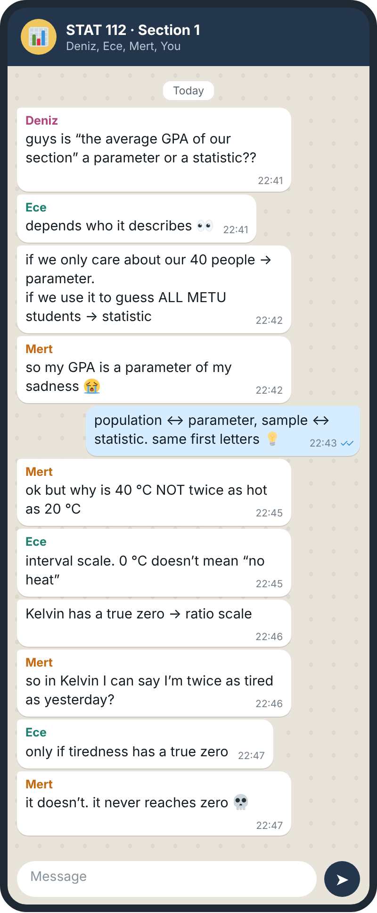
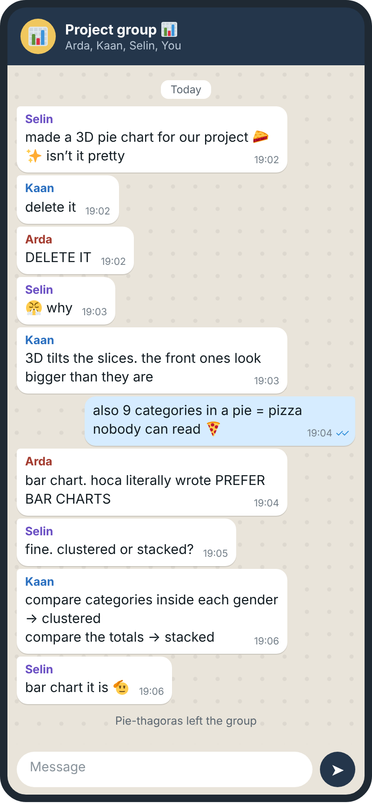
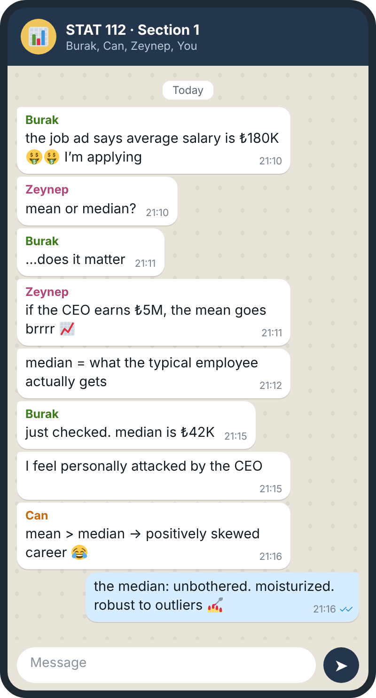
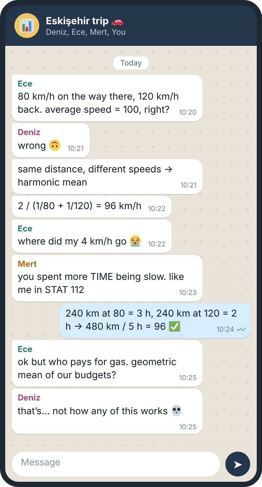
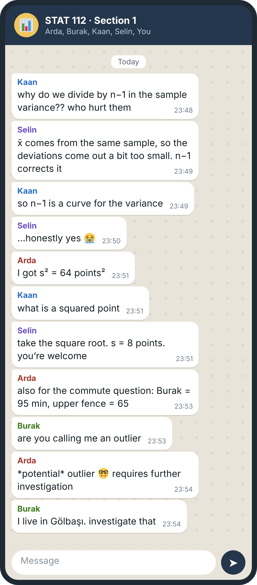

Read the chats, then ask yourself: *would I have answered correctly?* Each one matches a topic from the recitation notes.

## Recitation 1: basic terms, scales and charts

::: {layout-ncol="2"}
{fig-alt="Student chat about parameter vs statistic and interval vs ratio scales"}

{fig-alt="Student chat about why 3D pie charts are a bad idea"}
:::

## Recitation 2: numerical descriptive measures

::: {layout-ncol="2"}
{fig-alt="Student chat about mean vs median salaries"}

{fig-alt="Student chat about the harmonic mean of speeds"}
:::

::: {layout-ncol="2"}
{fig-alt="Student chat about n-1, the standard deviation and outliers"}

:::

The names and chats are made up. Emoji graphics: Twemoji, CC-BY 4.0.

