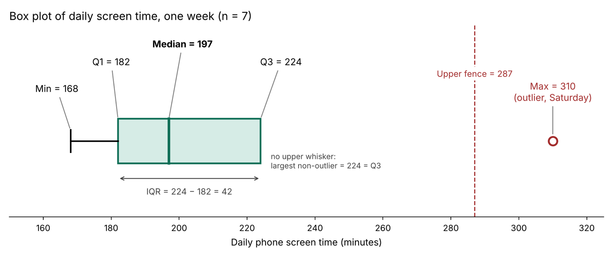
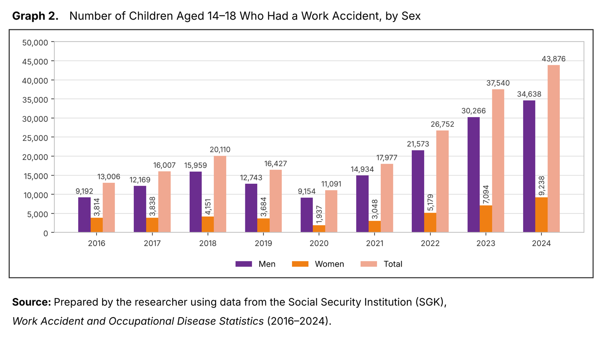
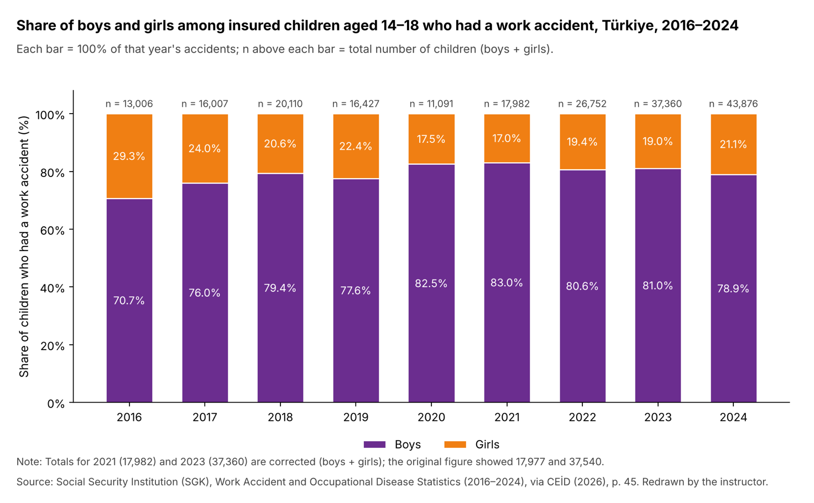

**Due:** Friday, 6 November 2026, 23:59 (Türkiye time) on ODTUClass  ·  **Points:** 100 + 10 bonus

[<i class="bi bi-file-earmark-pdf"></i> Download the questions (PDF)](homework1/STAT112_Homework1_Questions.pdf){.btn .btn-primary download="STAT112_Homework1_Questions.pdf"}


| Question | Topic | Points |
|:---|:---|---:|
| 1 | [Your own data](#q1) | 30 |
| 2 | [Your personal dataset](#q2) | 20 |
| 3 | [Grade the chatbot](#q3) | 25 |
| 4 | [Misleading graph hunt](#q4) | 25 |
| Bonus | [AI-use log and reflection](#qb) | 10 |
| | **Total** | **110** |

## How to use this answer key

- **Your numbers will differ.** Questions 1, 2 and 4 use your own data, your own student ID and your own graph. The key uses example data, so compare your *method* with the key, not your final numbers.
- **Try first, then look.** Every solution is folded. Work out each part yourself, then click **Solution** to compare.
- **Check your own numbers.** The [checker at the bottom of this page](#check) recomputes Questions 1 and 2 with your own week of data and your own ID.

::: {.callout-note title="Course conventions used in the key"}
- Sample variance divides by $n-1$.
- Quartiles use the $(n+1)p$ position rule: $Q_1$ is at position $(n+1)/4$ and $Q_3$ at $3(n+1)/4$ in the sorted data. A position such as 2.5 means halfway between the 2nd and 3rd values.
- Fences are $Q_1 - 1.5 \times IQR$ and $Q_3 + 1.5 \times IQR$; a value outside them is a potential outlier.
- Intermediate steps keep 4 decimals; final answers are rounded to 2 decimals.
:::

## Question 1: Your own data (30 points) {#q1}

Record **one** numerical variable about your own life for **7 consecutive days**: your daily phone screen time in minutes, or your daily number of steps. Attach screenshot(s) that show the daily values; the values in your table must match your screenshots.

Example data used in this key (made up): daily phone screen time in minutes for one week.

| Day | Mon | Tue | Wed | Thu | Fri | Sat | Sun |
|:---|---:|---:|---:|---:|---:|---:|---:|
| Screen time (min) | 182 | 205 | 168 | 224 | 197 | 310 | 190 |

**a. [7 pts]** Describe your variable: is it qualitative or quantitative, discrete or continuous, and on which scale of measurement? In this context, what is the experimental unit? Do your 7 values form a population or a sample, and if a sample, of which population? Is the mean of your 7 values a parameter or a statistic? Justify each answer in one sentence.

::: {.callout-tip collapse="true" title="Solution 1a"}
- **Type:** quantitative, because screen time is a measured amount, not a category.
- **Discrete or continuous:** continuous, because time can take any value in an interval; the phone only rounds it to whole minutes.
- **Scale:** ratio, because 0 minutes means no screen time at all, so "twice as much" makes sense.
- **Experimental unit:** one day of my life, because each value describes one day.
- **Population or sample:** a sample of 7 days from the population of all days in my current semester.
- **Parameter or statistic:** the mean of these 7 values is a statistic, because it is computed from a sample.
:::

**b. [8 pts]** Make a table with the columns $x_i$, $x_i-\bar{x}$ and $(x_i-\bar{x})^2$. Then compute the mean, median, mode (if any), range, sample variance, standard deviation and coefficient of variation.

::: {.callout-tip collapse="true" title="Solution 1b"}
$$\bar{x}=\frac{\sum_{i=1}^{7}x_i}{n}=\frac{1476}{7}=210.8571\approx 210.86\ \text{min}$$

| $x_i$ | $x_i-\bar{x}$ | $(x_i-\bar{x})^2$ |
|---:|---:|---:|
| 182 | −28.8571 | 832.7347 |
| 205 | −5.8571 | 34.3061 |
| 168 | −42.8571 | 1836.7347 |
| 224 | 13.1429 | 172.7347 |
| 197 | −13.8571 | 192.0204 |
| 310 | 99.1429 | 9829.3061 |
| 190 | −20.8571 | 435.0204 |
| **Σ = 1476** | **0** | **13332.8571** |

Check: the deviations add up to 0, as they always must.

- **Median:** sorted data are 168, 182, 190, **197**, 205, 224, 310. The middle (4th) value is 197 min.
- **Mode:** none, because every value appears once.
- **Range:** 310 − 168 = 142 min.

$$s^2=\frac{\sum(x_i-\bar{x})^2}{n-1}=\frac{13332.8571}{6}=2222.1429\approx 2222.14\ \text{min}^2$$

$$s=\sqrt{2222.1429}=47.1396\approx 47.14\ \text{min}$$

$$CV=\frac{s}{\bar{x}}\times100\%=\frac{47.1396}{210.8571}\times100\%=22.36\%$$
:::

**c. [12 pts]** Find $Q_1$, $Q_3$, the $IQR$, the lower and upper fences and any potential outliers. Draw a box plot **by hand** (a photo is fine) and label the five-number summary on it.

::: {.callout-tip collapse="true" title="Solution 1c"}
With $n = 7$, $Q_1$ is at position $(7 + 1)/4 = 2$ and $Q_3$ at position $3(7 + 1)/4 = 6$ in the sorted data.

- $Q_1$ = 182 min, $Q_3$ = 224 min.
- $IQR$ = 224 − 182 = 42 min.
- Lower fence = $Q_1 - 1.5 \times IQR$ = 182 − 63 = 119 min.
- Upper fence = $Q_3 + 1.5 \times IQR$ = 224 + 63 = 287 min.
- **Potential outlier:** 310 min (Saturday), because 310 > 287. No value is below 119.

Five-number summary for the box plot: minimum 168, $Q_1$ 182, median 197, $Q_3$ 224, maximum 310. Because 310 is an outlier, draw it as a separate point, and end the upper whisker at 224, the largest value that is not an outlier. The lower whisker runs from 182 down to 168.

{fig-alt="Box plot of daily screen time: minimum 168, Q1 182, median 197, Q3 224, upper fence 287, and an outlier at 310 minutes on Saturday."}
:::


**d. [3 pts]** In 3–4 sentences of your own: which measure of centre best describes your "typical day", and why? Can you explain any unusual value (a weekend, an exam day, a trip…)?

::: {.callout-tip collapse="true" title="Solution 1d"}
The median (197 min) describes my typical day better than the mean (210.86 min). The mean is pulled up by Saturday's 310 minutes, which is an outlier, while the median is not affected by one extreme value. Five of my seven days are below the mean, which shows it is not "typical". Saturday was unusual because I had no classes and watched a series in the evening.
:::

## Question 2: Your personal dataset (20 points) {#q2}

The weekly study hours of 9 STAT 112 students are:

$$x:\ 4,\ 7,\ 7,\ 9,\ 10,\ 12,\ 13,\ 15,\ 31$$

Let $a$ = the last digit of your student ID and $b$ = (the second-to-last digit of your student ID) + 1. For example, ID 2581347 gives $a = 7$ and $b = 4 + 1 = 5$. Your instructor converts hours into "effort points" with $y_i = a + b \cdot x_i$.

This key uses the ID **2073617**. Enter your own ID in the [checker](#check-q2) to see your values.

**a. [3 pts]** Write down your $a$ and $b$, and your nine $y$ values.

::: {.callout-tip collapse="true" title="Solution 2a"}
My ID is 2073617: the last digit is 7, so $a = 7$. The second-to-last digit is 1, so $b = 1 + 1 = 2$. The transformation is $y_i = 7 + 2x_i$.

| $x_i$ | 4 | 7 | 7 | 9 | 10 | 12 | 13 | 15 | 31 |
|:---|---:|---:|---:|---:|---:|---:|---:|---:|---:|
| $y_i = 7 + 2x_i$ | 15 | 21 | 21 | 25 | 27 | 31 | 33 | 37 | 69 |
:::

**b. [6 pts]** Directly from your $y$ values, compute $\bar{y}$, the median, $s_y$, $Q_1$, $Q_3$ and the $IQR$. Show your work.

::: {.callout-tip collapse="true" title="Solution 2b"}
$$\bar{y}=\frac{15+21+21+25+27+31+33+37+69}{9}=\frac{279}{9}=31$$

| $y_i$ | $y_i-\bar{y}$ | $(y_i-\bar{y})^2$ |
|---:|---:|---:|
| 15 | −16 | 256 |
| 21 | −10 | 100 |
| 21 | −10 | 100 |
| 25 | −6 | 36 |
| 27 | −4 | 16 |
| 31 | 0 | 0 |
| 33 | 2 | 4 |
| 37 | 6 | 36 |
| 69 | 38 | 1444 |
| **Σ = 279** | **0** | **1992** |

$$s_y^2=\frac{1992}{9-1}=249,\qquad s_y=\sqrt{249}=15.78$$

- **Median:** the $y$ values are already sorted; the middle (5th) value is 27.
- **$Q_1$:** position $(9 + 1)/4 = 2.5$, halfway between the 2nd and 3rd values: $(21 + 21)/2 = 21$.
- **$Q_3$:** position $3(9 + 1)/4 = 7.5$, halfway between the 7th and 8th values: $(33 + 37)/2 = 35$.
- **$IQR$** = 35 − 21 = 14.
:::

**c. [6 pts]** Compute $\bar{x}$, $s_x$, and the $IQR$ of the original $x$ data. Then use the rules for a linear transformation to check your answers in part (b). Do they agree? If not, find your mistake.

::: {.callout-tip collapse="true" title="Solution 2c"}
$$\bar{x}=\frac{108}{9}=12,\qquad s_x^2=\frac{\sum(x_i-\bar{x})^2}{n-1}=\frac{498}{8}=62.25,\qquad s_x=7.89$$

For $x$: $Q_1 = (7 + 7)/2 = 7$, $Q_3 = (13 + 15)/2 = 14$, so $IQR = 7$. The median of $x$ is 10.

Rules for $y = a + bx$ with $b > 0$: the shift $a$ changes measures of centre but not measures of spread; the factor $b$ multiplies both.

| Statistic | Rule | Using the rule | Direct from $y$ | Agree? |
|:---|:---|---:|---:|:---|
| Mean | $\bar{y} = a + b\bar{x}$ | 7 + 2(12) = 31 | 31 | Yes |
| Median | $a + b \cdot$ (median of $x$) | 7 + 2(10) = 27 | 27 | Yes |
| Standard deviation | $s_y = b\,s_x$ | 2(7.89) = 15.78 | 15.78 | Yes |
| IQR | $IQR_y = b \cdot IQR_x$ | 2(7) = 14 | 14 | Yes |

All answers agree, so part (b) is correct.
:::

**d. [5 pts]** Is $CV_y$ equal to $CV_x$? Explain why or why not, and state when they would be equal.

::: {.callout-tip collapse="true" title="Solution 2d"}
$$CV_x=\frac{7.89}{12}\times100\%=65.75\%,\qquad CV_y=\frac{15.78}{31}\times100\%=50.90\%$$

No, they are not equal. Multiplying by $b$ scales the standard deviation and the mean by the same factor, which cancels in the CV. Adding $a = 7$ raises the mean but leaves the standard deviation unchanged, so the CV gets smaller. The two CVs are equal only when $a = 0$, that is, when the transformation is a pure change of scale ($y = bx$). Students whose ID ends in 0 will find $CV_y = CV_x$.
:::

## Question 3: Grade the chatbot (25 points) {#q3}

A student gave this question to an AI chatbot:

> *"Here are last week's daily maximum temperatures (°C).*
> *Ankara: 18, 21, 19, 24, 20, 22, 16.*
> *Antalya: 27, 26, 28, 27, 29, 26, 25.*
> *Summarise and compare the two cities.*
> *Also: Ayşe cycles 30 km to campus at 15 km/h and returns along the same 30 km at 30 km/h. What is her average speed?"*

The chatbot's answer, split into numbered statements:

| # | Chatbot's statement |
|:---|:---|
| S1 | Temperature in °C is measured on a ratio scale, so a 24 °C day is twice as warm as a 12 °C day. |
| S2 | Ankara mean: x̄ = (18 + 21 + 19 + 24 + 20 + 22 + 16) / 7 = 140 / 7 = 20 °C. |
| S3 | Ankara median: the middle (4th) value of the data is 24 °C. |
| S4 | Ankara range: 24 − 16 = 8 °C. |
| S5 | Ankara variance: s² = Σ(x − x̄)² / n = 42 / 7 = 6, so s = 2.45 °C. |
| S6 | Antalya: x̄ = 26.86 °C and median = 27 °C. Since the mean is smaller than the median, Antalya's temperatures are clearly right-skewed. |
| S7 | Antalya standard deviation: s = 1.35 °C. |
| S8 | To compare the variability of the two cities fairly, we must use the coefficient of variation: CV(Ankara) = 2.45 / 20 = 12.3% and CV(Antalya) = 1.25 / 26.86 = 4.6%. So Ankara is about 2.6 times as variable as Antalya. |
| S9 | Ayşe's average speed is (15 + 30) / 2 = 22.5 km/h. |

**a. [18 pts]** Decide for **each** statement whether it is correct or wrong. For every wrong statement, explain the mistake in **one sentence** and give the corrected statement or number.

::: {.callout-tip collapse="true" title="Solution 3a"}
| # | Verdict | The mistake, in one sentence | Corrected statement |
|:---|:---|:---|:---|
| S1 | **Wrong** | °C is an interval scale because 0 °C does not mean "no temperature", so ratios are meaningless. | Temperature in °C is on an interval scale; 24 °C is 12 °C warmer than 12 °C, not "twice as warm". |
| S2 | Correct | — | x̄ = 140/7 = 20 °C. |
| S3 | **Wrong** | The 4th value was taken from the unsorted data. | Sorted: 16, 18, 19, **20**, 21, 22, 24, so the median is 20 °C. |
| S4 | Correct | — | Range = 24 − 16 = 8 °C. |
| S5 | **Wrong** | Sample variance divides by n − 1, not n. | s² = 42/6 = 7 °C², so s = √7 = 2.65 °C. |
| S6 | **Wrong** | A mean below the median points to left skew, not right skew, and a 0.14 °C gap in 7 values is too small to call "clearly" skewed. | x̄ = 26.86 °C and median = 27 °C; the mean is only slightly below the median, so the data are roughly symmetric (at most slightly left-skewed). |
| S7 | Correct | — | s = √(10.8571/6) = √1.8095 = 1.35 °C. |
| S8 | **Wrong** | It uses the wrong s for Ankara (2.45) and a value for Antalya (1.25) that contradicts S7, and the CV is not meaningful for °C, which has no true zero. | Both cities use the same unit, so compare the standard deviations directly: 2.65 °C vs 1.35 °C, so Ankara is about 2.65/1.35 ≈ 2 times as variable as Antalya. |
| S9 | **Wrong** | The arithmetic mean of two speeds is wrong when the times differ; average speed is total distance divided by total time. | Time = 30/15 + 30/30 = 2 + 1 = 3 h, so average speed = 60/3 = **20 km/h** (the harmonic mean of 15 and 30). |

Working for S7 and the Antalya mean: Σx = 188, x̄ = 188/7 = 26.8571; Σ(x − x̄)² = 10.8571.

$$\bar{v}=\frac{\text{total distance}}{\text{total time}}=\frac{30+30}{\frac{30}{15}+\frac{30}{30}}=\frac{60}{3}=20\ \text{km/h}$$

**Grading note:** for S8, naming any one of the three errors with a correct fix earns 1 pt; full marks need the correct numbers plus the point that the CV is not suitable for °C. Using the CV with the correct values (2.65/20 = 13.23% and 1.35/26.86 = 5.01%) and the correct conclusion earns 1 of 2 pts.
:::

**b. [7 pts]** Write a corrected comparison of the two cities in 3 sentences: centre, spread, and which city's weather is more predictable.

::: {.callout-tip collapse="true" title="Solution 3b"}
Antalya was about 7 °C warmer than Ankara last week, with a mean of 26.86 °C and a median of 27 °C against Ankara's 20 °C and 20 °C. Ankara's temperatures varied about twice as much (s = 2.65 °C, range 8 °C) as Antalya's (s = 1.35 °C, range 4 °C). Antalya's weather was therefore more predictable from day to day.
:::

## Question 4: Misleading graph hunt (25 points) {#q4}

Find a graph published **in the 60 days before the due date (on or after 7 September 2026)** by a Turkish news site, TV channel, newspaper, social-media account, company or public institution (e.g. TÜİK).

::: {.callout-important title="Note to students"}
The example below was published on 4 September 2026, three days before the window in the question starts. It is used here only to show what a complete answer looks like. In your own homework, a graph from before 7 September gets 0 points for the whole question, so check the publication date of your source carefully.
:::

**a. [8 pts]** Attach a screenshot of the graph together with its **exact link** and **publication date**. Graphs without a source that I can check get 0 points for the whole question.

::: {.callout-tip collapse="true" title="Solution 4a"}
The following figure is taken from page 45 of the [Gender Equality Monitoring Report of Türkiye (2025–2026)](https://en-ceidizler.ceid.org.tr/Gender-Equality-Monitoring-Report-of-Turkiye-20252026-d161), published by the Cinsiyet Eşitliği İzleme Derneği (CEİD) on 4 September 2026. The report's authors built the graph from Sosyal Güvenlik Kurumu (SGK) work-accident and occupational-disease statistics for 2016–2024. I have utilized an AI to obtain the translated version from the original Turkish figure on page 45 of the report.

{fig-alt="Grouped bar chart: number of children aged 14 to 18 who had a work accident, by sex, 2016 to 2024, with separate bars for men, women and the total."}
:::

**b. [7 pts]** Which variables does the graph show? For each one, give its type (qualitative/quantitative, discrete/continuous) and scale of measurement.

::: {.callout-tip collapse="true" title="Solution 4b"}
| Variable | Type | Discrete or continuous | Scale |
|:---|:---|:---|:---|
| Year (2016–2024) | Quantitative (used here as categories in time order) | Discrete | Interval |
| Sex (Men / Women) | Qualitative | — | Nominal |
| Number of 14–18-year-olds who had a work accident | Quantitative | Discrete (a count) | Ratio |

Year is on an interval scale because "year 0" does not mean "no time": differences between years make sense, but ratios do not. The number of accidents is on a ratio scale because 0 means no accidents at all.
:::

**c. [10 pts]** Name the type of graph. Is it a good choice for these variables? Point out at least one way in which it could mislead a reader (e.g. a truncated axis, 3D effects, a pie chart with too many slices, missing sample size, unequal intervals), or argue convincingly why it does not mislead.

::: {.callout-tip collapse="true" title="Solution 4c"}
This is a **grouped (clustered) bar chart**. For each year it shows three columns: men, women and the total. A bar chart is a reasonable choice for comparing counts across years and between the sexes. The y-axis starts at 0, each column shows its value, and the data source is stated.

However, the graph can mislead a reader in several ways:

1. **Two totals are wrong.** In 2021, 14,934 + 3,048 = 17,982, but the chart shows 17,977. In 2023, 30,266 + 7,094 = 37,360, but the chart shows 37,540, which is 180 more. The other seven years add up correctly.
2. **The total should not be a separate column.** Boys and girls are parts of the total, so a stacked column chart would show this better. In this chart every child is shown twice, and the tall total columns pull attention away from the comparison between boys and girls.
3. **It shows counts, not rates.** Accidents rose from 11,091 in 2020 to 43,876 in 2024, which looks alarming. But the number of insured 14–18-year-olds may also have grown, for example through vocational apprenticeship programmes. Without accidents per 1,000 insured young workers, we cannot tell whether work became more dangerous or whether more young people were registered. The low 2020 value may also reflect fewer young people working during the pandemic.
4. **Unregistered work is missing.** SGK only records insured workers. Children in informal work, such as agriculture or domestic work, are not counted, so the real numbers are probably higher, especially for girls.
5. **The labels are unclear.** The title talks about children, but the legend says "Kadın" (women) instead of "Kız" (girls). The y-axis also has no title saying what is being counted.

**A better graph** is a 100% stacked bar chart with the totals corrected (see the figure below). Each bar shows what share of that year's accidents happened to boys and to girls, so every bar ends at 100%, and the total number of children (n) is printed above each bar. This makes a change visible that the original graph hid: girls' share fell from 29.3% in 2016 to about 17% in 2020–2021, then rose to 21.1% in 2024.

{fig-alt="100% stacked bar chart: share of boys and girls among insured children aged 14 to 18 who had a work accident, 2016 to 2024, with corrected totals above each bar."}
:::

## Bonus: AI-use log and reflection (10 points) {#qb}

Points here are given for honesty and reflection, not for whether you used AI.

**a. [6 pts]** If you used any AI tool for this homework: name the tool, paste your prompt(s), and summarise what it answered. For each use, say what you checked yourself and describe one thing it got wrong, left out, or did differently from the STAT 112 rules. If you did not use AI, write "I did not use AI tools for this homework" and describe how you checked one of your answers yourself.

**b. [4 pts]** In 4–5 sentences, describe two specific risks of trusting an AI tool with statistics homework, and one good way to use AI as a study tool.

::: {.callout-note}
The bonus has no single correct answer, so no model solution is given. It is graded on honesty and on how specific your reflection is.
:::

## Check your own numbers {#check}

Enter your own values below. Everything is recomputed with the STAT 112 methods ($n-1$ in the variance, $(n+1)p$ quartile positions). Nothing you type leaves this page.

```{=html}
<style>
.hw-check{--hc-border:var(--bs-border-color,#dee2e6);--hc-muted:var(--bs-secondary-color,#6c757d);--hc-soft:var(--bs-tertiary-bg,#f8f9fa);--hc-accent:var(--bs-primary,#2780e3);--hc-bad:var(--bs-danger,#dc3545);--hc-ok:var(--bs-success,#198754);display:grid;gap:14px;margin-bottom:2rem}
.hw-check .hc-inputs{display:grid;grid-template-columns:repeat(auto-fit,minmax(90px,1fr));gap:10px}
.hw-check label{font-size:.85rem;color:var(--hc-muted);display:block;margin-bottom:2px}
.hw-check input,.hw-check select{font-family:var(--bs-font-monospace,monospace);width:100%;min-width:0}
.hw-check .hc-results{display:grid;grid-template-columns:repeat(auto-fit,minmax(140px,1fr));gap:10px}
.hw-check .hc-res{border:1px solid var(--hc-border);border-radius:8px;padding:8px 12px;background:var(--hc-soft)}
.hw-check .hc-res .k{display:block;font-size:.82rem;color:var(--hc-muted)}
.hw-check .hc-res .v{display:block;font-family:var(--bs-font-monospace,monospace);font-weight:600;font-size:1.05rem;overflow-wrap:anywhere}
.hw-check .hc-res.flag{border-color:var(--hc-bad)}
.hw-check .hc-res.flag .v{color:var(--hc-bad)}
.hw-check .hc-err{color:var(--hc-bad);font-weight:600}
.hw-check .hc-steps{display:grid;gap:4px;font-size:.95rem}
.hw-check .hc-steps code{white-space:normal}
.hw-check .hc-tbl{overflow-x:auto}
.hw-check .hc-tbl table{margin:0}
.hw-check .hc-tbl td,.hw-check .hc-tbl th{text-align:right;font-variant-numeric:tabular-nums}
.hw-check .hc-svg{overflow-x:auto;border:1px solid var(--hc-border);border-radius:8px;padding:6px}
.hw-check .hc-svg svg{display:block;width:100%;min-width:520px;height:auto}
.hw-check .hc-yes{color:var(--hc-ok);font-weight:700}
.hw-check .hc-no{color:var(--hc-bad);font-weight:700}
</style>

<h3 id="check-q1">Question 1 checker</h3>
<div class="hw-check" id="hc1">
  <div class="row g-2 align-items-end">
    <div class="col-sm-5"><label for="hc1-var">Variable</label>
      <select class="form-select" id="hc1-var"><option value="min">Screen time (minutes)</option><option value="steps">Steps</option></select></div>
    <div class="col-sm-4"><button class="btn btn-outline-primary" type="button" id="hc1-reset">Reset to example</button></div>
  </div>
  <div class="hc-inputs" id="hc1-inputs"></div>
  <p class="hc-err" id="hc1-err" role="alert" hidden></p>
  <div id="hc1-out" style="display:grid;gap:14px"></div>
</div>

<h3 id="check-q2">Question 2 checker</h3>
<div class="hw-check" id="hc2">
  <div class="row g-2"><div class="col-sm-5"><label for="hc2-id">Student ID</label>
    <input class="form-control" id="hc2-id" inputmode="numeric" autocomplete="off" value="2073617"></div></div>
  <p class="hc-err" id="hc2-err" role="alert" hidden></p>
  <div id="hc2-out" style="display:grid;gap:14px"></div>
</div>

<script>
(function(){
"use strict";
const $=s=>document.querySelector(s);
const sum=a=>a.reduce((s,x)=>s+x,0), sortN=a=>[...a].sort((x,y)=>x-y);
function qpos(s,p){const n=s.length,pos=p*(n+1);if(pos<=1)return{pos,val:s[0]};if(pos>=n)return{pos,val:s[n-1]};const k=Math.floor(pos),f=pos-k;return{pos,val:s[k-1]+f*(s[k]-s[k-1])};}
function median(s){const n=s.length;return n%2?s[(n-1)/2]:(s[n/2-1]+s[n/2])/2;}
function modes(a){const m=new Map();a.forEach(x=>m.set(x,(m.get(x)||0)+1));const mx=Math.max(...m.values());if(mx<2)return[];return[...m].filter(([,c])=>c===mx).map(([v])=>v).sort((x,y)=>x-y);}
const r2=x=>Math.round((x+Number.EPSILON)*100)/100;
const f2=x=>{const v=r2(x);return(Object.is(v,-0)?0:v).toLocaleString("en-US",{maximumFractionDigits:2});};
const f4=x=>{const v=Math.round(x*1e4)/1e4;return(v<0?"−":"")+Math.abs(v).toFixed(4);};
const fi=x=>(x<0?"−":"")+Math.abs(x).toLocaleString("en-US",{maximumFractionDigits:4});
const posTxt=p=>Number.isInteger(p)?String(p):p.toFixed(2).replace(/0+$/,"");
function stats(x){const n=x.length,s=sortN(x),mean=sum(x)/n,dev=x.map(v=>v-mean),sq=dev.map(d=>d*d),ss=sum(sq),v=ss/(n-1),sd=Math.sqrt(v),q1=qpos(s,.25),q3=qpos(s,.75),iqr=q3.val-q1.val,lf=q1.val-1.5*iqr,uf=q3.val+1.5*iqr,out=x.filter(t=>t<lf||t>uf),inn=s.filter(t=>t>=lf&&t<=uf);
  return{n,s,mean,dev,sq,ss,v,sd,cv:sd/mean*100,med:median(s),modes:modes(x),min:s[0],max:s[n-1],q1,q3,iqr,lf,uf,out,lw:inn[0],uw:inn[inn.length-1]};}
const res=(k,v,flag)=>`<div class="hc-res${flag?" flag":""}"><span class="k">${k}</span><span class="v">${v}</span></div>`;

function niceStep(r){const raw=r/6,mag=Math.pow(10,Math.floor(Math.log10(raw))),q=raw/mag;return(q<1.5?1:q<3?2:q<7?5:10)*mag;}
function boxSVG(st,unit){
  const W=640,H=200,L=40,R=40,y=86,h=42,ink="currentColor",bad="var(--hc-bad)",acc="var(--hc-accent)",mut="var(--hc-muted)";
  let lo=st.min,hi=st.max;if(st.uf<=hi+(hi-lo)*0.4)hi=Math.max(hi,st.uf);if(st.lf>=lo-(hi-lo)*0.4)lo=Math.min(lo,st.lf);
  const pad=(hi-lo||1)*0.08;lo-=pad;hi+=pad;const step=niceStep(hi-lo),t0=Math.ceil(lo/step)*step,X=v=>L+(v-lo)/(hi-lo)*(W-L-R);
  let g=`<svg viewBox="0 0 ${W} ${H}" role="img" aria-label="Box plot of your data">`;
  for(let t=t0;t<=hi+1e-9;t+=step){const xx=X(t);g+=`<line x1="${xx}" y1="150" x2="${xx}" y2="156" stroke="${mut}"/><text x="${xx}" y="172" text-anchor="middle" font-size="12" fill="${mut}">${fi(+t.toFixed(6))}</text>`;}
  g+=`<line x1="${L}" y1="150" x2="${W-R}" y2="150" stroke="${mut}"/><text x="${W/2}" y="194" text-anchor="middle" font-size="12" fill="${mut}">${unit==="min"?"Daily screen time (minutes)":"Daily steps"}</text>`;
  [["Lower fence",st.lf],["Upper fence",st.uf]].forEach(([l,v])=>{if(v>=lo&&v<=hi){const xx=X(v);g+=`<line x1="${xx}" y1="40" x2="${xx}" y2="146" stroke="${bad}" stroke-dasharray="4 4"/><text x="${xx}" y="34" text-anchor="middle" font-size="11.5" fill="${bad}">${l} ${f2(v)}</text>`;}});
  g+=`<g stroke="${ink}" stroke-width="2"><line x1="${X(st.lw)}" y1="${y}" x2="${X(st.q1.val)}" y2="${y}"/><line x1="${X(st.lw)}" y1="${y-12}" x2="${X(st.lw)}" y2="${y+12}"/><line x1="${X(st.q3.val)}" y1="${y}" x2="${X(st.uw)}" y2="${y}"/><line x1="${X(st.uw)}" y1="${y-12}" x2="${X(st.uw)}" y2="${y+12}"/></g>`;
  g+=`<rect x="${X(st.q1.val)}" y="${y-h/2}" width="${Math.max(1,X(st.q3.val)-X(st.q1.val))}" height="${h}" fill="${acc}" fill-opacity=".15" stroke="${acc}" stroke-width="2"/><line x1="${X(st.med)}" y1="${y-h/2}" x2="${X(st.med)}" y2="${y+h/2}" stroke="${acc}" stroke-width="3.5"/>`;
  g+=`<text x="${X(st.med)}" y="${y-h/2-8}" text-anchor="middle" font-size="12" font-weight="700" fill="${ink}">Median ${f2(st.med)}</text><text x="${X(st.q1.val)}" y="${y+h/2+16}" text-anchor="middle" font-size="11.5" fill="${ink}">Q1 ${f2(st.q1.val)}</text><text x="${X(st.q3.val)}" y="${y+h/2+16}" text-anchor="middle" font-size="11.5" fill="${ink}">Q3 ${f2(st.q3.val)}</text>`;
  st.out.forEach(o=>{g+=`<circle cx="${X(o)}" cy="${y}" r="6" fill="none" stroke="${bad}" stroke-width="2.2"/><text x="${X(o)}" y="${y+24}" text-anchor="middle" font-size="11.5" fill="${bad}">${fi(o)}</text>`;});
  return g+"</svg>";
}

/* Q1 */
const EX1=[182,205,168,224,197,310,190],box=$("#hc1-inputs");
for(let i=0;i<7;i++){const d=document.createElement("div");d.innerHTML=`<label for="hc1-d${i}">Day ${i+1}</label><input class="form-control" id="hc1-d${i}" inputmode="decimal" autocomplete="off" value="${EX1[i]}">`;box.appendChild(d);}
const ins=Array.from(box.querySelectorAll("input"));
function run1(){
  const unit=$("#hc1-var").value,err=$("#hc1-err"),out=$("#hc1-out"),vals=ins.map(i=>i.value.trim().replace(",","."));
  const bad=vals.findIndex(v=>v===""||!isFinite(+v)||+v<0);
  if(bad>=0){err.textContent=`Day ${bad+1} needs a number of 0 or more.`;err.hidden=false;out.innerHTML="";return;}
  const x=vals.map(Number),st=stats(x),u=unit==="min"?" min":" steps";
  if(st.mean===0){err.textContent="All values are 0, so the CV cannot be computed. Check your data.";err.hidden=false;} else err.hidden=true;
  const rows=x.map((v,i)=>`<tr><td>${fi(v)}</td><td>${f4(st.dev[i])}</td><td>${f4(st.sq[i])}</td></tr>`).join("")+`<tr><th>Σ = ${fi(sum(x))}</th><th>0</th><th>${f4(st.ss)}</th></tr>`;
  out.innerHTML=`<div class="hc-tbl"><table class="table table-sm"><thead><tr><th>x<sub>i</sub></th><th>x<sub>i</sub> − x̄</th><th>(x<sub>i</sub> − x̄)²</th></tr></thead><tbody>${rows}</tbody></table></div>
  <div class="hc-results">${res("Mean x̄",f2(st.mean)+u)}${res("Median",f2(st.med)+u)}${res("Mode",st.modes.length?st.modes.map(fi).join(", "):"none")}${res("Range",f2(st.max-st.min)+u)}${res("Variance s²",f2(st.v))}${res("Std. deviation s",f2(st.sd)+u)}${res("CV",st.mean?st.cv.toFixed(2)+"%":"—")}${res("Q1",f2(st.q1.val))}${res("Q3",f2(st.q3.val))}${res("IQR",f2(st.iqr))}${res("Lower fence",f2(st.lf))}${res("Upper fence",f2(st.uf))}${res("Potential outliers",st.out.length?st.out.map(fi).join(", "):"none",st.out.length>0)}</div>
  <div class="hc-steps"><span>Sorted data: <code>${st.s.map(fi).join(", ")}</code></span><span>x̄ = <code>${fi(sum(x))} / 7 = ${f4(st.mean)}</code></span><span>s² = <code>${f4(st.ss)} / 6 = ${f4(st.v)}</code>, s = <code>√${f4(st.v)} = ${f4(st.sd)}</code></span><span>Q1 at position <code>${posTxt(st.q1.pos)}</code>, Q3 at position <code>${posTxt(st.q3.pos)}</code>.</span><span>Five-number summary: min ${fi(st.min)}, Q1 ${f2(st.q1.val)}, median ${f2(st.med)}, Q3 ${f2(st.q3.val)}, max ${fi(st.max)}. Whiskers end at ${fi(st.lw)} and ${fi(st.uw)}${st.uw===st.q3.val?" (no upper whisker: it equals Q3)":""}${st.lw===st.q1.val?" (no lower whisker: it equals Q1)":""}.</span></div>
  <div class="hc-svg">${boxSVG(st,unit)}</div>
  <p><strong>Remember:</strong> your homework still needs a box plot drawn <em>by hand</em>. Use this one only to check yours.</p>`;
}
ins.forEach(i=>i.addEventListener("input",run1));$("#hc1-var").addEventListener("change",run1);
$("#hc1-reset").addEventListener("click",()=>{ins.forEach((i,k)=>i.value=EX1[k]);$("#hc1-var").value="min";run1();});
run1();

/* Q2 */
const X2=[4,7,7,9,10,12,13,15,31];
function run2(){
  const raw=$("#hc2-id").value.replace(/\s/g,""),err=$("#hc2-err"),out=$("#hc2-out");
  if(!/^\d{2,}$/.test(raw)){err.textContent="Enter your student ID using digits only (for example 2073617).";err.hidden=false;out.innerHTML="";return;}
  err.hidden=true;
  const a=+raw[raw.length-1],b=+raw[raw.length-2]+1,y=X2.map(v=>a+b*v),sx=stats(X2),sy=stats(y);
  const yrows=y.map((v,i)=>`<tr><td>${fi(v)}</td><td>${fi(+sy.dev[i].toFixed(4))}</td><td>${fi(+sy.sq[i].toFixed(4))}</td></tr>`).join("")+`<tr><th>Σ = ${fi(sum(y))}</th><th>0</th><th>${fi(+sy.ss.toFixed(4))}</th></tr>`;
  const chk=(n,rule,c,d)=>{const ok=Math.abs(r2(c)-r2(d))<0.011;return`<tr><td style="text-align:left">${n}</td><td style="text-align:left"><code>${rule}</code></td><td>${f2(c)}</td><td>${f2(d)}</td><td class="${ok?"hc-yes":"hc-no"}">${ok?"Yes":"No"}</td></tr>`;};
  out.innerHTML=`<div class="hc-results">${res("a (last digit)",a)}${res("b (second-to-last + 1)",b)}${res("Transformation",`y = ${a} + ${b}x`)}</div>
  <div class="hc-tbl"><table class="table table-sm"><tbody><tr><th style="text-align:left">x<sub>i</sub></th>${X2.map(v=>`<td>${v}</td>`).join("")}</tr><tr><th style="text-align:left">y<sub>i</sub></th>${y.map(v=>`<td>${fi(v)}</td>`).join("")}</tr></tbody></table></div>
  <h4>Part (b): directly from y</h4>
  <div class="hc-tbl"><table class="table table-sm"><thead><tr><th>y<sub>i</sub></th><th>y<sub>i</sub> − ȳ</th><th>(y<sub>i</sub> − ȳ)²</th></tr></thead><tbody>${yrows}</tbody></table></div>
  <div class="hc-results">${res("ȳ",f2(sy.mean))}${res("Median",f2(sy.med))}${res("s²<sub>y</sub>",f2(sy.v))}${res("s<sub>y</sub>",f2(sy.sd))}${res("Q1 (position 2.5)",f2(sy.q1.val))}${res("Q3 (position 7.5)",f2(sy.q3.val))}${res("IQR",f2(sy.iqr))}</div>
  <h4>Part (c): check with the linear-transformation rules</h4>
  <p>For x: x̄ = 12, median = 10, s<sub>x</sub> = √62.25 = 7.89, Q1 = 7, Q3 = 14, IQR = 7.</p>
  <div class="hc-tbl"><table class="table table-sm"><thead><tr><th style="text-align:left">Statistic</th><th style="text-align:left">Rule</th><th>Using the rule</th><th>Direct from y</th><th>Agree?</th></tr></thead><tbody>${chk("Mean",`${a} + ${b}(12)`,a+b*sx.mean,sy.mean)}${chk("Median",`${a} + ${b}(10)`,a+b*sx.med,sy.med)}${chk("Std. deviation",`${b}(7.89)`,b*sx.sd,sy.sd)}${chk("IQR",`${b}(7)`,b*sx.iqr,sy.iqr)}</tbody></table></div>
  <h4>Part (d): coefficients of variation</h4>
  <div class="hc-results">${res("CV<sub>x</sub>",sx.cv.toFixed(2)+"%")}${res("CV<sub>y</sub>",sy.cv.toFixed(2)+"%")}</div>
  <p>${a===0?"Your ID ends in 0, so a = 0 and y = bx is a pure change of scale: the factor b cancels in the CV, so CV<sub>y</sub> = CV<sub>x</sub>.":`Your a = ${a} raises the mean but leaves the standard deviation unchanged, so CV<sub>y</sub> is smaller than CV<sub>x</sub>. The two would be equal only if a = 0.`}</p>
  <p><strong>Rounding:</strong> if you multiply the rounded value 7.89 by b, your answer can differ from s<sub>y</sub> in the second decimal. That still counts as agreeing; keep more decimals in intermediate steps to avoid it.</p>`;
}
$("#hc2-id").addEventListener("input",run2);run2();
})();
</script>
```
