

## How to use this page

Each question below is interactive. Click an option or type an answer, then press **Check** (or <kbd>Enter</kbd>). The page tells you right away whether the answer is correct. **Show answer** reveals the solution and the explanation, and **Reset** clears the question so you can try it again.

Numbers can be typed with a dot or a comma (`3.2` or `3,2`). Unless a question says otherwise, round to **2 decimals**. Keep a calculator nearby!

::: quiz-scoreboard
Progress
:::

# Part A — The big picture

When we describe a **numerical** variable, we answer three questions:

| Question | Family of measures | Examples |
|---|---|---|
| *Where is the centre of the data?* | **Central tendency (location)** | mean, median, mode, geometric mean, harmonic mean |
| *How spread out are the values?* | **Dispersion (variability)** | range, variance, standard deviation, coefficient of variation, IQR |
| *What does the distribution look like?* | **Shape** | skewness, kurtosis |

Percentiles and quartiles describe the **position** of a value; the five-number summary and the box plot put centre, spread and shape into one picture.

<!-- ===================================================================== -->

:::: {.quiz type="classify" options="Central tendency|Dispersion|Shape"}
Sort each measure into the right family.

- Arithmetic mean :: Central tendency
- Range :: Dispersion
- Median :: Central tendency
- Variance :: Dispersion
- Mode :: Central tendency
- Standard deviation :: Dispersion
- Geometric mean :: Central tendency
- Coefficient of variation :: Dispersion
- Harmonic mean :: Central tendency
- Interquartile range (IQR) :: Dispersion
- Skewness :: Shape
- Kurtosis :: Shape

::: explain
| Measures of central tendency | Measures of dispersion |
|---|---|
| 1. Arithmetic mean | 1. Range |
| 2. Median | 2. Variance |
| 3. Mode | 3. Standard deviation |
| 4. Geometric mean | 4. Coefficient of variation |
| 5. Harmonic mean | 5. Interquartile range |
| | 6. Percentiles / quartiles (used to build the IQR) |

**Skewness** (asymmetry) and **kurtosis** (tailedness) describe the **shape** of the distribution.
:::
::::

<!-- ===================================================================== -->

:::: {.quiz type="match"}
Match each **formula** with the name of the **measure** (sample versions).

- $\displaystyle \bar{x}=\frac{1}{n}\sum_{i=1}^{n}x_i$ :: Arithmetic mean
- $\displaystyle \left(\prod_{i=1}^{n}x_i\right)^{1/n}$ :: Geometric mean
- $\displaystyle \frac{n}{\sum_{i=1}^{n} 1/x_i}$ :: Harmonic mean
- $\displaystyle \frac{\sum (x_i-\bar{x})^2}{n-1}$ :: Sample variance
- $\displaystyle \sqrt{s^2}$ :: Standard deviation
- $\displaystyle \frac{s}{\bar{x}}\times 100\%$ :: Coefficient of variation
- $Q_3 - Q_1$ :: Interquartile range
- $\max - \min$ :: Range

::: explain
Keep this as a **formula sheet**. Each formula appears again in the parts below, together with an example.
:::
::::

<!-- ===================================================================== -->

:::: {.quiz type="ms" answer="b,c"}
Students' **letter grades** (AA, BA, BB, …, FF) are on an **ordinal** scale. Which measures of central tendency are appropriate? Select all that apply.

- Arithmetic mean
- Median
- Mode
- Geometric mean
- Standard deviation

::: explain
For ordinal data we can **count** (mode) and **rank** (median), but the distance between AA and BA is not necessarily the same as between CC and DC, so averaging the categories is not justified.
The **standard deviation** is not a measure of central tendency at all; it measures spread.

| Scale | Mode | Median | Mean |
|---|:-:|:-:|:-:|
| Nominal | ✓ | ✗ | ✗ |
| Ordinal | ✓ | ✓ | ✗ (debated) |
| Interval / Ratio | ✓ | ✓ | ✓ |
:::
::::

# Part B — Measures of central tendency

::: {.callout-note collapse="false"}
## Key terms and formulas: central tendency

- **Arithmetic mean**: the "balance point" of the data. It uses every observation, so it is **sensitive to outliers**.
  $$\bar{x}=\frac{1}{n}\sum_{i=1}^{n}x_i \quad\text{(sample)}$$
  $$\mu=\frac{1}{N}\sum_{i=1}^{N}x_i \quad\text{(population)}$$
- **Median**: the middle value of the **ordered** data. Half of the observations are below it and half are above it. It is **robust** to outliers.
  - $n$ odd: the $\left(\frac{n+1}{2}\right)$th ordered value
  - $n$ even: the average of the $\left(\frac{n}{2}\right)$th and $\left(\frac{n}{2}+1\right)$th ordered values
- **Mode**: the most frequent value. A data set can have no mode, one mode (*unimodal*) or several modes (*bimodal*, *multimodal*).
- **Geometric mean (GM)**: for **multiplicative** quantities such as growth rates and returns. All values must be **positive**.
  $$GM=\sqrt[n]{x_1x_2\cdots x_n}\quad\Longleftrightarrow\quad \log GM=\frac{1}{n}\sum_{i=1}^{n}\log x_i$$
- **Harmonic mean (HM)**: for **rates** (km/h, ₺/litre, pages/hour) measured over **equal amounts** of the "per" quantity (equal distances, equal money spent…). All values must be **positive**.
  $$HM=\frac{n}{\dfrac{1}{x_1}+\dfrac{1}{x_2}+\cdots+\dfrac{1}{x_n}}$$
- For positive data: $\;HM \le GM \le AM$, with equality only when all values are the same.
:::

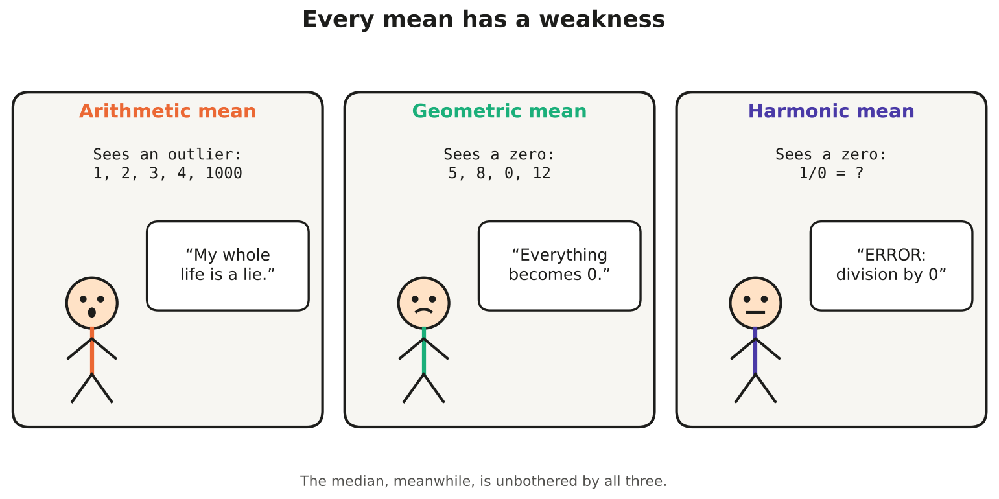{fig-align="center" fig-alt="Comic: the arithmetic mean is scared of outliers, the geometric mean and harmonic mean are scared of zeros."}

<!-- ===================================================================== -->
:::: {.quiz type="fill"}
Warm-up with tiny numbers: for the data set $\{2,\ 8\}$, find

arithmetic mean $=$ []{.blank answer="5" tol="0.001"}, geometric mean $=$ []{.blank answer="4" tol="0.001"}, harmonic mean $=$ []{.blank answer="3.2" tol="0.001"}

::: explain
- $AM = (2+8)/2 = 5$
- $GM = \sqrt{2 \times 8} = \sqrt{16} = 4$
- $HM = \dfrac{2}{\frac12 + \frac18} = \dfrac{2}{0.625} = 3.2$

So $HM = 3.2 \;<\; GM = 4 \;<\; AM = 5$.
:::
::::

<!-- ===================================================================== -->

## Physicians and dentists

The table gives the number of **physicians** and **dentists** per 100,000 population for 12 midwestern U.S. states in 2000.

| Rate / State | Ohio | Indiana | Illinois | Michigan | Wisconsin | Minnesota | Iowa | Missouri | North Dakota | South Dakota | Nebraska | Kansas |
|:---|:---:|:---:|:---:|:---:|:---:|:---:|:---:|:---:|:---:|:---:|:---:|:---:|
| **Physicians' rate** | 188 | 146 | 206 | 177 | 177 | 207 | 141 | 186 | 157 | 129 | 162 | 166 |
| **Dentists' rate** | 56 | 48 | 61 | 64 | 70 | 70 | 60 | 55 | 55 | 54 | 71 | 52 |

::: {.callout-note}
For the calculations in the following sections, you can use the **Calculator** tab.
:::

<!-- ===================================================================== -->

:::: {.quiz type="fill"}
Calculate the **mean**, **median** and **mode** of each rate. Round the means to 2 decimals.

**Physicians:** mean $=$ []{.blank answer="170.17" tol="0.01"}, median $=$ []{.blank answer="171.5" tol="0.01"}, mode $=$ []{.blank answer="177" tol="0"}

**Dentists:** mean $=$ []{.blank answer="59.67" tol="0.01"}, median $=$ []{.blank answer="58" tol="0.01"}, the two modes are []{.blank answer="55" tol="0"} and []{.blank answer="70" tol="0"}

::: explain
**Physicians.** $\sum x = 2042$, so $\bar{x} = 2042/12 = 170.17$.
Ordered: 129, 141, 146, 157, 162, **166, 177**, 177, 186, 188, 206, 207. With $n=12$ (even), the median is the average of the 6th and 7th values: $(166+177)/2 = 171.5$. The value 177 appears twice, so the mode is **177**.

**Dentists.** $\sum x = 716$, so $\bar{x} = 716/12 = 59.67$.
Ordered: 48, 52, 54, 55, 55, **56, 60**, 61, 64, 70, 70, 71. The median is $(56+60)/2 = 58$. Both 55 and 70 appear twice, so the data are **bimodal**: the modes are **55 and 70**.
:::
::::

<!-- ===================================================================== -->

:::: {.quiz type="classify" options="Slightly negatively (left) skewed|Approximately symmetric|Slightly positively (right) skewed"}
Compare the mean and the median you found above. What do they suggest about the shape of each distribution?

- Physicians' rate (mean 170.17, median 171.5) :: Slightly negatively (left) skewed | Approximately symmetric
- Dentists' rate (mean 59.67, median 58) :: Slightly positively (right) skewed | Approximately symmetric

::: explain
- Physicians: mean < median, so there is a slight pull to the **left** (the low values 129 and 141).
- Dentists: mean > median, so there is a slight pull to the **right**.

In both cases the difference is small (about 1.3 and 1.7 units), so "approximately symmetric" is also a fair answer. With only 12 observations we should not over-interpret small differences.
:::
::::

<!-- ===================================================================== -->

:::: {.quiz type="fill"}
Now calculate the **geometric mean** and the **harmonic mean** of each rate (2 decimals). \
*Tip:* for the GM, average the logarithms: $GM = 10^{\frac{1}{n}\sum \log_{10} x_i}$.

**Physicians:** GM $=$ []{.blank answer="168.50" tol="0.05"}, HM $=$ []{.blank answer="166.81" tol="0.05"}

**Dentists:** GM $=$ []{.blank answer="59.22" tol="0.05"}, HM $=$ []{.blank answer="58.78" tol="0.05"}

::: explain
| | AM | GM | HM |
|---|--:|--:|--:|
| Physicians | 170.17 | 168.50 | 166.81 |
| Dentists | 59.67 | 59.22 | 58.78 |

Notice $HM \le GM \le AM$ in both rows. Since these values are fairly close to one another, the three means are also close.

**Physicians, HM:** $\sum 1/x_i = 0.071940$, so $HM = 12/0.071940 = 166.81$.
:::
::::

<!-- ===================================================================== -->

:::: {.quiz type="short" answer="96" tol="0.5" unit="km/h"}
Ayşe drives **240 km** from Ankara to Eskişehir at **80 km/h** and returns the same 240 km at **120 km/h**.

What is her average speed for the whole round trip?

::: explain
The tempting answer, $(80+120)/2 = 100$ km/h, is **wrong**: she spends *more time* driving at the slower speed.

- Time: $240/80 = 3$ h, then $240/120 = 2$ h, so 5 h in total.
- Average speed $= \dfrac{\text{total distance}}{\text{total time}} = \dfrac{480}{5} = 96$ km/h.

This is exactly the **harmonic mean**: $HM = \dfrac{2}{\frac{1}{80}+\frac{1}{120}} = 96$ km/h. Equal **distances**, different **speeds** → harmonic mean.
:::
::::

<!-- ===================================================================== -->

:::: {.quiz type="short" answer="44.44" tol="0.02" unit="₺ per litre"}
Every week Mert fills up for **exactly ₺1,000**, whatever the price. In week 1 fuel costs **₺40/litre**, in week 2 it costs **₺50/litre**.

What is the average price he paid per litre over the two weeks?

::: explain
- Week 1: $1000/40 = 25$ litres. Week 2: $1000/50 = 20$ litres.
- Average price $= \dfrac{\text{total money}}{\text{total litres}} = \dfrac{2000}{45} = 44.44$ ₺ per litre.

This is the harmonic mean of 40 and 50: $\dfrac{2}{\frac{1}{40}+\frac{1}{50}} = 44.44$. The **same amount of money** is spent each time, so the "per" quantity (₺) is fixed and the HM is the right mean. (If he had bought the *same number of litres* each week, the arithmetic mean, ₺45, would be correct.)
:::
::::

<!-- ===================================================================== -->

:::: {.quiz type="short" answer="10.52" tol="0.05" unit="% per year"}
An investment fund returned **+20%** in year 1, **−10%** in year 2 and **+25%** in year 3.

What is the **average annual return** (2 decimals, in %)?

::: explain
Returns **multiply**, so convert them to growth factors: 1.20, 0.90, 1.25.

$$GM = \sqrt[3]{1.20 \times 0.90 \times 1.25} = \sqrt[3]{1.35} = 1.1052$$

so the average return is **10.52% per year**. Check: ₺1,000 × 1.1052³ ≈ ₺1,350, the same as ₺1,000 × 1.20 × 0.90 × 1.25.
The arithmetic mean of the returns, $(20-10+25)/3 = 11.67\%$, **overstates** the growth: ₺1,000 × 1.1167³ ≈ ₺1,392.
Note that we could not use −10 directly in the GM, because the GM needs positive values. Growth factors solve the problem.
:::
::::

<!-- ===================================================================== -->

:::: {.quiz type="mc" answer="c"}
You are analyzing the speeds of three runners across three segments of a marathon, each having **equal distance**:

Runner 1: 12, 15, 11 km/h  
Runner 2: 14, 13, 14 km/h  
Runner 3: 10, 16, 12 km/h  

Which type of mean is the most appropriate measure to calculate each runner’s true overall average speed?

- Arithmetic mean
- Geometric mean
- Harmonic mean

::: explain
Because speeds are rates (km/h) measured over **equal distances**, the **harmonic mean** is required to obtain the true average speed:

| Runner | Arithmetic Mean | Harmonic Mean (True Speed) |
|---|--:|--:|
| Runner 1 | 12.67 km/h | 12.45 km/h |
| Runner 2 | 13.67 km/h | 13.65 km/h |
| Runner 3 | 12.67 km/h | 12.20 km/h |
:::
::::
<!-- ===================================================================== -->

:::: {.quiz type="classify" options="Arithmetic mean|Geometric mean|Harmonic mean"}
Which mean would you use in each situation?

- Average of a student's five quiz scores :: Arithmetic mean
- Average annual growth of a city's population, which grew by 3%, 5% and 2% :: Geometric mean
- Average speed of a bus that travels equal distances at 50, 60 and 75 km/h :: Harmonic mean
- Average height of the students in this recitation :: Arithmetic mean
- Average hourly growth factor of a bacteria culture that doubles, then triples, then doubles :: Geometric mean
- Average price per kg of tomatoes when you spend ₺200 each time you go to the bazaar :: Harmonic mean
- Average typing speed (words per minute) over three texts of 500 words each :: Harmonic mean
- Average monthly electricity bill of a household over a year :: Arithmetic mean

::: explain
- **Same type of values that add up** → **arithmetic mean**
- **Values that multiply** (growth, interest, ratios) → **geometric mean**
- **Rates over a fixed amount** of the "per" quantity (equal distances, equal money, equal words) → **harmonic mean**
:::
::::

## Mean or median?

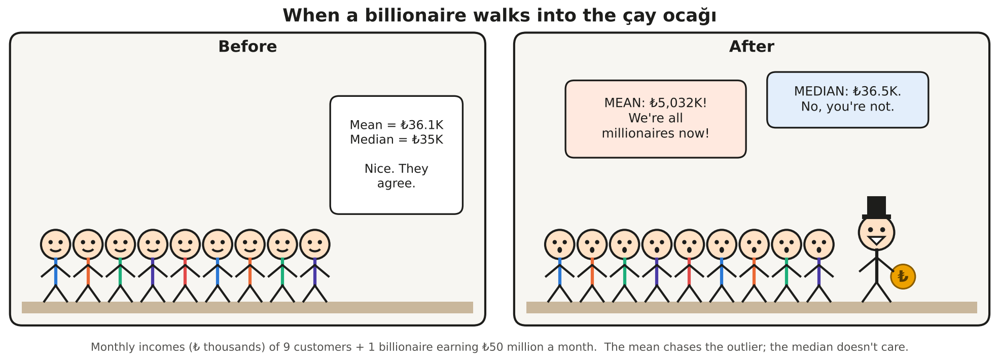{fig-align="center" fig-alt="Comic: nine customers in a tea house have similar incomes; after a billionaire walks in, the mean income jumps to millions but the median barely moves."}

<!-- ===================================================================== -->

:::: {.quiz type="fill"}
Nine customers in a *çay ocağı* have the following monthly incomes (in ₺ thousands):

$$28,\ 30,\ 32,\ 35,\ 35,\ 38,\ 40,\ 42,\ 45$$

**Before:** mean $=$ []{.blank answer="36.11" tol="0.01"}, median $=$ []{.blank answer="35" tol="0"}

A billionaire earning **₺50,000 thousand** (₺50 million) per month walks in.

**After:** mean $=$ []{.blank answer="5032.5" tol="0.05"}, median $=$ []{.blank answer="36.5" tol="0.01"}, mode $=$ []{.blank answer="35" tol="0"}

::: explain
- Before: $\sum x = 325$, $\bar{x} = 325/9 = 36.11$. With $n=9$ the median is the 5th value, **35**.
- After: $\sum x = 50{,}325$, $\bar{x} = 50{,}325/10 = 5{,}032.5$, about **139 times** the old mean!
  With $n=10$ the median is the average of the 5th and 6th values: $(35+38)/2 = 36.5$. The mode is still **35**.

**One** extreme observation moved the mean from 36 to 5,032 but the median only from 35 to 36.5. The median is **robust** (resistant) to outliers; the mean is not.
:::
::::

<!-- ===================================================================== -->

:::: {.quiz type="mc" answer="b"}
You are analyzing the salaries of employees in a company. A few employees, such as the CEO and other top executives, have **extremely high** salaries. Which measure should you use to describe the "typical" salary?

- Mean
- Median
- Mode
- Geometric mean
- Harmonic mean

::: explain
The extreme salaries pull the **mean** upwards (positive skew), so most employees earn *less* than the mean salary. The **median** is not affected by how extreme the top salaries are, so it represents a typical employee better. This is why official statistics usually report **median** income.
:::
::::

<!-- ===================================================================== -->

:::: {.quiz type="tf" answer="true"}
If the instructor adds **5 bonus points** to every student's exam score, both the mean and the median increase by exactly 5 points.

::: explain
**True.** Adding a constant shifts every observation, so every measure of **location** (mean, median, mode, quartiles) shifts by the same constant.
What about spread? The range, variance, standard deviation and IQR do **not** change, because the distances between the scores stay the same. More about this in Part C.
:::
::::

<!-- ===================================================================== -->

:::: {.quiz type="tf" answer="false"}
The geometric mean of the yearly returns −5%, +10% and +20% can be computed directly as $\sqrt[3]{(-5)\times 10 \times 20}$.

::: explain
**False.** The GM is defined only for **positive** values. The product here is negative, and the result has no meaning as an average return.
Convert returns to **growth factors** first: 0.95, 1.10, 1.20. Then $GM = \sqrt[3]{0.95 \times 1.10 \times 1.20} = 1.0784$, an average return of **7.84%** per year.
:::
::::

## Skewness: where are the mean, median and mode?

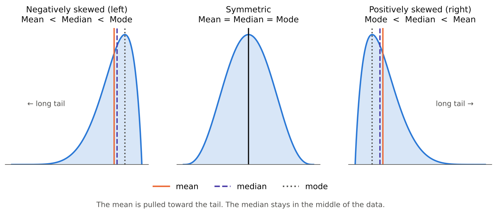{fig-align="center" fig-alt="Three density curves: left-skewed with mean < median < mode, symmetric with all three equal, right-skewed with mode < median < mean."}

<!-- ===================================================================== -->

:::: {.quiz type="classify" options="Positively skewed|Negatively skewed|Approximately symmetric"}
Indicate whether each distribution is **positively** skewed, **negatively** skewed, or approximately **symmetric**.

- Incomes of taxpayers: mean \$48,000, median \$43,000 :: Positively skewed
- GPAs of all students at a college: mean 3.01, median 3.20 :: Negatively skewed
- Number of "romantic affairs" reported anonymously by young adults: mean 2.6, median 1.9 :: Positively skewed
- Age at death in a developed country: mean 76, median 80 :: Negatively skewed
- Heights of adult women: mean 162 cm, median 162 cm :: Approximately symmetric
- House prices in İstanbul: mean ₺12 million, median ₺7 million :: Positively skewed
- Scores on a very easy 10-point quiz, where most students get 9 or 10 :: Negatively skewed
- Waiting time at a bank: most customers wait a few minutes, a few wait over an hour :: Positively skewed

::: explain
**Rule of thumb:** the mean is pulled toward the **long tail**.

- **Mean > median** → long tail on the right → **positively** (right) skewed. Typical for incomes, prices, waiting times and counts, which cannot go below 0 but can be very large.
- **Mean < median** → long tail on the left → **negatively** (left) skewed. Typical for GPAs, easy-exam scores and age at death, which have a natural upper limit.
:::
::::

# Part C — Measures of dispersion

Two classes can both have a mean of 60 on the midterm. In one class everyone scores between 55 and 65; in the other, scores range from 10 to 100. **Central tendency alone is not enough.**

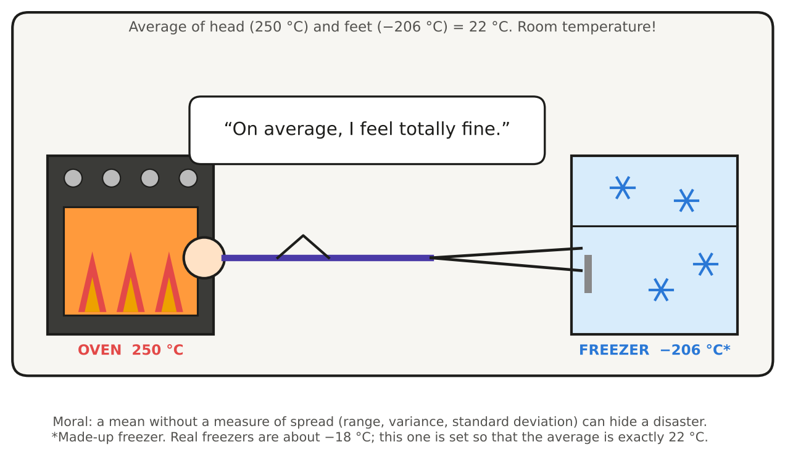{fig-align="center" fig-alt="Comic: a statistician with his head in an oven and his feet in a freezer says 'On average, I feel totally fine.'"}

::: {.callout-note collapse="false"}
## Key terms and formulas: dispersion

- **Range** $= \max - \min$. Easy to compute, but it uses only the two most extreme values.
- **Deviation** of an observation: $x_i-\bar{x}$. Deviations always sum to **zero**, so we **square** them.
- **Variance**: the average squared deviation.
  $$\sigma^2=\frac{1}{N}\sum_{i=1}^{N}(x_i-\mu)^2 \quad\text{(population)}$$
  $$s^2=\frac{1}{n-1}\sum_{i=1}^{n}(x_i-\bar{x})^2 \quad\text{(sample)}$$
  **Shortcut formula:**
  $$s^2=\frac{1}{n-1}\left[\sum x_i^2-\frac{\left(\sum x_i\right)^2}{n}\right]$$
- **Standard deviation**: $s=\sqrt{s^2}$. It is in the **same units** as the data, unlike the variance (squared units).
- **Coefficient of variation**: $CV=\dfrac{s}{\bar{x}}\times 100\%$. It is **unit-free**, so it compares the *relative* spread of variables with different units or very different means. It is meaningful only for **ratio-scale** data with a positive mean.
- **Linear transformation** $y = a + bx$: $\bar{y} = a + b\bar{x}$, $s_y = |b|\,s_x$ and $s_y^2 = b^2 s_x^2$. Adding a constant moves the data without changing the spread; multiplying rescales the spread.
:::

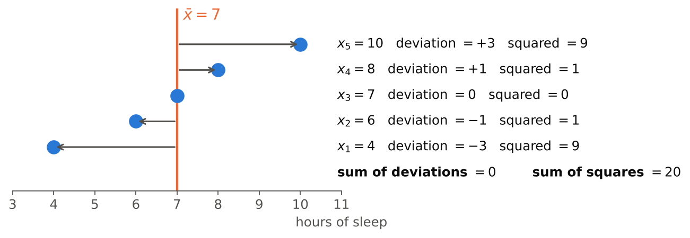{fig-align="center" fig-alt="Dot plot of 4, 6, 7, 8, 10 with arrows showing deviations from the mean 7; deviations sum to 0 and squared deviations sum to 20."}

<!-- ===================================================================== -->

:::: {.quiz type="fill"}
A sample of five students reported their hours of sleep last night: $4,\ 6,\ 7,\ 8,\ 10$ (see the figure above).

Sum of deviations $\sum (x_i-\bar{x}) =$ []{.blank answer="0" tol="0"} \
Sum of squared deviations $\sum (x_i-\bar{x})^2 =$ []{.blank answer="20" tol="0"} \
Sample variance $s^2 =$ []{.blank answer="5" tol="0.001"} \
Sample standard deviation $s =$ []{.blank answer="2.24" tol="0.01"} hours \
Coefficient of variation $CV =$ []{.blank answer="31.94" tol="0.06"} % \
If these five students were the **whole population**, the variance would be $\sigma^2 =$ []{.blank answer="4" tol="0.001"}

::: explain
$\bar{x} = 35/5 = 7$. Deviations: $-3, -1, 0, +1, +3$, which sum to **0** (always!).
Squared deviations: $9 + 1 + 0 + 1 + 9 = 20$.

- $s^2 = \dfrac{20}{n-1} = \dfrac{20}{4} = 5$ and $s = \sqrt{5} = 2.24$ hours
- Shortcut check: $\sum x^2 = 265$, so $\dfrac{1}{4}\left[265 - \dfrac{35^2}{5}\right] = \dfrac{265-245}{4} = 5$ ✓
- $CV = 2.24/7 \times 100\% = 31.94\%$
- Population version: $\sigma^2 = 20/N = 20/5 = 4$
:::
::::

<!-- ===================================================================== -->

:::: {.quiz type="mc" answer="b"}
Why do we divide by $n-1$ instead of $n$ in the **sample** variance?

- Because one observation is always an outlier and should be removed.
- Because deviations are measured from $\bar{x}$, which is computed from the same data, so they tend to be a little too small; dividing by $n-1$ corrects this underestimation of $\sigma^2$.
- Because it makes the variance smaller and therefore easier to interpret.
- It is only a convention: dividing by $n$ or $n-1$ always gives the same result.

::: explain
The sample mean $\bar{x}$ sits in the "middle" of *this particular* sample, so $\sum (x_i-\bar{x})^2$ is on average **smaller** than $\sum (x_i-\mu)^2$ would be. Dividing by $n-1$ instead of $n$ makes $s^2$ a little larger, which makes it an **unbiased** estimator of $\sigma^2$.
Another way to see it: once $\bar{x}$ is known, only $n-1$ deviations are free to vary, because they must sum to 0. These are the **degrees of freedom**.
:::
::::

## Law enforcement officers

The yearly numbers of law enforcement officers killed in the United States over 13 years:

$$164,\ 165,\ 157,\ 164,\ 152,\ 147,\ 148,\ 131,\ 147,\ 155,\ 172,\ 145,\ 160$$

<!-- ===================================================================== -->

:::: {.quiz type="fill"}
Ordered data: 131, 145, 147, 147, 148, 152, 155, 157, 160, 164, 164, 165, 172

Mean $\bar{x} =$ []{.blank answer="154.38" tol="0.01"} \
Sample variance $s^2 =$ []{.blank answer="119.76" tol="0.05"} \
Standard deviation $s =$ []{.blank answer="10.94" tol="0.01"} \
Range $=$ []{.blank answer="41" tol="0"} \
$Q_1 =$ []{.blank answer="147" tol="0"}, $\;Q_3 =$ []{.blank answer="164" tol="0"}, $\;IQR =$ []{.blank answer="17" tol="0"} \
Coefficient of variation $=$ []{.blank answer="7.09" tol="0.02"} %

::: explain
- $\sum x = 2007$, so $\bar{x} = 2007/13 = 154.38$.
- $\sum x^2 = 311{,}287$, so
  $$s^2 = \frac{1}{12}\left[311{,}287 - \frac{2007^2}{13}\right] = \frac{1437.08}{12} = 119.76$$
  and $s = \sqrt{119.76} = 10.94$.
- Range $= 172 - 131 = 41$.
- **Quartiles** (lecture rule): for $Q_1$, $np = 13(0.25) = 3.25$, so we need at least 3.25 values $\le Q_1$ and at least 9.75 values $\ge Q_1$. That is the **4th** ordered value, $Q_1 = 147$. For $Q_3$, $np = 9.75$ gives the **10th** value, $Q_3 = 164$. So $IQR = 164 - 147 = 17$.
- $CV = 10.94/154.38 \times 100\% = 7.09\%$. The yearly numbers vary only about 7% around their mean, which is a fairly **stable** series.
:::
::::

<!-- ===================================================================== -->

:::: {.quiz type="mc" answer="b"}
You are analyzing the distribution of income among individuals in two different countries. Which measure should you use to assess the **variability** of income that **excludes the influence of extreme outliers**?

- Range
- Interquartile range (IQR)
- Standard deviation
- Coefficient of variation

::: explain
The IQR $= Q_3 - Q_1$ uses only the **middle 50%** of the data, so a few billionaires do not change it.
The **range** depends *only* on the extremes, and the **standard deviation** and **CV** square the deviations, which makes outliers even more influential.
:::
::::

<!-- ===================================================================== -->

:::: {.quiz type="mc" answer="e"}
During a heatwave, City A records daily temperatures in **°C** and City B records them in **°F**. Which approach gives a **fair comparison** of the day-to-day variability in the two cities?

- Compare the two ranges as they are.
- Compare the two IQRs as they are.
- Compare the two standard deviations as they are.
- Compare the two coefficients of variation.
- Convert both series to the same scale (e.g. °C), then compare their standard deviations.

::: explain
The CV *looks* like the right tool because it is unit-free, **but it only works for ratio-scale data**. Temperature in °C or °F is on an **interval** scale with no true zero, so the CV changes when the scale changes:

| | Mean | SD | CV |
|---|--:|--:|--:|
| Same days in °C | 30 | 4 | 13.3% |
| Same days in °F | 86 | 7.2 | 8.4% |

Same weather, different CV! Converting both cities to the same unit and then comparing **standard deviations** (or IQRs) is the correct approach.
:::
::::

<!-- ===================================================================== -->

:::: {.quiz type="fill"}
In a hospital, **newborn** weights have mean 3.3 kg and standard deviation 0.5 kg. **Adult men** have mean weight 78 kg and standard deviation 11 kg.

CV of newborns $=$ []{.blank answer="15.15" tol="0.05"} %, CV of adult men $=$ []{.blank answer="14.10" tol="0.05"} %. \
Relative to their mean, the weights of []{.blank answer="newborns|newborn|babies|newborn babies"} vary more.

::: explain
- Newborns: $CV = 0.5/3.3 \times 100\% = 15.15\%$
- Adult men: $CV = 11/78 \times 100\% = 14.10\%$

The adults' SD (11 kg) is **22 times** larger than the newborns' SD (0.5 kg), but their mean is also much larger. *Relative* to the mean, **newborn** weights are slightly more variable. Comparing SDs directly would be misleading here.
:::
::::

<!-- ===================================================================== -->

:::: {.quiz type="fill"}
September daily high temperatures in Ankara have mean **26 °C** and standard deviation **3 °C**. Convert to Fahrenheit using $F = 32 + 1.8\,C$.

Mean $=$ []{.blank answer="78.8" tol="0.01"} °F, standard deviation $=$ []{.blank answer="5.4" tol="0.01"} °F, variance $=$ []{.blank answer="29.16" tol="0.01"} °F²

::: explain
For $y = a + bx$ with $a = 32$ and $b = 1.8$:

- $\bar{y} = 32 + 1.8(26) = 78.8$ °F, because the mean moves **and** stretches.
- $s_y = |1.8| \times 3 = 5.4$ °F, because the "+32" shift does **not** affect the spread.
- $s_y^2 = 1.8^2 \times 3^2 = 3.24 \times 9 = 29.16$ °F².
:::
::::

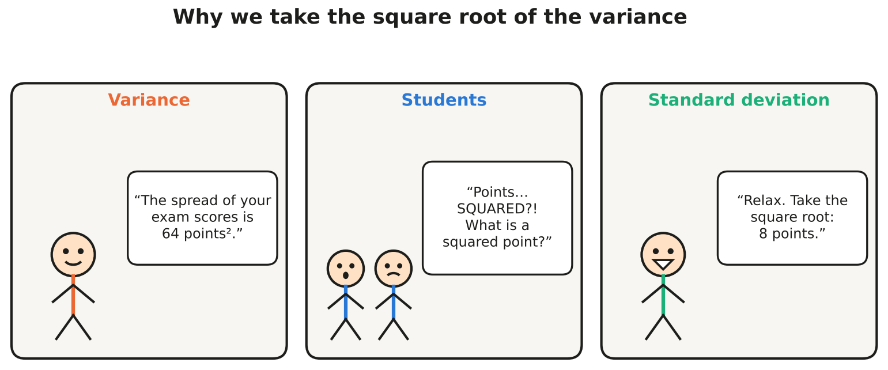{fig-align="center" fig-alt="Comic: the variance says the spread is 64 points squared; students are confused; the standard deviation says it is 8 points."}

<!-- ===================================================================== -->

:::: {.quiz type="ms" answer="a,c,d"}
Which statements about the variance and the standard deviation are **true**? Select all that apply.

- If all observations are equal, the standard deviation is 0.
- The variance can be negative when most observations are below the mean.
- The standard deviation is measured in the same units as the data.
- Multiplying every observation by 3 multiplies the variance by 9.
- Adding 10 to every observation increases the standard deviation by 10.

::: explain
- **a. True.** All deviations are 0, so there is no spread.
- **b. False.** The variance is an average of **squares**, so it is always $\ge 0$.
- **c. True.** That is why we usually report $s$ rather than $s^2$.
- **d. True.** $s_y^2 = b^2 s_x^2 = 9 s_x^2$, while the standard deviation is multiplied by 3.
- **e. False.** Shifting all values changes nothing about how far they are from one another, so the SD is unchanged.
:::
::::

# Part D — Shape: the empirical rule and kurtosis

::: {.callout-note collapse="false"}
## Key terms: shape

- **Skewness** measures **asymmetry**: which side has the longer tail (see Part B).
- **Kurtosis** measures **tailedness**: how heavy the tails are, that is, how prone the distribution is to producing **extreme values**. It is *not* just "how pointy the peak is".
  - Normal distribution: kurtosis $= 3$, so **excess kurtosis** $=$ kurtosis $- 3 = 0$ (**mesokurtic**)
  - Excess kurtosis $> 0$: **leptokurtic**, heavy tails, more outliers
  - Excess kurtosis $< 0$: **platykurtic**, light tails, fewer outliers
- **Empirical rule**: for **mound-shaped** (bell-shaped) data, about **68%** of the observations lie within $\bar{x} \pm s$, about **95%** within $\bar{x} \pm 2s$, and about **99.7%** within $\bar{x} \pm 3s$.
:::

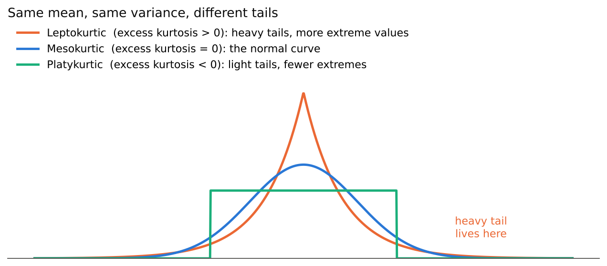{fig-align="center" fig-alt="Three distributions with the same mean and variance: a peaked heavy-tailed leptokurtic curve, a normal mesokurtic curve, and a flat platykurtic uniform shape."}

<!-- ===================================================================== -->

:::: {.quiz type="classify" options="Platykurtic|Mesokurtic|Leptokurtic"}
Classify each distribution. **Read carefully:** some values are *kurtosis* and some are *excess kurtosis*.

- Excess kurtosis $= -1.2$ :: Platykurtic
- Excess kurtosis $= 0.02$ :: Mesokurtic
- Excess kurtosis $= 3$ :: Leptokurtic
- Kurtosis $= 3$ :: Mesokurtic
- Kurtosis $= 1.8$ :: Platykurtic
- Kurtosis $= 9$ :: Leptokurtic
- Daily stock returns, which have many more extreme crashes and jumps than a normal distribution :: Leptokurtic

::: explain
Always check which one is reported: **excess kurtosis $=$ kurtosis $- 3$**.

- Kurtosis 3 means excess 0: **mesokurtic** (normal-like tails).
- Kurtosis 1.8 means excess −1.2: **platykurtic**. This is the uniform distribution!
- Kurtosis 9 means excess 6: **leptokurtic**.

Financial returns are the classic leptokurtic example: "once-in-a-century" crashes happen far more often than the normal model predicts.
:::
::::

<!-- ===================================================================== -->

:::: {.quiz type="tf" answer="false"}
Kurtosis tells us only how tall and sharp the peak of a distribution is.

::: explain
**False.** Kurtosis is mainly about the **tails**, that is, about outliers and extreme values. Two distributions can have similar-looking peaks but very different tails, and the tails drive the kurtosis.
:::
::::

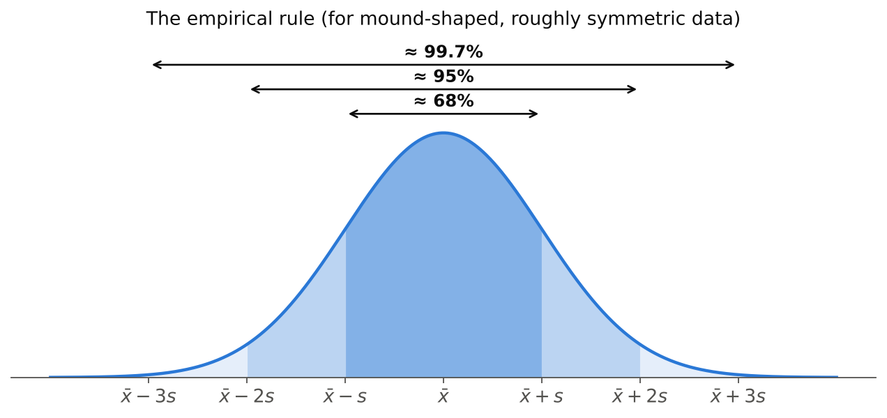{fig-align="center" fig-alt="Normal curve with shaded bands: about 68% within one standard deviation, 95% within two, 99.7% within three."}

<!-- ===================================================================== -->

:::: {.quiz type="fill"}
Scores on a large STAT 112 midterm are **mound-shaped** with mean **62** and standard deviation **9**. Use the empirical rule.

About 68% of the scores lie between []{.blank answer="53" tol="0"} and []{.blank answer="71" tol="0"}. \
About 95% of the scores lie between []{.blank answer="44" tol="0"} and []{.blank answer="80" tol="0"}. \
About []{.blank answer="99.7" tol="0.05"} % of the scores lie between 35 and 89. \
Approximately []{.blank answer="2.5" tol="0.05"} % of the students scored **above 80**. \
Approximately []{.blank answer="34" tol="0.5"} % of the students scored **between 62 and 71**.

::: explain
- $62 \pm 9 = [53,\ 71]$ contains about 68%
- $62 \pm 2(9) = [44,\ 80]$ contains about 95%
- $62 \pm 3(9) = [35,\ 89]$ contains about 99.7%
- **Above 80:** 5% is outside $[44, 80]$. By symmetry half of that is in the upper tail, so about **2.5%**.
- **Between 62 and 71:** half of the central 68%, so about **34%**.
:::
::::

# Part E — Percentiles, quartiles and box plots

::: {.callout-note collapse="false"}
## Key terms and formulas: position

- **The $p$th percentile** ($0<p<1$): a value such that **at least $np$** observations are $\le$ it **and** **at least $n(1-p)$** observations are $\ge$ it.
- **Quartiles**: $Q_1$ = 25th percentile, $Q_2$ = median = 50th percentile, $Q_3$ = 75th percentile.
- **Five-number summary**: minimum, $Q_1$, median, $Q_3$, maximum.
- **Interquartile range**: $IQR = Q_3 - Q_1$, the spread of the middle 50%.
- **Fences** for potential outliers:
  $$\text{lower fence} = Q_1 - 1.5\,IQR$$
  $$\text{upper fence} = Q_3 + 1.5\,IQR$$
  Observations outside the fences are flagged as **potential outliers**. The whiskers stop at the most extreme observations **inside** the fences.
:::

<!-- ===================================================================== -->

:::: {.quiz type="match"}
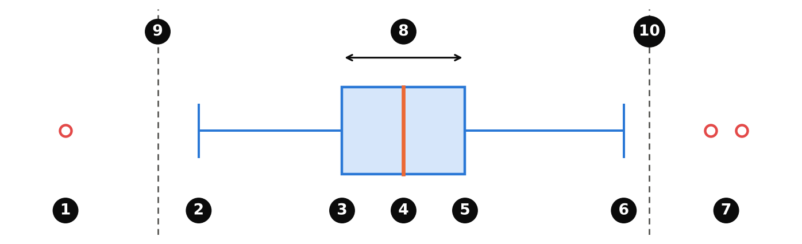{fig-alt="Box plot with numbered labels 1 to 10."}

Match each numbered label in the box plot with what it shows.

- Label 1 :: A potential outlier below the lower fence
- Label 2 :: End of the lower whisker: the smallest observation inside the fences
- Label 3 :: First quartile, Q1 (25th percentile)
- Label 4 :: Median, Q2 (50th percentile)
- Label 5 :: Third quartile, Q3 (75th percentile)
- Label 6 :: End of the upper whisker: the largest observation inside the fences
- Label 7 :: Potential outliers above the upper fence
- Label 8 :: Interquartile range, the width of the box: Q3 − Q1
- Label 9 :: Lower fence: Q1 − 1.5 × IQR (not drawn on most box plots)
- Label 10 :: Upper fence: Q3 + 1.5 × IQR (not drawn on most box plots)

::: explain
- The **box** holds the middle 50% of the data, and the line inside is the median.
- The **whiskers** do *not* necessarily reach the minimum and maximum. They stop at the last observation inside the fences, and anything beyond is plotted as a separate point.
- When there are no outliers, the whisker ends **are** the minimum and the maximum.
:::
::::

<!-- ===================================================================== -->

:::: {.quiz type="fill"}
The one-way commute times (minutes) of 15 METU students, already ordered:

$$12,\ 15,\ 18,\ 20,\ 22,\ 22,\ 25,\ 27,\ 30,\ 31,\ 35,\ 38,\ 40,\ 45,\ 95$$

Median $=$ []{.blank answer="27" tol="0"}, $\;Q_1 =$ []{.blank answer="20" tol="0"}, $\;Q_3 =$ []{.blank answer="38" tol="0"}, $\;IQR =$ []{.blank answer="18" tol="0"} \
Lower fence $=$ []{.blank answer="-7" tol="0"}, upper fence $=$ []{.blank answer="65" tol="0"} \
The potential outlier is []{.blank answer="95" tol="0"} minutes, so the upper whisker ends at []{.blank answer="45" tol="0"}. \
The 90th percentile is []{.blank answer="45" tol="0"} minutes. \
The mean is []{.blank answer="31.67" tol="0.01"}, which is larger than the median, so the distribution is []{.blank answer="positively skewed|right skewed|skewed to the right|positive|right|positively|right-skewed"}.

::: explain
- $n = 15$, so the median is the $\frac{15+1}{2} = 8$th value: **27**.
- $Q_1$: $np = 15(0.25) = 3.75$, so we need ≥ 3.75 values below it and ≥ 11.25 values above it. That is the **4th** value, **20**.
- $Q_3$: $np = 11.25$ gives the **12th** value, **38**.
- $IQR = 38 - 20 = 18$ and $1.5 \times IQR = 27$.
- Fences: $20 - 27 = -7$ and $38 + 27 = 65$. Only **95** is outside, so it is a potential outlier. The upper whisker stops at **45**, the largest value inside the fences.
- $P_{90}$: $np = 13.5$, so we need ≥ 13.5 values below it and ≥ 1.5 above it. That is the **14th** value, **45**.
- $\bar{x} = 475/15 = 31.67 > 27$: the student with a 95-minute commute pulls the mean to the right, so the distribution is **positively skewed**.

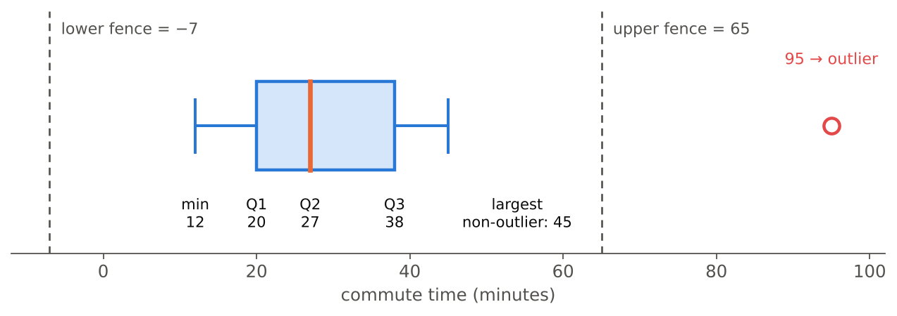{fig-alt="Box plot of commute times: box from 20 to 38, median 27, whiskers from 12 to 45, outlier at 95, fences at -7 and 65."}
:::
::::

<!-- ===================================================================== -->

:::: {.quiz type="mc" answer="c"}
Your university entrance exam result places you at the **85th percentile**. What does this mean?

- You answered 85% of the questions correctly.
- Your score is 85 out of 100.
- About 85% of the test takers scored at or below your score, and about 15% scored at or above it.
- Only 85 people scored higher than you.

::: explain
A percentile describes your **position relative to the other test takers**, not the percentage of questions you answered correctly. At the 85th percentile, you did as well as or better than about 85% of the group.
:::
::::

## Reading box plots

A market researcher studies the **annual revenue** of the stores of a retail chain.

<!-- ===================================================================== -->

:::: {.quiz type="fill"}
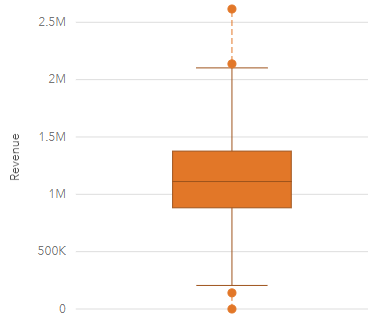{fig-align="center" width="340" fig-alt="Box plot of annual store revenue."}

Read the box plot (in millions of ₺; approximate values are fine).

Median ≈ []{.blank answer="1.1" tol="0.06"} M, $\;Q_1$ ≈ []{.blank answer="0.88" tol="0.06"} M, $\;Q_3$ ≈ []{.blank answer="1.38" tol="0.06"} M, $\;IQR$ ≈ []{.blank answer="0.5" tol="0.07"} M \
Number of stores flagged as potential outliers: []{.blank answer="4" tol="0"}

::: explain
- The box runs from about **0.88 M** ($Q_1$) to about **1.38 M** ($Q_3$), so $IQR \approx 0.5$ M. The median line is at about **1.1 M**.
- Fences: $0.88 - 1.5(0.5) \approx 0.13$ M and $1.38 + 1.5(0.5) \approx 2.13$ M.
- **Four** stores lie outside: two low (about 0.13 M and 0) and two high (about 2.15 M and 2.6 M).
- The median is close to the centre of the box and the whiskers have similar lengths, so the distribution is roughly **symmetric**, apart from a few unusual stores.
- A store with **zero** revenue deserves a closer look. Was it newly opened, closed for renovation, or is it a data-entry error?
:::
::::
<!-- ===================================================================== -->

:::: {.quiz type="open" keywords="1.1|median; outlier|unusual|extreme; middle 50|Q1|Q3|IQR|box; symmetric|skew"}
Write a 2–3 sentence interpretation of the single **revenue** box plot above, as you would write it in a report for the store manager.

::: explain
**Model answer:** The median annual revenue is about ₺1.1 million, so half of the stores earn less than this and half earn more. The middle 50% of stores earn between roughly ₺0.9 and ₺1.4 million (IQR ≈ ₺0.5 million), and the distribution is roughly symmetric. Four stores are potential outliers: two earn unusually little (one about ₺0) and two earn unusually much (up to about ₺2.6 million). These four should be investigated.
:::
::::

<!-- ===================================================================== -->

:::: {.quiz type="ms" answer="a,b,d,f"}
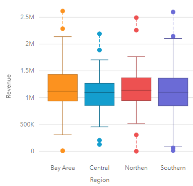{fig-align="center" width="420" fig-alt="Side-by-side box plots of store revenue for Bay Area, Central, Northern and Southern regions."}

The same stores, now split by **region**. Which statements are supported by the plot? Select all that apply.

- The median revenue is roughly the same (about 1.1 M) in all four regions.
- Every region has at least one store flagged as a potential outlier.
- The Southern region's median revenue is clearly the highest.
- Between the whisker ends, the Southern region shows the widest spread.
- The Central region has a store with revenue above 2.5 M.
- The Bay Area has potential outliers on both the low and the high side.

::: explain
- **a. True.** All the median lines are close to 1.1 M.
- **b. True.** Each region has points beyond its whiskers.
- **c. False.** The Northern median is, if anything, slightly higher, and the differences are tiny.
- **d. True.** The Southern whiskers run from about 0.1 M to 2.1 M.
- **e. False.** Central's highest point is about 2.2 M.
- **f. True.** It has a store near 0 and two above 2.2 M.

**Overall:** region does not seem to make much difference to typical revenue. The boxes overlap almost completely.
:::
::::

<!-- ===================================================================== -->

:::: {.quiz type="classify" options="Symmetric|Positively skewed|Negatively skewed"}
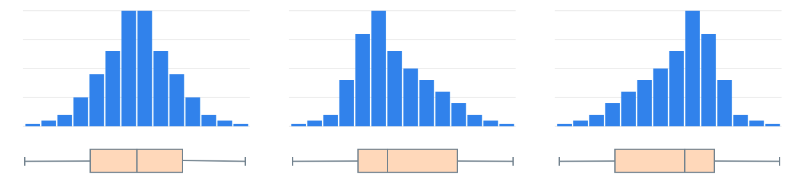{fig-align="center" fig-alt="Three histograms, each with its box plot below."}

Describe the distribution in each panel.

- Left panel :: Symmetric
- Middle panel :: Positively skewed
- Right panel :: Negatively skewed

::: explain
- **Left:** the median is in the middle of the box and the whiskers are equal: **symmetric**.
- **Middle:** the long tail is on the right; the median is closer to $Q_1$ and the right whisker is longer: **positively (right) skewed**.
- **Right:** the mirror image, with a long tail on the left; the median is closer to $Q_3$: **negatively (left) skewed**.

**Box plot shortcut:** the longer whisker and the larger half of the box point toward the tail.
:::
::::

<!-- ===================================================================== -->

:::: {.quiz type="classify" options="Box plot 1|Box plot 2|Box plot 3|Box plot 4" label="Match histogram to box plot"}
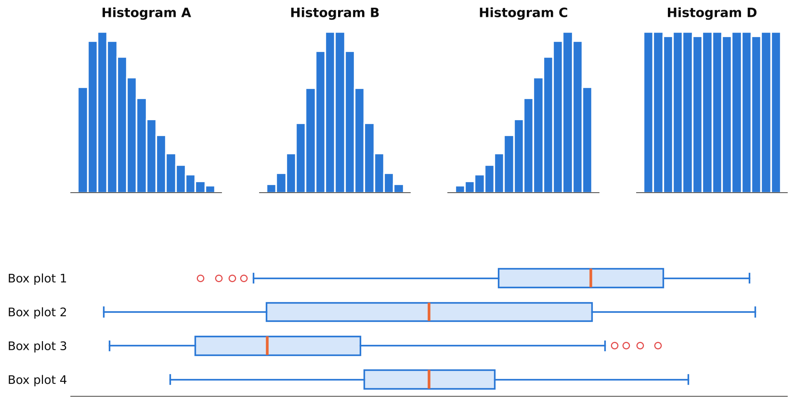{fig-align="center" fig-alt="Four histograms labelled A to D and four box plots labelled 1 to 4 in a different order."}

Each histogram shows the same data as one of the box plots. Which box plot belongs to each histogram?

- Histogram A :: Box plot 3
- Histogram B :: Box plot 4
- Histogram C :: Box plot 1
- Histogram D :: Box plot 2

::: explain
- **A (right-skewed)** → **Box plot 3**: the median sits near the left of the box, there is a long right whisker, and the high values are flagged as outliers.
- **B (symmetric, bell-shaped)** → **Box plot 4**: a narrow box in the centre with balanced whiskers. Most data are near the middle, so the IQR is small.
- **C (left-skewed)** → **Box plot 1**: the mirror image of box plot 3.
- **D (flat, uniform)** → **Box plot 2**: a very **wide** box, because the values are spread evenly, and a median exactly in the middle.

Box plots 2 and 4 are both symmetric. The **width of the box** (the IQR) tells them apart.
:::
::::

<!-- ===================================================================== -->

:::: {.quiz type="order"}
Put the steps for constructing a box plot by hand in the correct order.

- Sort the data from smallest to largest
- Find the median, $Q_1$ and $Q_3$
- Compute $IQR = Q_3 - Q_1$
- Compute the fences $Q_1 - 1.5\,IQR$ and $Q_3 + 1.5\,IQR$
- Flag the observations outside the fences as potential outliers
- Draw the box from $Q_1$ to $Q_3$ with a line at the median
- Draw the whiskers to the most extreme observations inside the fences and plot the outliers as points

::: explain
You need the quartiles before the IQR, the IQR before the fences, and the fences before you know **where the whiskers stop**.
:::
::::

