

## How to use this page

Each question below is interactive. Click an option or type an answer, then press **Check** (or <kbd>Enter</kbd>). **Show answer** reveals the solution and the explanation, and **Reset** clears the question so you can try again.

Numbers can be typed with a dot or a comma (`3.2` or `3,2`); round to **2 decimals** unless a question says otherwise.

::: quiz-scoreboard
Progress
:::

# Part A — Histograms

::: {.callout-note collapse="false"}
## Key terms: histograms

- A **histogram** consists of **adjoining boxes** (no gaps between the boxes). The horizontal axis shows what the data represent; the vertical axis shows the **frequency** or the **relative frequency** (percent). The graph has the **same shape** with either label.
- A histogram shows the **shape**, the **center** and the **spread** of the data. It is most practical for **large** data sets (100 values or more) and it is **not suitable for categorical (qualitative) data**.
- **Number of classes:** many histograms use **5 to 15** classes. A guide based on the number of observations:

| Number of observations | < 50 | 50–200 | 200–500 | 500–1,000 | 1,000–5,000 | 5,000–50,000 | > 50,000 |
|---|:-:|:-:|:-:|:-:|:-:|:-:|:-:|
| Number of classes | 5–7 | 7–9 | 9–10 | 10–11 | 11–13 | 13–17 | 17–20 |

- **Class width** $= \dfrac{\text{largest} - \text{smallest}}{\text{number of classes}}$ (largest and smallest observations), rounded **up** to a convenient number. The first class starts at a number **smaller than the smallest observation**.
- **Relative frequency** $= \dfrac{\text{class frequency}}{\text{total number of observations}}$. Use it when comparing two or more histograms whose samples have **different sizes**.
- **Unequal class widths:** when some classes have very low frequencies, several classes can be **combined** into a wider, "more populated" class, or an **open-ended class** can be formed at the lower or upper end.
- **Reading a histogram:** the highest bar is the **modal class**; a long tail to the right means **positively (right) skewed**, a long tail to the left means **negatively (left) skewed**; bars spread over a wide range mean high variability; a **gap or dip** means no or few observations in that range.
- **Shapes:** symmetric (bell or mound shaped), positively or negatively skewed, uniform, **unimodal** (one modal class), **bimodal** (two modal classes) or multimodal.
:::

<!-- ===================================================================== -->

:::: {.quiz type="fill"}
80 students reported how many minutes they spend on their phone in bed before falling asleep.

| Minutes | 0–15 | 15–30 | 30–45 | 45–60 | 60–75 | 75–90 | 90–105 |
|---|:-:|:-:|:-:|:-:|:-:|:-:|:-:|
| Frequency | 6 | 14 | 24 | 18 | 10 | 5 | 3 |

The relative frequency of the class 30–45 is []{.blank answer="0.3" tol="0.001"}. \
The modal class is []{.blank answer="30-45|30–45|30 - 45|30 to 45"} minutes. \
The midpoint of the class 45–60 is []{.blank answer="52.5" tol="0.01"}. \
[]{.blank answer="22.5" tol="0.05"} % of the students spend **60 minutes or more** on their phone before sleeping. \
The long tail is on the right, so the histogram is []{.blank answer="positively skewed|right skewed|right-skewed|positively|skewed to the right|positive skew"}.

::: explain
- $n = 6 + 14 + 24 + 18 + 10 + 5 + 3 = 80$, so the relative frequency of 30–45 is $24/80 = 0.30$. It is also the modal class (24 is the largest frequency).
- Midpoint of 45–60: $(45 + 60)/2 = 52.5$.
- 60 minutes or more: $(10 + 5 + 3)/80 = 18/80 = 0.225 = 22.5\%$.
- The frequencies fall off slowly towards large values: a long right tail, so the histogram is **positively (right) skewed**.

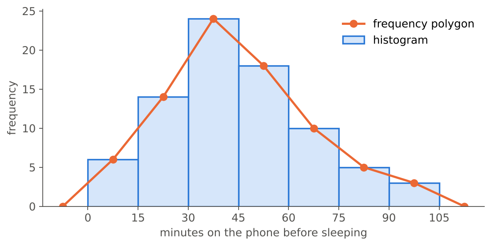{fig-alt="Histogram of the frequency table with a frequency polygon drawn through the class midpoints."}
:::
::::

<!-- ===================================================================== -->

:::: {.quiz type="fill"}
A bus company recorded **320** commute times (in minutes). The smallest is **2.4** and the largest is **79.8** minutes.

According to the table in the key terms, the histogram should have between 9 and []{.blank answer="10" tol="0"} classes. \
The range is []{.blank answer="77.4" tol="0.01"} minutes. Using **9** classes, the class width is $77.4 / 9 =$ []{.blank answer="8.6" tol="0.01"}, which we round **up** to []{.blank answer="9" tol="0"} minutes. \
The first class must start at a number smaller than []{.blank answer="2.4" tol="0.001"}; if it starts at 2, the 9 classes cover 2 to []{.blank answer="83" tol="0"} minutes.

::: explain
- 320 observations lie in the row **200–500**, which suggests **9–10** classes.
- Range $= 79.8 - 2.4 = 77.4$; width $= 77.4/9 = 8.6$, rounded up to **9**.
- Starting at 2 (smaller than the smallest value 2.4), the classes are 2–11, 11–20, …, 74–83. The last class ends at $2 + 9 \times 9 = 83 \ge 79.8$, so every observation fits.
:::
::::

<!-- ===================================================================== -->

:::: {.quiz type="ms" answer="a,b,c,e"}
Which statements about histograms are **true**? Select all that apply.

- The boxes of a histogram are adjoining: there are no gaps between them.
- A histogram drawn with relative frequencies has the same shape as one drawn with frequencies.
- Histograms are more practical when the data set has about 100 values or more.
- A histogram is a good graph for the favourite colours of 200 students.
- The first class should start at a number smaller than the smallest observation.
- Changing the class width changes the data, so only one histogram of a data set is correct.

::: explain
- **d is false:** favourite colour is **categorical (qualitative)**; a histogram is not suitable for categorical data.
- **f is false:** the data stay the same; only the *picture* changes. That is why it is useful to try several class (bar) widths, as in the tipping example of the lecture.
:::
::::

<!-- ===================================================================== -->

:::: {.quiz type="classify" options="Symmetric|Positively skewed|Negatively skewed|Bimodal|Uniform"}
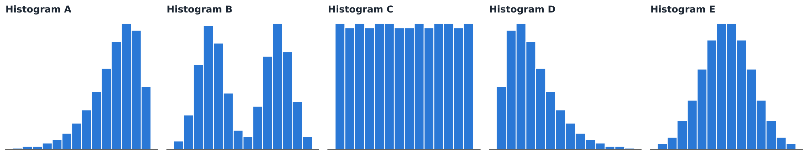{fig-alt="Five histograms labelled A to E with different shapes."}

Describe the shape of each histogram.

- Histogram A :: Negatively skewed
- Histogram B :: Bimodal
- Histogram C :: Uniform
- Histogram D :: Positively skewed
- Histogram E :: Symmetric

::: explain
- **A:** long tail to the **left** → negatively skewed.
- **B:** two modal classes → bimodal.
- **C:** all bars about the same height → uniform.
- **D:** long tail to the **right** → positively skewed.
- **E:** mound (bell) shaped and mirror-symmetric → symmetric. Many statistical techniques require a bell-shaped population; drawing the histogram helps to check this.
:::
::::

<!-- ===================================================================== -->

:::: {.quiz type="mc" answer="c"}
600 customers' spending at a campus café (in ₺) is shown with three different bar widths.

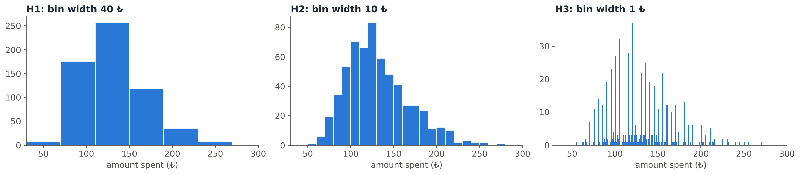{fig-alt="Three histograms of the same café spending data with bin widths 40, 10 and 1 lira."}

Which histogram reveals that **many customers spend a round amount** (a multiple of 5 ₺)?

- H1 (bar width 40 ₺)
- H2 (bar width 10 ₺)
- H3 (bar width 1 ₺)
- None of them: a histogram can never show this

::: explain
Only the narrow bars of **H3** show the tall peaks at 50, 55, 60, … ₺: many amounts are **rounded** to a multiple of 5. With the wide bars of H1 the histogram simply looks unimodal and right-skewed; H2 starts to show more detail.

This is the same lesson as the tips histograms in the lecture: as the bar width gets smaller, the histogram went from unimodal to multimodal, revealing that customers round their tips. Wide bars show the **overall shape**; narrow bars show **fine details**. Look at several widths before you interpret.
:::
::::

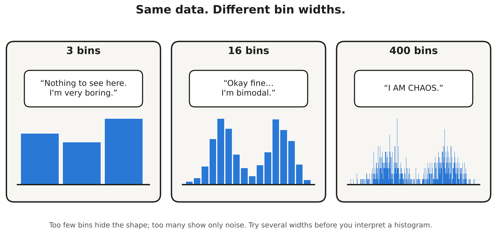{fig-align="center" fig-alt="Comic: the same data shown with 3, 16 and 400 bins say very different things."}

<!-- ===================================================================== -->

:::: {.quiz type="fill"}
The monthly incomes (thousand ₺) of 200 part-time student workers are grouped as follows:

| Income | 0–5 | 5–10 | 10–15 | 15–20 | 20–25 | 25–30 | 30–35 | 35–40 |
|---|:-:|:-:|:-:|:-:|:-:|:-:|:-:|:-:|
| Frequency | 38 | 74 | 52 | 27 | 5 | 2 | 1 | 1 |

The last four classes have very low frequencies. If we **combine** them into one wider class 20–40, its frequency is []{.blank answer="9" tol="0"}. \
Alternatively, we can form an **open-ended class** "20 and over" with the same frequency. With this class, the table has []{.blank answer="5" tol="0"} classes.

::: explain
$5 + 2 + 1 + 1 = 9$. The new table is 0–5, 5–10, 10–15, 15–20 and "20 and over": **5** classes.

The lecture: *it is generally best to use equal class widths, but unequal class widths are used when the frequency of some classes is too low; several classes are then combined to form a wider and "more populated" class, or an open-ended class is formed at the higher or lower end.*
:::
::::

<!-- ===================================================================== -->

:::: {.quiz type="mc" answer="b"}
Section A has **40** students and Section B has **160** students. You want to compare their exam score distributions with two histograms. What should the vertical axis show?

- Frequencies, because they are the real counts
- Relative frequencies (or percentages)
- The class midpoints
- It does not matter, the comparison is the same either way

::: explain
With frequencies, Section B's bars are about four times as tall just because it is bigger, which hides the comparison. The lecture: *relative frequencies should be used when comparing two or more histograms and the number of observations of the samples are different.* Also use the **same classes** for both histograms.
:::
::::

<!-- ===================================================================== -->

:::: {.quiz type="open" keywords="two groups|two populations|mix|mixture|different groups|two types|gymnast|basketball; separate|split|by team|each team|two histograms|for each|separately; bimodal|two peaks|two modes|two modal"}
The heights of all members of a university sports club form a **bimodal** histogram, with one modal class near 168 cm and another near 192 cm. The club has a gymnastics team and a basketball team.

Explain what the two modal classes probably mean, and how you would display the data instead.

::: explain
**Model answer:** The histogram is bimodal because two different groups are mixed together: gymnasts (shorter) and basketball players (taller). This also makes the spread of the combined data large. Draw a separate histogram for each team, using the **same classes** and **relative frequencies** (the teams may have different sizes), so the two distributions can be compared.

:::
::::

<!-- ===================================================================== -->

:::: {.quiz type="order"}
Put the steps for constructing a histogram in the correct order.

- Collect the data and find the smallest and largest observations
- Choose the number of classes (use the table of the number of observations)
- Compute the class width and round it up to a convenient number
- Set the class limits, starting below the smallest value
- Count the frequency (and relative frequency) of each class
- Draw adjoining boxes whose heights are the frequencies (or relative frequencies)

::: explain
This is the lecture's recipe: **collect data → prepare a frequency distribution → draw a histogram**. You need the number of classes before you can compute the width, and the class limits before you can count.
:::
::::

# Part B — Frequency polygons, dot diagrams and outliers

::: {.callout-note collapse="false"}
## Key terms

- **Frequency polygon:** points at the **midpoints** of the class intervals (height = frequency), connected with straight lines. As in the lecture example, the polygon is closed with a point of frequency 0 one class width beyond each end.
- **Dot diagram:** each observation is a dot on a number line. The aim is to identify **unusual features** of the data.
- **Outlier:** an observation that is unusually large or small relative to the other values. Three reasons for outliers: (1) the measurement was observed, recorded or entered **incorrectly**; (2) it comes from a **different population**; (3) it is **correct but represents a rare event**.
:::

<!-- ===================================================================== -->

:::: {.quiz type="fill"}
Look at the frequency polygon in the explanation of the first question (phone time before sleeping, classes of width 15 from 0 to 105 minutes).

Each point of a frequency polygon is plotted at the class []{.blank answer="midpoint|midpoints|mid-point|mid-points|middle|centre|center"}. The first point of the data is at $x =$ []{.blank answer="7.5" tol="0.01"} with height []{.blank answer="6" tol="0"}. To close the polygon, we add one extra point with frequency 0 at each end, at $x =$ []{.blank answer="-7.5" tol="0.01"} and $x =$ []{.blank answer="112.5" tol="0.01"}.

::: explain
The points are the midpoints 7.5, 22.5, …, 97.5 with heights equal to the frequencies (6, 14, …, 3). The extra points sit one class width (15) beyond the first and last midpoints: $7.5 - 15 = -7.5$ and $97.5 + 15 = 112.5$, just like 44.5 and 104.5 in the calculus scores example of the lecture.
:::
::::

<!-- ===================================================================== -->

:::: {.quiz type="fill"}
A consumer magazine tested the battery life of **17 phones of the same model**:

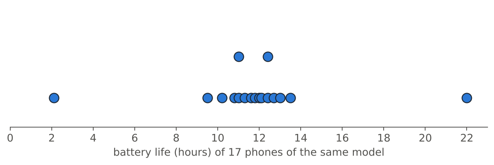{fig-alt="Dot plot of battery life of 17 phones: most between 9.5 and 13.5 hours, one at 2.1 and one at 22 hours."}

Most phones last between []{.blank answer="9.5" tol="0.01"} and []{.blank answer="13.5" tol="0.01"} hours. \
The dot diagram shows []{.blank answer="2|two"} unusual values: a very small one at []{.blank answer="2.1" tol="0.01"} hours and a very large one at []{.blank answer="22" tol="0.01"} hours.

::: explain
Fifteen dots form a cluster from 9.5 to 13.5 hours. The values **2.1** and **22.0** are far from all the others: they are potential **outliers**. Identifying such unusual features is exactly the aim of a dot diagram (compare the neutrino example of the lecture, where one time of 7.3 s stands out).
:::
::::

<!-- ===================================================================== -->

:::: {.quiz type="classify" options="Recorded or entered incorrectly|Comes from a different population|Correct, but a rare event"}
For each outlier, what is the most likely reason?

- A student's height is recorded as 2.78 cm :: Recorded or entered incorrectly
- The phone that lasts 22 hours in the test above turns out to be the newer "Pro" model with a bigger battery :: Comes from a different population
- In a study of adults' blood pressure, one participant is a 9-year-old child :: Comes from a different population
- A "daily screen time" of 31 hours :: Recorded or entered incorrectly
- The highest river level in 50 years of daily measurements, recorded during a once-in-a-century flood :: Correct, but a rare event
- A ₺160 tip on a ₺530 food order from a very generous customer :: Correct, but a rare event

::: explain
- **Incorrect values** (2.78 cm, 31 hours in a day) are impossible: they were observed, recorded or entered incorrectly.
- **Different population:** another phone model, a child among adults.
- **Rare events:** a record flood or a very generous customer are correct values. As the lecture says about the large tips: *these are outliers, but from a waiter's perspective, these are the customers that you like!*
:::
::::

# Part C — Scatter plots and correlation

::: {.callout-note collapse="false"}
## Key terms: two numerical variables

- Two variables are **related (associated)** when knowing one helps you understand or predict the other. The statistical study of the relationship between variables is called **regression**.
- A **scatter plot** shows the $(x, y)$ pairs. It helps us understand the **form**, **direction** and **strength** of the relationship.
- **Explanatory (independent, input) variable** $x$: explains changes in the response; horizontal axis. **Response (dependent, output) variable** $y$: measures the outcome. If there is no explanatory–response distinction, **either variable can go on the horizontal axis**.
- Typical patterns: positive linear, negative linear, no relationship, nonlinear (e.g. negative nonlinear, concave); also quadratic, cubic, exponential, logarithmic or random patterns.
- **Correlation** measures the **strength and direction of the linear relationship**. The **correlation coefficient** of two continuous variables:
  $$r = \frac{\sum (x_i - \bar{x})(y_i - \bar{y})}{\sqrt{\sum (x_i - \bar{x})^2}\,\sqrt{\sum (y_i - \bar{y})^2}}$$
- Properties: $-1 \le r \le 1$. If $r = 1$, the data form a straight line with a **positive** slope; if $r = -1$, a straight line with a **negative** slope; if $r = 0$, the data have **no (linear) correlation**.
:::

<!-- ===================================================================== -->

:::: {.quiz type="classify" options="Explanatory|Response"}
For each pair, which variable is the **explanatory** variable and which is the **response**?

- Hours of sunlight per day (in a study of plant growth) :: Explanatory
- Plant growth (cm per week) :: Response
- Price of a cup of coffee (in a study of daily sales) :: Explanatory
- Number of cups of coffee sold per day :: Response
- Daily maximum temperature (in a study of electricity use) :: Explanatory
- Daily electricity use for air conditioning :: Response

::: explain
The response variable measures the **outcome** of the study; the explanatory variable explains changes in it: sunlight → growth, price → sales, temperature → electricity use. The explanatory variable goes on the **horizontal** ($x$) axis. If there is no natural explanatory–response distinction (for example, the heights of two siblings), either variable can go on the horizontal axis.
:::
::::

<!-- ===================================================================== -->

:::: {.quiz type="classify" options="Strong positive|Strong negative|Weak positive|Weak negative|No relationship|Nonlinear relationship"}
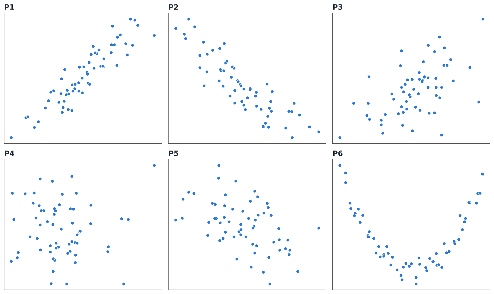{fig-alt="Six scatter plots labelled P1 to P6 with different correlations."}

Describe the relationship shown in each scatter plot.

- P1 :: Strong positive
- P2 :: Strong negative
- P3 :: Weak positive
- P4 :: No relationship
- P5 :: Weak negative
- P6 :: Nonlinear relationship

::: explain
The computed values are P1: $r = 0.91$, P2: $r = -0.87$, P3: $r = 0.54$, P4: $r = 0.00$, P5: $r = -0.48$ and P6: $r = -0.01$.

**P6 is the trap:** the points follow a clear U-shaped (nonlinear) pattern, yet $r \approx 0$. The correlation coefficient is a measure of the **linear** relationship only, so always look at the scatter plot, not just at $r$.
:::
::::

<!-- ===================================================================== -->

:::: {.quiz type="fill"}
Five students report the hours they slept the night before an exam ($x$) and their exam score ($y$):

| $x$ (hours of sleep) | 4 | 5 | 6 | 7 | 8 |
|---|:-:|:-:|:-:|:-:|:-:|
| $y$ (score) | 50 | 62 | 58 | 70 | 75 |

$\bar{x} =$ []{.blank answer="6" tol="0.001"}, $\bar{y} =$ []{.blank answer="63" tol="0.001"} \
$\sum (x_i-\bar{x})(y_i-\bar{y}) =$ []{.blank answer="58" tol="0.01"}, $\sum (x_i-\bar{x})^2 =$ []{.blank answer="10" tol="0.01"}, $\sum (y_i-\bar{y})^2 =$ []{.blank answer="388" tol="0.01"} \
$r =$ []{.blank answer="0.93" tol="0.006"}: a []{.blank answer="strong positive|strong, positive|strong positive linear|positive strong|very strong positive"} linear relationship.

::: explain
| $x$ | $y$ | $x - \bar{x}$ | $y - \bar{y}$ | $(x-\bar{x})(y-\bar{y})$ | $(x-\bar{x})^2$ | $(y-\bar{y})^2$ |
|:-:|:-:|:-:|:-:|:-:|:-:|:-:|
| 4 | 50 | −2 | −13 | 26 | 4 | 169 |
| 5 | 62 | −1 | −1 | 1 | 1 | 1 |
| 6 | 58 | 0 | −5 | 0 | 0 | 25 |
| 7 | 70 | 1 | 7 | 7 | 1 | 49 |
| 8 | 75 | 2 | 12 | 24 | 4 | 144 |
| | | | **Sum** | **58** | **10** | **388** |

$$r = \frac{58}{\sqrt{10}\,\sqrt{388}} = \frac{58}{62.29} = 0.93$$

There is a **strong positive** linear relationship: students who slept more tended to score higher.
:::
::::

<!-- ===================================================================== -->

:::: {.quiz type="ms" answer="a,b,c,e"}
Which statements about the correlation coefficient $r$ are **true**? Select all that apply.

- $r$ is always between −1 and 1.
- If $r = -1$, all points lie on a straight line with a negative slope.
- $r$ measures the strength and direction of the **linear** relationship.
- If $r = 0.8$, then 80% of the points lie on a straight line.
- A strong nonlinear relationship can have $r$ close to 0.
- A positive $r$ means that $y$ decreases as $x$ increases.
- $r$ can be computed between the favourite colour and the hometown of students.

::: explain
- **d is false:** $r$ is not a percentage of points; it measures how closely the points follow a straight line.
- **f is false:** a positive $r$ means $y$ tends to **increase** as $x$ increases.
- **g is false:** $r$ is defined for two **continuous (numerical)** variables, not for categorical ones.
:::
::::

<!-- ===================================================================== -->

:::: {.quiz type="mc" answer="b"}
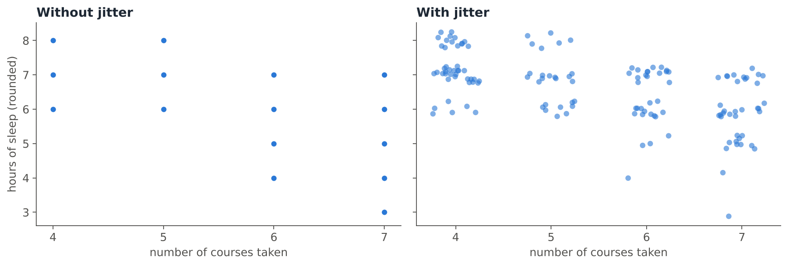{fig-alt="Two scatter plots of number of courses versus rounded hours of sleep for 140 students: without jitter only a few dots are visible; with jitter all points are visible."}

The data show 140 students, but the left plot seems to contain only about 15 dots. Why, and what does jittering do?

- Most students did not answer, so their dots are missing.
- Many students have exactly the same (courses, sleep) pair, so their dots are drawn on top of each other. Jittering adds a small amount of random noise so that the overlapping points become visible.
- Jittering removes outliers so that the plot looks cleaner.
- Jittering rounds the data so that more points fall on the same spot.

::: explain
Both variables are **discrete**, so dozens of students share each position: this is **overplotting**. The lecture: *jittering is the act of adding random noise to data in order to prevent overplotting.* For example, to a value of 1 you might add $u$, a uniform random number in $[-0.5,\, 0.5]$ (here we used $[-0.25,\, 0.25]$).
:::
::::

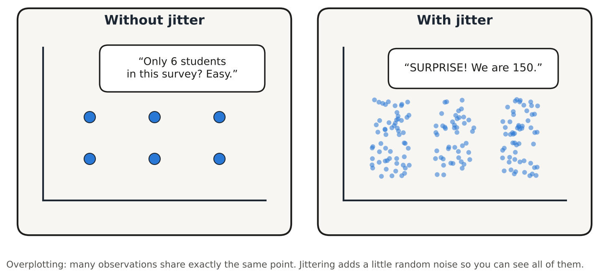{fig-align="center" fig-alt="Comic: without jitter the plot looks like 6 students; with jitter it shows about 150."}

<!-- ===================================================================== -->

:::: {.quiz type="ms" answer="a,c,d"}
Which statements about scatter plots and jittering are **true**? Select all that apply.

- Scatter plots are really only effective when both variables are continuous.
- Jittering is needed when both variables are continuous and no two observations are equal.
- With discrete data such as party size or years of education, a box plot at every level can be tedious and difficult to read, so a jittered scatter plot is a good alternative.
- When points overlap because there are many thousands of observations, jittering does not help, but transparency can lessen the overplotting.
- Jittering changes the relationship between the two variables.

::: explain
- **b is false:** jittering is for overlapping marks, typically from **discrete** data that is almost continuous.
- **e is false:** the noise is small; it only separates the overlapping marks so that the existing relationship can be seen.
:::
::::

# Part D — Case study: a courier's pilot study

A courier who delivers for a food app near METU recorded **all 300 orders** s/he delivered during eight weeks in spring 2026. *(The data were simulated for this recitation.)* The main question: **"Which factors are most related with the tip rate?"**

| Variable | Description |
|---|---|
| `TOTAL` | order total (₺) |
| `TIP` | tip (₺) |
| `PAY` | payment: App or Cash |
| `WEATHER` | Dry or Rainy |
| `DAY` | day of the week |
| `TIME` | Lunch or Dinner |
| `ITEMS` | number of items in the order |

Like the restaurant-tipping data of the lecture, this is a **pilot study**: there should be no temptation to make inferences about all customers. The aim is to explore the data and to formulate ideas for a careful study later.

<!-- ===================================================================== -->

:::: {.quiz type="fill"}
**Data restructuring.** A tip of ₺20 means something different on a ₺150 order than on a ₺600 order, so we create a new variable, the **tip rate** = TIP / TOTAL.

An order of ₺250 with a ₺20 tip has a tip rate of []{.blank answer="8" tol="0.01"} %. \
An order of ₺600 with a ₺30 tip has a tip rate of []{.blank answer="5" tol="0.01"} %.

**Table 1** (all 300 orders):

| | TOTAL (₺) | TIP (₺) | Tip rate (%) | ITEMS |
|---|:-:|:-:|:-:|:-:|
| Mean | 336.98 | 29.68 | 8.77 | 2.70 |
| SD | 117.63 | 17.82 | 3.78 | 1.30 |

On average, customers tipped about []{.blank answer="8.77" tol="0.3"} % of the order total.

::: explain
$20/250 = 0.08 = 8\%$ and $30/600 = 0.05 = 5\%$. The tip rate "calibrates" the tip according to the bill, so orders of different sizes can be compared. This is the first suggested approach in the lecture's tipping case study (data restructuring).
:::
::::

<!-- ===================================================================== -->

:::: {.quiz type="ms" answer="a,b,d"}
**Table 2:** average tip rate in % (number of orders) broken down by weather and time of day.

| | Lunch | Dinner | Total |
|---|:-:|:-:|:-:|
| **Dry** | 8.2 (120) | 8.6 (110) | 8.4 (230) |
| **Rainy** | 9.3 (6) | 10.2 (64) | 10.1 (70) |
| **Total** | 8.2 (126) | 9.2 (174) | 8.8 (300) |

Which statements are supported by Table 2? Select all that apply.

- On rainy days the average tip rate was higher than on dry days, both at lunch and at dinner.
- The courier delivered very few lunch orders on rainy days, so the average 9.3% is based on only 6 orders and should be interpreted with care.
- These data prove that rain makes all food-app customers in Ankara tip more.
- Most orders were delivered at dinner.
- The lowest average tip rate occurred on rainy dinners.

::: explain
- **a:** 9.3 > 8.2 at lunch and 10.2 > 8.6 at dinner.
- **b:** like the lecture's Friday lunch "with only 7 dining parties", an average based on very few observations is not reliable.
- **c is false:** this is a pilot study of **one** courier; there should be no temptation to make inferences, only to formulate ideas for a careful study.
- **d:** 174 of the 300 orders were at dinner.
- **e is false:** rainy dinners have the **highest** average tip rate (10.2%); the lowest are dry lunches (8.2%).
:::
::::

<!-- ===================================================================== -->

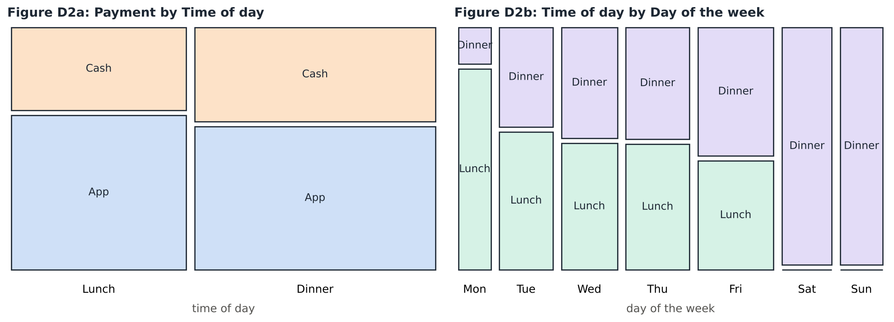{fig-alt="Two mosaic plots. Left: payment by time of day; the app and cash shares are about the same at lunch and dinner. Right: time of day by day of the week; Saturday and Sunday have no lunch orders and Monday has very few dinner orders."}

:::: {.quiz type="ms" answer="a,c,d"}
**Mosaic plots.** The width of each column shows how many orders fall in that category; the heights inside a column show the **conditional distribution** of the other variable. Which statements are supported by Figures D2a and D2b?

- In D2a, the share of app payments is roughly the same at lunch and at dinner, so payment method and time of day seem unrelated.
- In D2a, more orders were paid in cash than in the app.
- In D2b, there were no lunch orders on Saturday and Sunday.
- In D2b, Monday has very few dinner orders.
- In D2b, every day has the same number of orders.

::: explain
- **a:** the App/Cash split is about 65% / 35% at lunch and 60% / 40% at dinner: roughly equal rectangles across the categories, so no (strong) relationship. This is how the lecture read the "Smoking vs Sex" mosaic plot.
- **b is false:** the App rectangles are the larger ones in both columns (187 app vs 113 cash orders).
- **c, d:** the Saturday and Sunday columns are (almost) all "Dinner", and the Monday column is almost all "Lunch" (only 4 dinner orders).
- **e is false:** the columns have different widths, so the days have different numbers of orders.
:::
::::

<!-- ===================================================================== -->

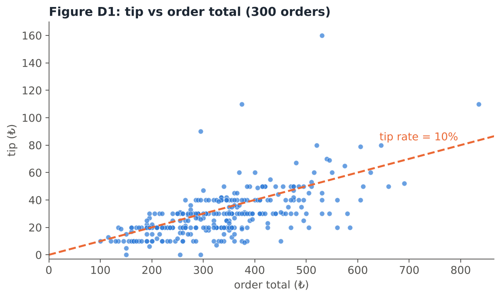{fig-alt="Scatter plot of tip versus order total for 300 orders, with a dashed line where the tip rate is 10%. Most points lie below the line, and the tips form horizontal rows at 10, 20, 30, 40 and 50 lira."}

:::: {.quiz type="ms" answer="a,b,c,e"}
Which statements are supported by Figure D1? Select all that apply.

- There is a positive, roughly linear relationship between the tip and the order total.
- Many points lie in horizontal rows at ₺10, ₺20, ₺30, …, so customers tend to round their tips to a multiple of ₺10.
- More points lie below the dashed 10% line than above it, so most customers tipped less than 10% of the order total.
- The plot proves that bigger orders cause bigger tips for every customer.
- There are more small orders (₺100–₺400) than very large ones, and a few very generous tips stand out.

::: explain
- **a, c, e:** In these data, 65% of the orders are below the 10% line, and the largest tip (₺160 on a ₺530 order, a 30% tip) is a clear outlier.
- **b:** 72% of the tips are multiples of ₺10. The rows of points are the scatter-plot version of the spikes we saw in histograms with narrow bars.
- **d is false:** a scatter plot shows a relationship; it does not prove anything about every customer, and this is only a pilot study.
:::
::::

<!-- ===================================================================== -->

:::: {.quiz type="mc" answer="c"}
**Comparative scatter plots.** A student drew tip vs order total separately for app and cash payments:

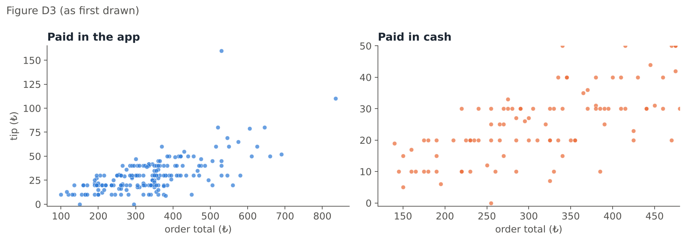{fig-alt="Two scatter plots side by side: app payments with tips up to 160 lira, and cash payments with a y-axis that only goes up to 50 and an x-axis that stops at about 480, so cash tips look larger."}

Looking at these plots, cash tips seem to be much larger than app tips. What is wrong?

- Nothing: the cash customers clearly tip more.
- The plots should be pie charts.
- The two plots use different scales on the axes, so they cannot be compared directly. Comparative scatter plots must use the same scales.
- The scatter plots should be replaced by histograms of tips.

::: explain
The cash plot has a $y$-axis from 0 to 50 (and a shorter $x$-axis), while the app plot goes up to 160, so the cash points are "stretched". The lecture's note on comparative scatter plots: *the scale on both plots is the same, to allow for direct comparison.* With the same scales the two groups look similar (average tip rate 8.9% for app and 8.5% for cash):

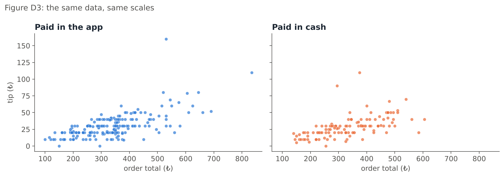{fig-alt="The same two scatter plots drawn with the same axis scales: the app and cash points look very similar."}
:::
::::

<!-- ===================================================================== -->

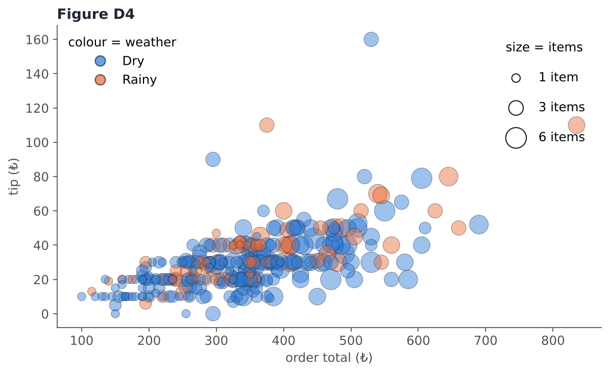{fig-alt="Bubble plot of tip versus order total; bubble size shows the number of items and colour shows dry or rainy weather."}

:::: {.quiz type="ms" answer="a,b,d"}
**Bubble plot for mixed relationships.** In Figure D4, which statements are true? Select all that apply.

- The plot shows four variables: TOTAL ($x$), TIP ($y$), ITEMS (bubble size) and WEATHER (colour).
- Bubble size is used for a numerical variable and colour for a categorical grouping.
- A bubble plot can only show two variables.
- Orders with more items (bigger bubbles) tend to have larger totals.
- Colour can only be used for numerical variables.

::: explain
- A **bubble chart** is an enhanced scatter plot: two numerical variables on the axes and a **third numerical variable** as bubble size. Extra variables can be added with **colours** (categorical grouping) and **shapes** (another categorical variable).
- **d:** the big bubbles are mostly on the right. With three numerical variables in one bubble chart we can make three pairwise comparisons (TOTAL vs TIP, TIP vs ITEMS, TOTAL vs ITEMS) and a three-way comparison.
:::
::::

# Part E — Case study: student flats near METU

A website listed **160 flats for rent** within 25 km of the METU campus in September 2026. *(The data were simulated for this recitation.)* For each flat we have the monthly `rent` (₺), the `size` (m²), the `distance` to campus (km), the building `age` (years), the `district` (Çankaya, Yenimahalle or Etimesgut) and whether it is `furnished`.

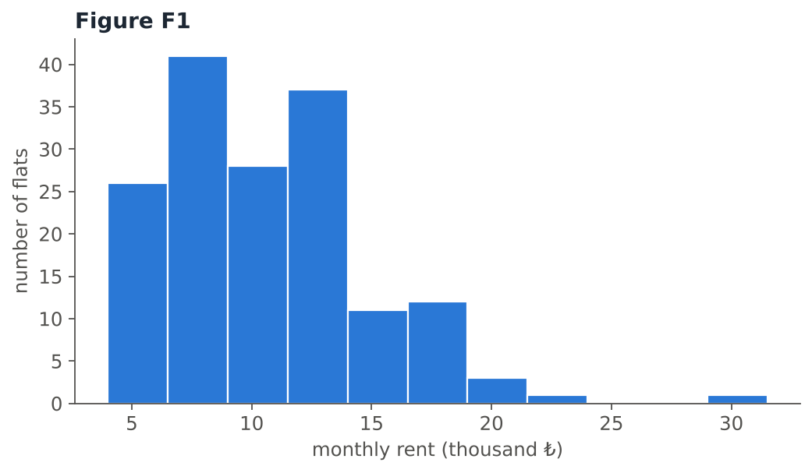{fig-alt="Figure F1: histogram of monthly rent, right-skewed with most flats between 5 and 15 thousand lira and one flat near 30 thousand."}

<!-- ===================================================================== -->

:::: {.quiz type="ms" answer="a,b,d,e"}
Use **Figure F1** (classes of width ₺2,500 starting at ₺4,000). Which statements are supported? Select all that apply.

- The distribution of rents is positively (right) skewed.
- Most flats rent for less than ₺15,000 a month.
- The histogram shows that bigger flats are more expensive.
- The modal class is ₺6,500–₺9,000.
- After a gap, one flat at almost ₺30,000 is far from the others: a potential outlier.
- Rent is a categorical variable, so a bar chart should be used instead.

::: explain
- **a, b:** the long tail is on the right; about 86% of flats are below ₺15,000.
- **c is not supported:** a histogram shows **one** variable. To see the relationship with size we need a scatter plot (Figure F2).
- **d:** the tallest bar (41 flats) is 6.5–9 thousand ₺.
- **e:** there are no flats between about ₺24,000 and ₺29,000, then one at ₺29,450.
- **f is false:** rent is numerical (continuous), so a histogram is the right graph.
:::
::::

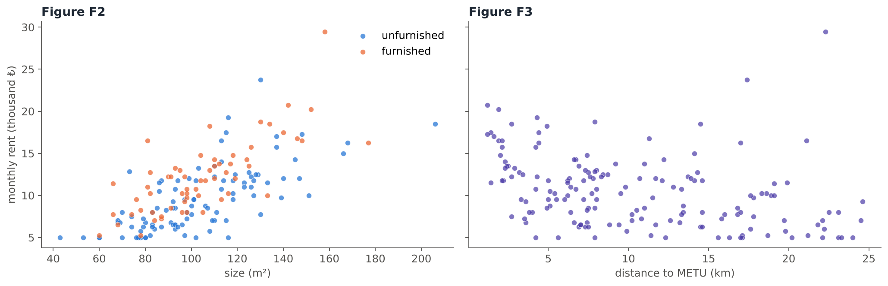{fig-alt="Figure F2: rent increases with size, furnished flats mostly above unfurnished ones. Figure F3: rent decreases with distance, steeply at first and then levelling off."}

<!-- ===================================================================== -->

:::: {.quiz type="ms" answer="a,b,c,f"}
Use **Figures F2 and F3**. Which statements are supported? Select all that apply.

- F2 shows a positive, roughly linear relationship between size and rent.
- For flats of the same size, furnished flats tend to be more expensive than unfurnished ones.
- F3 shows a negative nonlinear relationship: rent falls quickly over the first few kilometres and then levels off.
- F3 shows no relationship between distance and rent.
- F3 shows a strong positive relationship between distance and rent.
- In both plots, rent is the response variable.

::: explain
- **a, b:** the cloud in F2 rises from left to right, and the orange (furnished) points lie mostly above the blue ones. Colouring the points by group is a simple way to compare groups in one scatter plot.
- **c:** rent clearly decreases with distance, but along a **curve**: a negative nonlinear relationship (one of the typical patterns in the lecture). **d** and **e** are therefore false.
- **f:** rent is the outcome we want to understand, so it goes on the $y$-axis.
:::
::::

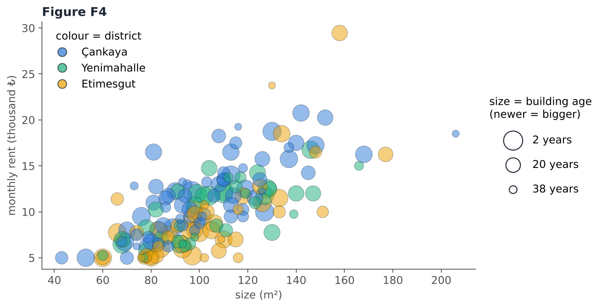{fig-align="center" width="640" fig-alt="Figure F4: bubble chart of size versus rent, bubble size by how new the building is and colour by district."}

<!-- ===================================================================== -->

:::: {.quiz type="mc" answer="c"}
In **Figure F4**, the position shows size and rent, the bubble size shows how **new** the building is (newer = bigger bubble), and the colour shows the district. How many variables are displayed in this one graph?

- 2
- 3
- 4
- 5

::: explain
Four: **size** ($x$), **rent** ($y$), **building age** (bubble size) and **district** (colour). Three are numerical and one, the colour, is a categorical grouping. Notice that the yellow (Etimesgut) bubbles tend to sit lower than blue (Çankaya) bubbles of the same size.
:::
::::

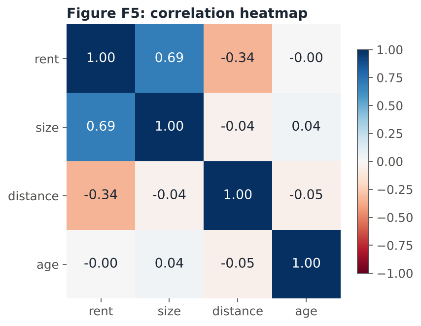{fig-align="center" width="560" fig-alt="Figure F5: correlation heatmap of rent, size, distance and age."}

<!-- ===================================================================== -->

:::: {.quiz type="fill"}
**Figure F5** is a correlation heatmap: each cell is the correlation coefficient of two variables.

The strongest linear relationship with rent is with []{.blank answer="size|floor area|size (m2)|size m2"}, with $r =$ []{.blank answer="0.69" tol="0.01"}. \
The correlation between rent and distance is $r =$ []{.blank answer="-0.34" tol="0.01"}. \
The correlation between rent and building age is approximately []{.blank answer="0" tol="0.02"}. \
The numbers on the diagonal are all equal to []{.blank answer="1" tol="0"}, because each variable is perfectly correlated with itself.

::: explain
- **Size:** $r = 0.69$, a fairly strong positive linear relationship.
- **Distance:** $r = -0.34$ looks weak, but F3 showed a clear **curved** relationship. $r$ measures only the **linear** relationship, so it understates a nonlinear pattern. Always look at the scatter plot too.
- **Age:** $r \approx 0$: almost no linear relationship with rent in these data.
- The heatmap is symmetric: the value above the diagonal equals the value below it.
:::
::::

# Part F — Your Turn

Try the following questions on paper first, then check your answers. 

<!-- ===================================================================== -->

:::: {.quiz type="fill"}
The waiting times (minutes) of **40** students at the campus ring-bus stop were recorded:

1.2, 1.3, 1.4, 1.5, 2.2, 2.2, 2.4, 2.6, 3.0, 3.3, 3.5, 3.7, 4.3, 4.6, 5.4, 5.4, 5.6, 5.6, 5.6, 5.8, 5.9, 6.0, 6.2, 6.5, 6.9, 7.4, 8.2, 8.3, 9.6, 9.9, 11.3, 11.3, 11.8, 13.9, 14.3, 18.1, 19.2, 21.4, 24.8, 28.6

**(a)** Using the table of the lecture, the number of classes should be between 5 and []{.blank answer="7" tol="0"}. \
**(b)** Using **6** classes, the class width is $(28.6 - 1.2)/6 =$ []{.blank answer="4.57" tol="0.01"}, rounded up to []{.blank answer="5" tol="0"} minutes. Start the first class at 0. \
**(c)** Complete the frequency distribution:

| Class | 0–5 | 5–10 | 10–15 | 15–20 | 20–25 | 25–30 |
|---|:-:|:-:|:-:|:-:|:-:|:-:|
| Frequency | []{.blank answer="14" tol="0"} | []{.blank answer="16" tol="0"} | []{.blank answer="5" tol="0"} | []{.blank answer="2" tol="0"} | []{.blank answer="2" tol="0"} | []{.blank answer="1" tol="0"} |

**(d)** The relative frequency of the class 5–10 is []{.blank answer="0.4" tol="0.001"}, and the modal class is []{.blank answer="5-10|5–10|5 - 10|5 to 10"}. \
**(e)** The histogram is []{.blank answer="positively skewed|right skewed|right-skewed|positively|skewed to the right|positive skew"}.

::: explain
**(a)** $n = 40 < 50$ → **5–7** classes. **(b)** Range $= 28.6 - 1.2 = 27.4$; $27.4 / 6 = 4.57$ → **5**. The first class starts at 0, which is smaller than the smallest value 1.2, and 6 classes of width 5 cover 0–30.

**(c)** Values below 5 run from 1.2 to 4.6: **14**; 5–10 (5.4 to 9.9): **16**; 10–15 (11.3, 11.3, 11.8, 13.9, 14.3): **5**; 15–20 (18.1, 19.2): **2**; 20–25 (21.4, 24.8): **2**; 25–30 (28.6): **1**. Check: $14 + 16 + 5 + 2 + 2 + 1 = 40$.

**(d)** $16/40 = 0.40$; the modal class is **5–10** (the highest bar).

**(e)** Most waiting times are short and a few are long: a long right tail, so **positively (right) skewed**. The value 28.6 is far from most others and could be checked as a potential outlier.

| Class | Frequency | Relative frequency |
|:-:|:-:|:-:|
| 0–5 | 14 | 0.350 |
| 5–10 | 16 | 0.400 |
| 10–15 | 5 | 0.125 |
| 15–20 | 2 | 0.050 |
| 20–25 | 2 | 0.050 |
| 25–30 | 1 | 0.025 |
| **Total** | **40** | **1.000** |
:::
::::

<!-- ===================================================================== -->

:::: {.quiz type="fill"}
Using the frequency distribution of **Q29**, a frequency polygon is drawn.

The points of the polygon are placed at $x = 2.5,$ []{.blank answer="7.5" tol="0.01"}$,\ 12.5,\ 17.5,\ 22.5,$ []{.blank answer="27.5" tol="0.01"}. \
The highest point is at $x =$ []{.blank answer="7.5" tol="0.01"} with height []{.blank answer="16" tol="0"}. \
To close the polygon, points with frequency 0 are added at $x =$ []{.blank answer="-2.5" tol="0.01"} and $x =$ []{.blank answer="32.5" tol="0.01"}.

::: explain
The points are at the **class midpoints** $(0+5)/2 = 2.5,\ 7.5,\ \dots,\ 27.5$ with heights 14, 16, 5, 2, 2, 1, joined by straight lines. The highest point is the midpoint of the modal class, (7.5, 16). The closing points lie one class width beyond the ends: $2.5 - 5 = -2.5$ and $27.5 + 5 = 32.5$ (they only bring the polygon down to the axis).
:::
::::

<!-- ===================================================================== -->

:::: {.quiz type="fill"}
An instructor recorded the number of practice quizzes ($x$) solved by six students and their midterm scores ($y$):

| $x$ (quizzes) | 1 | 2 | 3 | 4 | 5 | 6 |
|---|:-:|:-:|:-:|:-:|:-:|:-:|
| $y$ (score) | 45 | 50 | 62 | 58 | 70 | 81 |

**(a)** The explanatory variable is the number of []{.blank answer="quizzes|practice quizzes|quizzes solved|quiz"}, and the response variable is the midterm []{.blank answer="score|scores|midterm score"}. \
**(b)** $\bar{x} =$ []{.blank answer="3.5" tol="0.001"} and $\bar{y} =$ []{.blank answer="61" tol="0.001"}. \
**(c)** $\sum (x_i-\bar{x})(y_i-\bar{y}) =$ []{.blank answer="118" tol="0.01"}, $\sum (x_i-\bar{x})^2 =$ []{.blank answer="17.5" tol="0.01"} and $\sum (y_i-\bar{y})^2 =$ []{.blank answer="868" tol="0.01"}. \
**(d)** $r =$ []{.blank answer="0.96" tol="0.006"}. \
**(e)** The relationship is []{.blank answer="strong positive|strong, positive|strong positive linear|positive strong|very strong positive"} and linear.

::: explain
**(a)** The quizzes may explain changes in the score (the outcome), so $x$ = number of practice quizzes (horizontal axis) and $y$ = midterm score.

**(b)** $\bar{x} = 21/6 = 3.5$, $\bar{y} = 366/6 = 61$.

**(c)**

| $x$ | $y$ | $x - \bar{x}$ | $y - \bar{y}$ | $(x-\bar{x})(y-\bar{y})$ | $(x-\bar{x})^2$ | $(y-\bar{y})^2$ |
|:-:|:-:|:-:|:-:|:-:|:-:|:-:|
| 1 | 45 | −2.5 | −16 | 40 | 6.25 | 256 |
| 2 | 50 | −1.5 | −11 | 16.5 | 2.25 | 121 |
| 3 | 62 | −0.5 | 1 | −0.5 | 0.25 | 1 |
| 4 | 58 | 0.5 | −3 | −1.5 | 0.25 | 9 |
| 5 | 70 | 1.5 | 9 | 13.5 | 2.25 | 81 |
| 6 | 81 | 2.5 | 20 | 50 | 6.25 | 400 |
| | | | **Sum** | **118** | **17.5** | **868** |

**(d)** $$r = \frac{118}{\sqrt{17.5}\,\sqrt{868}} = \frac{118}{4.183 \times 29.462} = \frac{118}{123.25} = 0.96$$

**(e)** $r = 0.96$ is close to 1: a **strong positive linear** relationship. Students who solved more practice quizzes tended to get higher midterm scores.
:::
::::

<!-- ===================================================================== -->

:::: {.quiz type="open" keywords="skew|right|tail|unimodal; round|rounding|50|100|multiple|multimodal|peaks|spikes; 20|minimum|no amount|nothing below|less than"}
The amounts (₺) that 500 students loaded onto their transit cards are shown with three different bar widths.

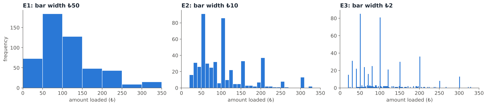{fig-alt="Three histograms of the same top-up amounts with bar widths 50, 10 and 2 lira. E1 looks right-skewed; E2 and E3 show tall spikes at 50, 100, 150, 200, 250 and 300 lira and smaller spikes at 20, 30, 40, 60, 70 and 80 lira, and nothing below 20 lira."}

Describe what each histogram tells you about the data. What do you learn from E2 and E3 that E1 hides? (4–6 sentences)

::: explain
**Model answer:**

- **E1 (₺50):** the distribution is unimodal and positively (right) skewed: most students load less than ₺150, and a few load large amounts up to ₺350.
- **E2 (₺10):** it is no longer a smooth unimodal shape; there are tall peaks at ₺50, ₺100, ₺150, ₺200, … with low bars in between.
- **E3 (₺2):** the histogram is clearly multimodal. The large peaks at multiples of ₺50, and smaller ones at ₺20, ₺30, ₺40, …, show that students **round** the amount they load to "nice" numbers. It is also clear that **no amount below ₺20** was loaded (perhaps a minimum top-up).
- **Lesson:** the bar width can hide or reveal features of the data. Wide bars show the overall shape; narrow bars show details such as rounding, gaps and outliers. 

:::
::::

<!-- ===================================================================== -->

:::: {.quiz type="classify" options="Relative-frequency histograms|Jittered scatter plot|Bubble chart|Comparative scatter plots (same scales)|Dot diagram|Mosaic plot"}
Choose the most appropriate graph for each task.

- Compare the exam score distributions of a class of 35 students and a class of 140 students :: Relative-frequency histograms
- Show the relationship between number of siblings and number of pets for 500 students (both are small whole numbers) :: Jittered scatter plot
- Show the relationship among three continuous variables (height, weight and age) in a single graph :: Bubble chart
- Show tip vs bill separately for male and female bill payers so the two groups can be compared :: Comparative scatter plots (same scales)
- Find unusual values among 12 measurements of the boiling point of a liquid :: Dot diagram
- Show whether the faculty (Engineering / Arts and Sciences / Architecture) and dormitory use (yes / no) of students are related :: Mosaic plot

::: explain
- **Different group sizes** → relative frequencies, with the same classes.
- **Discrete data with many repeated pairs** → overplotting, so jitter the points (add a little random noise).
- **Three numerical variables** → bubble chart: $x$, $y$ and bubble size.
- **Same relationship in two groups** → comparative scatter plots, drawn on the **same scales** to allow direct comparison.
- **A small data set and unusual values** → dot diagram, whose aim is to identify unusual features.
- **Two categorical variables** → mosaic plot, which shows the conditional distributions; roughly equal rectangles across categories suggest no relationship.

:::
::::

<!-- ===================================================================== -->

:::: {.quiz type="open" keywords="dorm|dormitory; home|live at home; 3|three|few|small|only|reliable|careful|caution; pilot|infer|inference|cannot|general|all students"}
In a small pilot study, students wore step counters for one week. The table shows the **average daily steps (thousands)** and, in parentheses, the **number of students**:

| | Lives in a dorm | Lives at home | Total |
|---|:-:|:-:|:-:|
| **Prep** | 9.1 (40) | 6.2 (35) | 7.7 (75) |
| **1st year** | 8.4 (52) | 5.9 (60) | 7.1 (112) |
| **4th year** | 11.5 (3) | 6.4 (48) | 6.7 (51) |
| **Total** | 8.8 (95) | 6.1 (143) | 7.2 (238) |

Write **three** observations from the table. At least one of them must be a warning about how to interpret the table.

::: explain
**Model answer (any three of these):**

1. In every year, students who live in a dorm walk more on average than students who live at home (e.g. 8.4 vs 5.9 thousand steps for 1st-year students).
2. For students who live at home, the averages are similar in all years (5.9–6.4 thousand steps).
3. **Warning:** the highest average, 11.5 thousand steps for 4th-year dorm students, is based on only **3 students**.
4. Most 4th-year students live at home, so their total average (6.7) is lower partly because so few of them live in a dorm.
5. **Warning:** this is a pilot study; there should be no temptation to make inferences about all students. It can only suggest ideas for a careful study.

:::
::::

<!-- ===================================================================== -->

:::: {.quiz type="ms" answer="b,c,e,g"}
Which of the following statements are **true**? Select all that apply. 

- A histogram can have gaps between its boxes if the classes are categories.
- The vertical axis of a histogram may show frequency, relative frequency or percent, and the shape stays the same.
- A modal class is the class with the largest number of observations.
- If $r = 0$, there is no relationship of any kind between $x$ and $y$.
- Jittering adds a small amount of random noise to the data to prevent overplotting.
- In a bubble chart, the bubble size must represent a categorical variable.
- An outlier may be a correct measurement that represents a rare event.
- An open-ended class can only be formed at the upper end of a histogram.

::: explain
- **a is false:** a histogram consists of adjoining boxes, and it is not suitable for categorical data.
- **d is false:** $r = 0$ means no **linear** correlation; a strong nonlinear (e.g. U-shaped) relationship can still exist.
- **f is false:** bubble size shows a third **numerical** variable; colours or shapes are used for categorical variables.
- **h is false:** an open-ended class can be formed at the higher **or** the lower end.
:::
::::

All data sets on this page were created for this recitation. The patterns are realistic, but the numbers are not real measurements.

