<style>
mjx-container[display="true"] { overflow-x: auto; overflow-y: hidden; max-width: 100%; }
div.quiz.qz-match { display: block; margin-top: 1.6rem; }
.qz-match-left mjx-container { max-width: 100%; overflow-x: auto; overflow-y: hidden; }
@media (max-width: 700px) { main table { display: block; max-width: 100%; overflow-x: auto; } }
.pts { font-weight: 700; color: #0f7c74; }
.qz-row-ctrls, .qz-row-ctrls > * { min-width: 0; max-width: 100%; }
.qz-row-ctrls select { width: 100%; }
</style>

## How to use this page

Each question below is interactive. Click an option or type an answer, then press **Check** (or <kbd>Enter</kbd>). **Show answer** reveals the solution and the explanation, and **Reset** clears the question so you can try again.


::: quiz-scoreboard
Progress
:::

# Part A — Many numerical variables

::: {.callout-note collapse="false"}
## Key terms

- **Scatter plot matrix:** when a data set has many continuous variables, we draw the scatter plots of **all pairwise combinations** of the variables and arrange them in a matrix. Row $i$, column $j$ shows variable $i$ against variable $j$.
- **Correlation plot:** shows the correlation coefficient $r$ for every pair of variables, often with coloured circles (colour = sign, size = strength).
- **Drawback of a correlation plot:** it does not give any information about the **nonlinearity** of a relationship; it only measures the **linear** relationship. If there is a nonlinear relationship, we can apply a **transformation** to the variables, such as $\log(x)$, to satisfy linearity.
- **Variable types in the data:** a variable stored as numbers is not always numerical. Codes such as 0/1 for "automatic/manual" or the number of cylinders (4, 6, 8) are **categories**, so they should be converted to **factors** before plotting.
:::

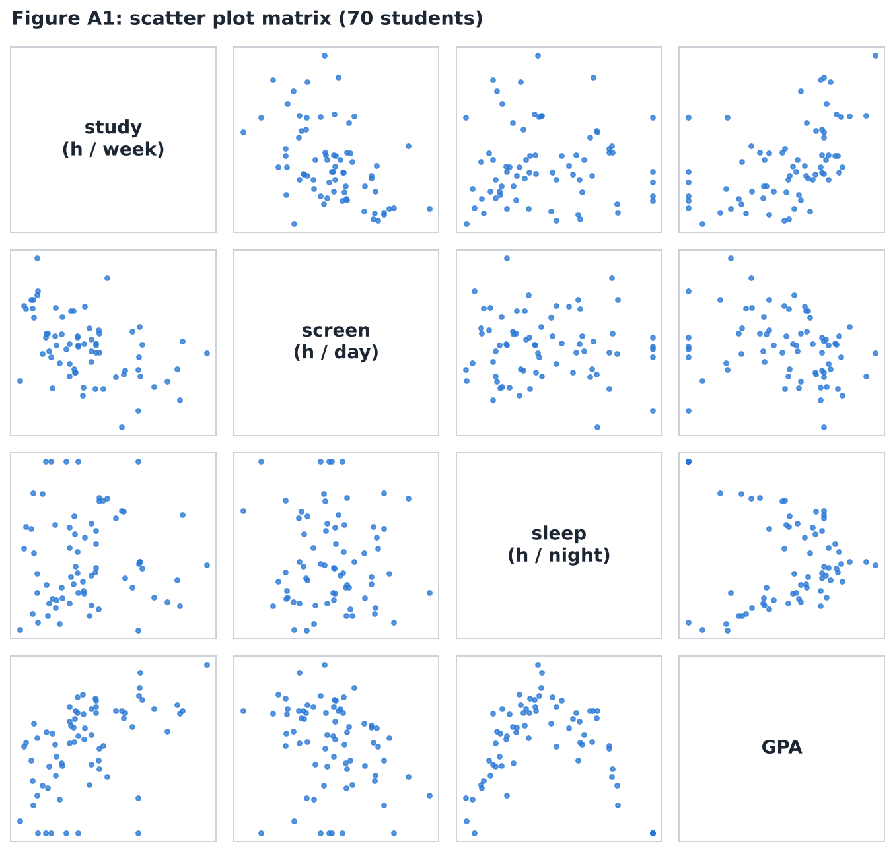{fig-alt="Figure A1: a 4 by 4 scatter plot matrix of study hours per week, screen time per day, sleep per night and GPA for 70 students. Study and GPA rise together; study and screen fall together; sleep and GPA form an upside-down U."}

<!-- ===================================================================== -->

:::: {.quiz type="fill"}
Use **Figure A1** (70 students; variables: study hours per week, screen time per day, sleep per night and GPA).

A scatter plot matrix of 4 variables contains []{.blank answer="6" tol="0"} **different** pairs of variables (each pair appears twice, above and below the diagonal). \
The panel in row "GPA", column "study" shows a []{.blank answer="positive|positive linear|positive, linear"} relationship. \
The panel in row "screen", column "study" shows a []{.blank answer="negative|negative linear|negative, linear"} relationship. \
The pair with an upside-down U (curved) shape is sleep and []{.blank answer="GPA|gpa"}.

::: explain
- With 4 variables there are $\binom{4}{2} = 6$ pairs: study–screen, study–sleep, study–GPA, screen–sleep, screen–GPA, sleep–GPA. The panels above the diagonal are the mirror images of those below it (axes swapped).
- Students who study more tend to have a **higher** GPA and **less** screen time.
- **Sleep–GPA:** GPA is highest around 7 hours of sleep and lower for both very short and very long sleep: a **nonlinear** relationship.
:::
::::

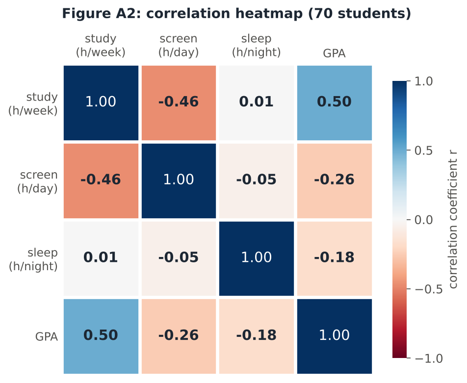{fig-align="center" width="560" fig-alt="Figure A2: correlation plot of study, screen, sleep and GPA with circles for each pair."}

<!-- ===================================================================== -->

:::: {.quiz type="fill"}
Use the correlation plot **Figure A2**, made from the same data.

The strongest positive correlation is between study and []{.blank answer="GPA|gpa"}, with $r =$ []{.blank answer="0.5" tol="0.005"}. \
The strongest negative correlation is between study and []{.blank answer="screen|screen time"}, with $r =$ []{.blank answer="-0.46" tol="0.005"}. \
The correlation between sleep and GPA is only $r =$ []{.blank answer="-0.18" tol="0.005"}.


::: explain
Darker tiles mean stronger correlations: study–GPA ($r = 0.50$, blue = positive) and study–screen ($r = -0.46$, red = negative). Ignore the dark diagonal: it only shows that each variable is perfectly correlated with itself ($r = 1$). Sleep–GPA has only a pale tile ($r = -0.18$), even though Figure A1 shows a clear pattern for this pair (see the next question).
:::
::::

<!-- ===================================================================== -->

:::: {.quiz type="mc" answer="c"}
Figure A2 says sleep and GPA are only weakly correlated ($r = -0.18$), but Figure A1 shows a clear upside-down U. How do you explain this?

- The correlation plot is wrong; $r$ was computed incorrectly.
- Sleep and GPA are not related at all.
- The relationship is strong but **nonlinear**; a correlation plot only measures the linear relationship, so it cannot show this pattern.
- The scatter plot matrix exaggerates relationships, so we should trust only the correlation plot.

::: explain
This is the drawback of correlation plots stated in the lecture: they give no information about the **nonlinearity** of a relationship. Always look at the scatter plot matrix together with the correlation plot. For a nonlinear relationship, a **transformation** of the variables (such as $\log(x)$) can sometimes make it linear.
:::
::::

<!-- ===================================================================== -->

:::: {.quiz type="classify" options="Quantitative|Qualitative (factor)"}
A data set on 40 phones was read into R. Its structure looks like this:

```
'data.frame':  40 obs. of  6 variables:
 $ price   : num  18999 24500 15999 ...
 $ battery : num  4500 5000 4000 ...
 $ weight  : num  187 201 174 ...
 $ cameras : num  2 3 2 ...
 $ fiveG   : num  1 1 0 ...    (0 = no, 1 = yes)
 $ brand   : num  1 3 2 ...    (1 = A, 2 = B, 3 = C)
```

Which variables should be treated as numerical and which should be converted to factors?

- price :: Quantitative
- battery (mAh) :: Quantitative
- weight (g) :: Quantitative
- cameras (number of rear cameras: 2, 3 or 4) :: Qualitative (factor)
- fiveG :: Qualitative (factor)
- brand :: Qualitative (factor)

::: explain
- `fiveG` and `brand` are **codes** for categories: their numbers have no numerical meaning (brand 3 is not "three times" brand 1).
- `cameras` takes only a few values that define groups (2, 3 or 4 cameras), so it is treated as a factor.
- Once these are factors, they can be used for colour, shape or separate panels instead of appearing in a scatter plot matrix as if they were continuous.
:::
::::

# Part B — Box plots, violin plots and split violin plots

::: {.callout-note collapse="false"}
## Key terms: read the four plots

A box plot uses only five numbers, so it **cannot show** whether a distribution is bimodal or multimodal. A **violin plot** adds the **density** on each side. Adding the points (**strip plot**) gives the complete view, and a **split violin** compares two groups inside one violin.

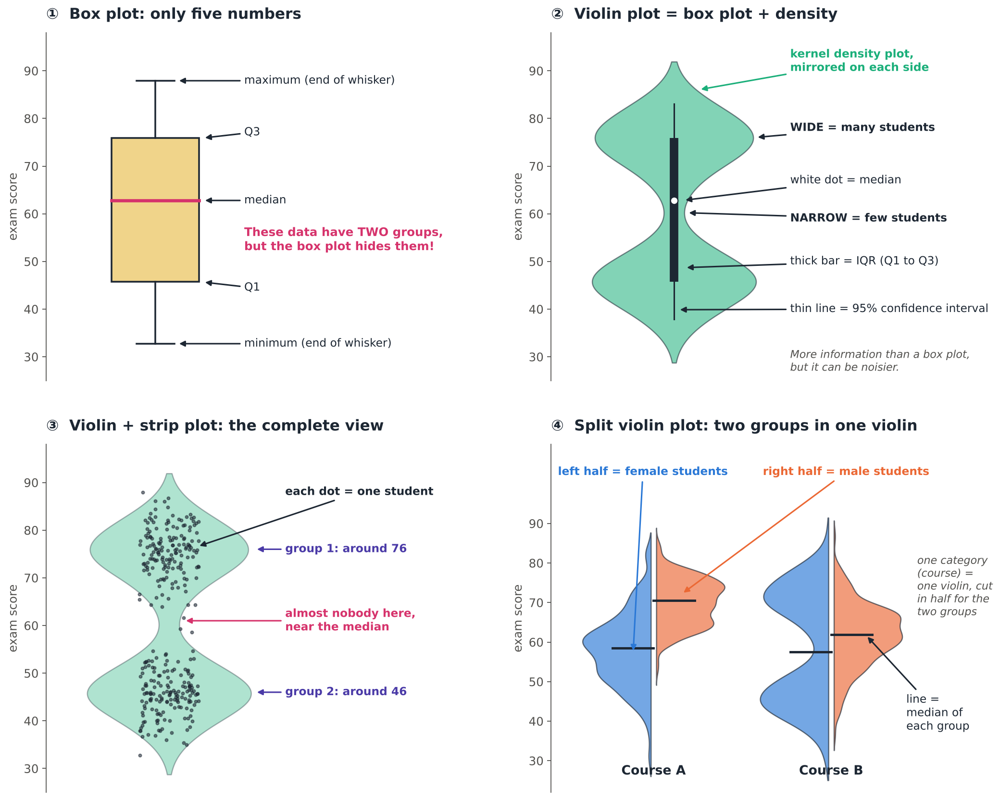{fig-alt="Four annotated plots of the same exam scores. 1: a box plot with labels for minimum, Q1, median, Q3 and maximum, and a note that it hides the two groups. 2: a violin plot with labels: kernel density mirrored on each side, wide means many students, narrow means few students, white dot is the median, thick bar is the interquartile range, thin line is the 95% confidence interval. 3: the violin with every student as a dot, showing groups around 46 and 76 and almost nobody near the median. 4: split violins for two courses, left half female students, right half male students, with a median line in each half."}

:::

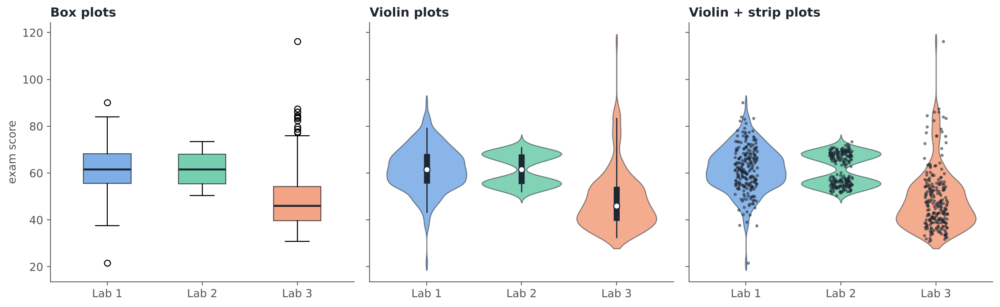{fig-alt="Exam scores in three labs drawn as box plots, violin plots, and violin plus strip plots. Labs 1 and 2 have almost identical box plots, but the violin of Lab 2 has two separate bulges. Lab 3 is right-skewed."}


<!-- ===================================================================== -->

:::: {.quiz type="mc" answer="b"}
Labs 1 and 2 have almost the same box: $Q_1 \approx 55$, median $\approx 61.5$, $Q_3 \approx 68$. What do the violin plots reveal?

- Lab 2 has a higher median than Lab 1.
- Lab 2 is bimodal: its scores form two groups, around 55 and around 68, with few students near the median.
- Lab 1 is bimodal.
- Lab 3 is symmetric.

::: explain
The box plot uses only five numbers, so it hides the two peaks of Lab 2. The violin's width shows the density: Lab 2 has two bulges and a narrow "waist" exactly at the median. Lab 1 is unimodal and roughly symmetric; Lab 3 is right-skewed (long upper tail). The third panel adds the individual points (a strip plot), which confirms the two groups in Lab 2.
:::
::::

<!-- ===================================================================== -->

:::: {.quiz type="classify" options="Median|Interquartile range|95% confidence interval|Density (how frequent the values are)"}
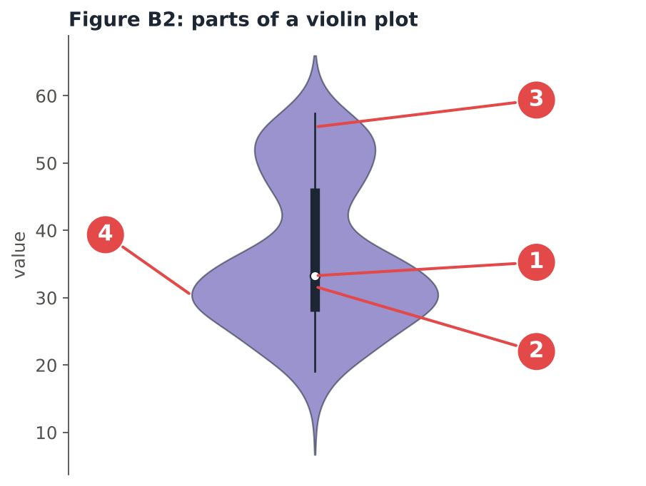{fig-align="center" width="420" fig-alt="A violin plot with four numbered labels: 1 points to the white dot, 2 to the thick black bar, 3 to the thin black line, 4 to the width of the violin."}

What does each numbered part of the violin plot show?

- 1 (white dot) :: Median
- 2 (thick black bar) :: Interquartile range
- 3 (thin black line) :: 95% confidence interval
- 4 (width of the violin) :: Density (how frequent the values are)

::: explain
The inside of the violin is a small box plot: the white dot is the **median** and the thick bar spans the **interquartile range** ($Q_1$ to $Q_3$); the thin line shows the **95% confidence interval**. The outline is a **kernel density plot**, mirrored on both sides: the wider the violin at a value, the more observations there are near that value. This violin is wide around 30 and again around 52: it is bimodal.
:::
::::

<!-- ===================================================================== -->

:::: {.quiz type="ms" answer="a,b,d"}
Which statements about box plots and violin plots are **true**? Select all that apply.

- A violin plot combines a box plot with a kernel density plot drawn on each side.
- Two groups can have nearly identical box plots but very different violin plots.
- A box plot clearly shows whether a distribution is bimodal.
- Violin plots display more information than box plots, but they can be noisier.
- In a violin plot, the thick black bar shows the range from the minimum to the maximum.

::: explain
- **c is false:** with box plots you can't see if the distribution is bimodal or multimodal.
- **e is false:** the thick bar is the **interquartile range**; the thin line shows the 95% confidence interval.
:::
::::

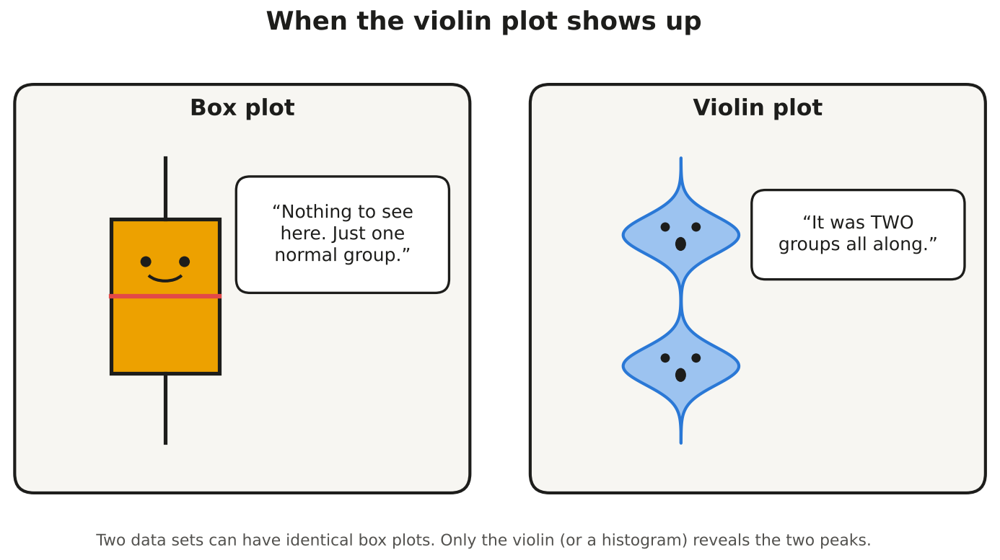{fig-align="center" fig-alt="Comic: a box plot claims to be one normal group, but the violin plot reveals two groups."}

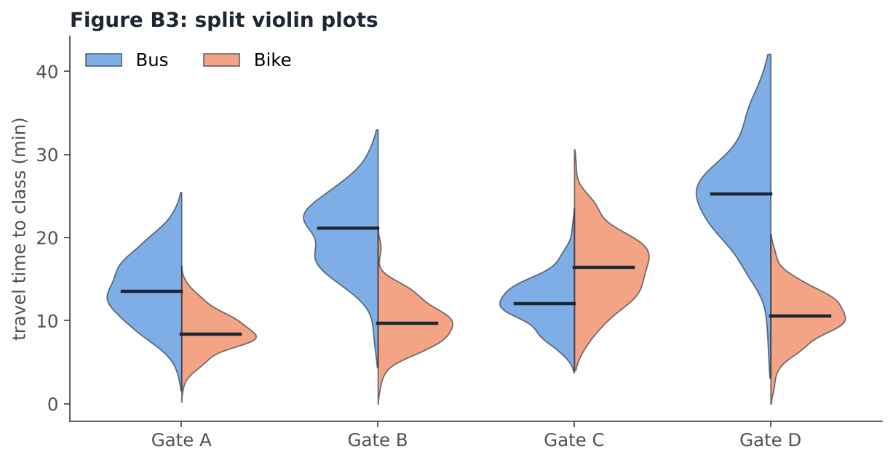{fig-alt="Figure B3: split violin plots of travel time to class at four campus gates. Left halves are bus users, right halves are bike users, with a median line in each half."}

<!-- ===================================================================== -->

:::: {.quiz type="fill"}
**Figure B3** shows travel time to class for students who come by **bus** (left, blue halves) and by **bike** (right, orange halves), at four campus gates.

The only gate where bike users are **slower** than bus users is Gate []{.blank answer="C|c"}. \
The largest difference between the bus and bike medians is at Gate []{.blank answer="D|d"}: about 25 minutes for bus users vs about []{.blank answer="10.6" tol="1"} minutes for bike users. \
The group with the **widest spread** of travel times is the []{.blank answer="bus|bus users"} users at Gate D.

::: explain
- In a split violin each category (gate) has one violin whose two halves are the two groups, so the groups can be compared directly at each gate.
- Gate C: bike median ≈ 16 min vs bus median ≈ 12 min, the only reversal.
- Gate D: bus ≈ 25 min vs bike ≈ 11 min. The blue half at Gate D is also the tallest (from about 3 to 42 minutes): bus travel times there vary the most.
:::
::::

# Part C — Lollipop, slope and dumbbell charts

::: {.callout-note collapse="false"}
## Key terms

- **Lollipop chart:** conveys the same information as a bar chart. By reducing the thick bars into thin lines with a dot, it **reduces clutter** and lays more emphasis on the **value**.
- **Slope chart:** a great tool to visualize **change in value and ranking** between categories (for example from one year to the next). Each category is a line between the two time points.
- **Dumbbell plot:** shows **relative positions** (like growth and decline) **between two points in time**, or compares the **distance between two categories**. To display the dumbbells in the desired order, arrange the levels of the $y$ variable (e.g. by the size of the change).
:::

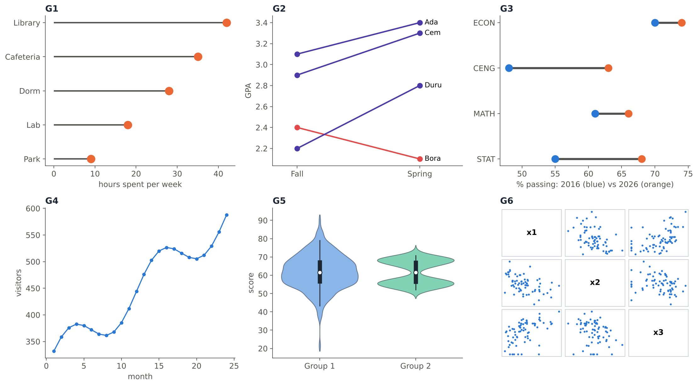{fig-alt="Six small graphs labelled G1 to G6."}

<!-- ===================================================================== -->

:::: {.quiz type="classify" options="Dumbbell plot|Line chart|Slope chart|Violin plot|Lollipop chart|Scatter plot matrix" label="Name that graph"}
Name each graph in the gallery above.

- G1 :: Lollipop chart
- G2 :: Slope chart
- G3 :: Dumbbell plot
- G4 :: Line chart
- G5 :: Violin plot
- G6 :: Scatter plot matrix

::: explain
- **G1:** thin lines with a dot at the value: a bar chart with less ink.
- **G2:** each student's GPA in two semesters joined by a line; crossing lines show changes in **ranking**.
- **G3:** two dots per department (2016 and 2026) joined by a bar that shows the change.
- **G4:** a variable plotted over time with the points connected in time order.
- **G5:** box plot + mirrored density on each side.
- **G6:** all pairwise scatter plots of three variables, arranged in a matrix.
:::
::::

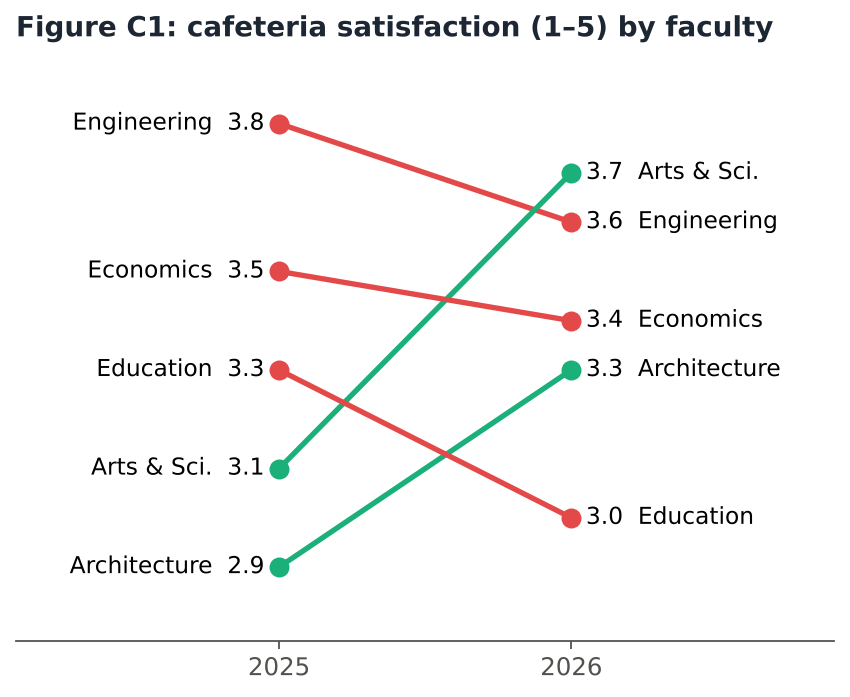{fig-align="center" width="560" fig-alt="Figure C1: slope chart of cafeteria satisfaction by faculty in 2025 and 2026."}

<!-- ===================================================================== -->

:::: {.quiz type="fill"}
Use the slope chart **Figure C1** (cafeteria satisfaction, scale 1–5).

The faculty with the largest **increase** is []{.blank answer="Arts & Sci.|Arts and Sciences|Arts & Sciences|Arts and Sci|Arts"}, by []{.blank answer="0.6" tol="0.01"} points. \
The number of faculties whose score **decreased** is []{.blank answer="3|three" tol="0"}. \
Ranked first in 2025: []{.blank answer="Engineering"}. Ranked first in 2026: []{.blank answer="Arts & Sci.|Arts and Sciences|Arts & Sciences|Arts and Sci|Arts"}. \
Education fell from rank 3 to rank []{.blank answer="5|five|last" tol="0"}.

::: explain
- Changes: Engineering 3.8 → 3.6 (−0.2), Arts & Sci. 3.1 → 3.7 (**+0.6**), Economics 3.5 → 3.4 (−0.1), Architecture 2.9 → 3.3 (+0.4), Education 3.3 → 3.0 (−0.3). Three red (falling) lines.
- Ranks in 2025: Engineering, Economics, Education, Arts & Sci., Architecture. In 2026: Arts & Sci., Engineering, Economics, Architecture, Education.
- The slope chart shows **both** the change in value (the slope) and the change in **ranking** (lines crossing).
:::
::::

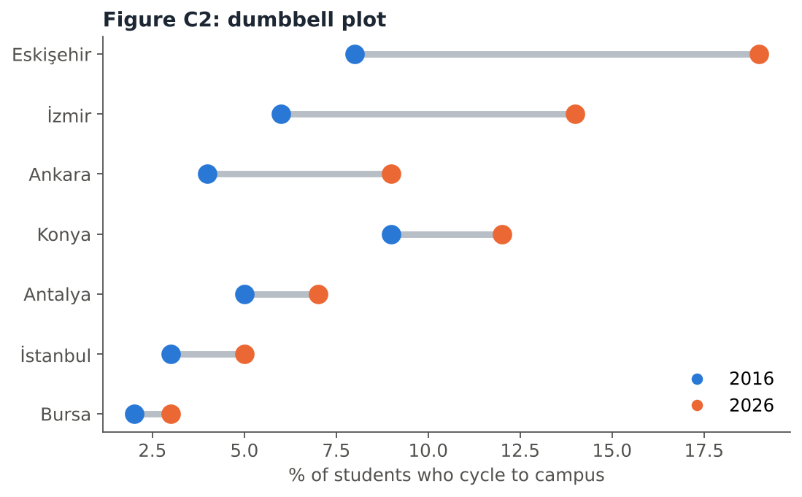{fig-align="center" width="600" fig-alt="Figure C2: dumbbell plot of the percentage of students who cycle to campus in 2016 and 2026 for seven cities, sorted by the size of the change."}

<!-- ===================================================================== -->

:::: {.quiz type="fill"}
Use the dumbbell plot **Figure C2** (% of students who cycle to campus).

The city with the largest increase from 2016 to 2026 is []{.blank answer="Eskişehir|Eskisehir"}, from 8% to []{.blank answer="19" tol="0"}%. \
The city with the smallest increase is []{.blank answer="Bursa"}. \
In 2016 the highest percentage was in []{.blank answer="Konya"}. \
The cities are sorted by the []{.blank answer="change|increase|size of the change|difference|growth|gap"} between the two years.

::: explain
Each dumbbell joins the 2016 value (blue) and the 2026 value (orange); the grey bar's length is the change. Eskişehir: 8 → 19 (+11), Bursa: 2 → 3 (+1). In 2016 Konya had the highest value (9%), but by 2026 two cities (Eskişehir and İzmir) had passed it.

The lecture's tip: to display the dumbbells in the desired order, arrange the levels of the $y$ variable. Sorting by the size of the change makes the comparison immediate.
:::
::::

<!-- ===================================================================== -->

:::: {.quiz type="match"}
Match each graph with the job it does best.

- Lollipop chart :: Compare values across categories like a bar chart, with less clutter
- Slope chart :: Show the change in value and in ranking between two time points
- Dumbbell plot :: Show growth or decline between two points in time for each category
- Violin plot :: Show the shape of a distribution, including several peaks
- Scatter plot matrix :: Look at all pairwise relationships among many continuous variables
- Line chart :: Show how a variable changes over successive points in time

::: explain
Choosing the graph starts with the question: *compare categories* (lollipop), *show change* (slope, dumbbell, line), *show relationships* (scatter plot matrix) or *show distributions* (violin).
:::
::::

# Part D — Time-series data and line charts

::: {.callout-note collapse="false"}
## Key terms

- Data can be classified by the time they are collected: **cross-sectional data** are all collected **once** in time; **time-series data** are collected at **successive points in time**.
- Time-series data are often depicted on a **line chart**: a plot of the variable over time, with the points connected in time order.
:::

<!-- ===================================================================== -->

:::: {.quiz type="classify" options="Time series|Cross-sectional"}
Are these **time-series** or **cross-sectional** data?

- Turkey's monthly inflation rate from 2015 to 2026 :: Time series
- The daily number of visitors to the METU library during October :: Time series
- The rents of 160 flats near METU in September 2026 :: Cross-sectional
- Your weight, measured every Monday for a year :: Time series
- The GPAs of all STAT 112 students this semester :: Cross-sectional
- The heights of the players of the national basketball team in 2026 :: Cross-sectional

::: explain
**Time series:** one unit (a country, a library, a person) observed at successive points in time; the **order** matters. **Cross-sectional:** many units measured **once**, at the same point in time.
:::
::::

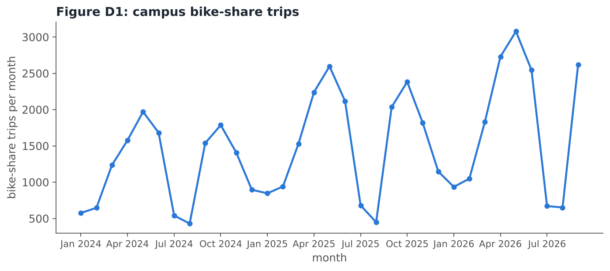{fig-alt="Figure D1: line chart of monthly campus bike-share trips from January 2024 to September 2026. Trips rise each spring and autumn, drop sharply in July and August and in winter, and the peaks get higher every year."}

<!-- ===================================================================== -->

:::: {.quiz type="ms" answer="a,b,c,e"}
Use the line chart **Figure D1** (monthly bike-share trips on campus). Which statements are supported? Select all that apply.

- There is an upward trend: the peaks get higher from 2024 to 2026.
- Every year, the number of trips drops sharply in July and August.
- Trips are also low in the winter months (December–February).
- The number of trips is the same every month.
- The highest number of trips in the period is in spring 2026.
- A histogram of the 33 monthly values would show the same information as the line chart.

::: explain
- **a, e:** the spring peaks rise from about 2,000 (2024) to about 2,600 (2025) and 3,100 (May 2026).
- **b, c:** a repeating pattern: low during the summer break and in winter, high in spring and autumn (semesters).
- **f is false:** a histogram ignores the **order** of the months, so the trend and the yearly pattern would disappear. For time-series data, use a line chart.
:::
::::

# Part E — Gestalt principles

::: {.callout-note collapse="false"}
## Key terms

- **Gestalt** is a German word meaning "whole", "shape" or "form". The Gestalt principle is a psychological term developed in the **1920s**: people tend to organize visual elements into groups or **"unified wholes"**. *The whole is greater than its parts.*
- **Gestalt laws** (Wertheimer, Köhler and Koffka) explain how we group smaller objects to form larger ones (**perceptual organization**):
  - **Closure:** the brain fills in gaps or missing lines to see a complete shape.
  - **Proximity:** objects that are **close** to one another are seen as one group.
  - **Similarity:** objects that share visual traits (size, colour, texture, dimension, shape, orientation) are seen as a group.
  - **Prägnanz (simplicity):** we reduce complex shapes to the **simplest** form possible.
  - **Continuity:** the eye follows paths, lines and curves rather than abrupt changes.
  - **Common region:** objects inside the **same bounded region** are seen as one group.
  - **Figure–ground:** the mind separates the **figure** (focal object) from the **ground** (background). Usually the larger area is seen as the ground and the smaller as the figure; lighter and darker colours influence this.
  - **Focal point:** the eye is captured by the element that is **different** from its surroundings.
:::

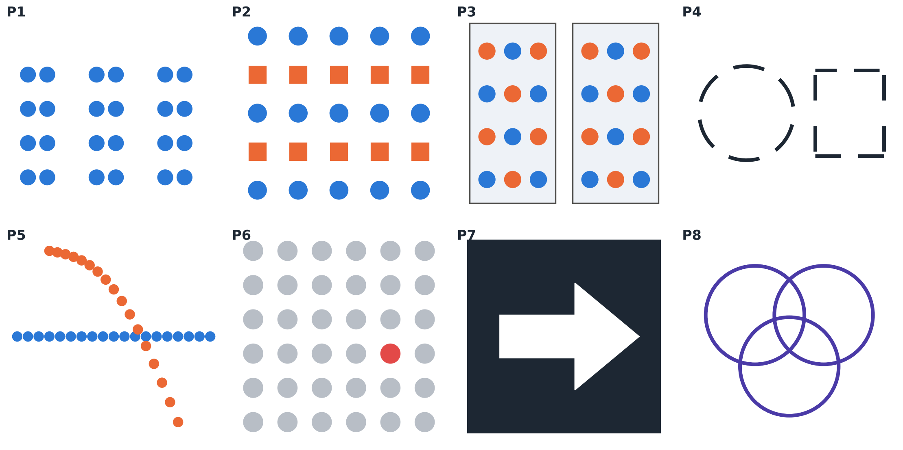{fig-alt="Eight small pictures labelled P1 to P8 illustrating Gestalt principles."}

<!-- ===================================================================== -->

:::: {.quiz type="classify" options="|Closure|Figure-ground|Similarity|Common region|Proximity|Focal point|Continuity|Prägnanz" label="Name that principle"}
Which Gestalt principle does each picture illustrate best?

- P1 :: Proximity
- P2 :: Similarity
- P3 :: Common region
- P4 :: Closure
- P5 :: Continuity
- P6 :: Focal point
- P7 :: Figure-ground
- P8 :: Prägnanz

::: explain
- **P1:** 24 identical dots, but the spacing makes us see **three groups**.
- **P2:** we see **rows** of circles and rows of squares (same shape and colour belong together).
- **P3:** the colours alternate, yet we group the dots by the **box** they are in; common region overrides colour.
- **P4:** a circle and a square with gaps: the brain fills in the missing parts.
- **P5:** we see one straight line and one curve crossing, not two broken pieces; the eye follows the smoothest path.
- **P6:** the single red dot catches the eye immediately.
- **P7:** the white arrow is the **figure** and the black area is the **ground**.
- **P8:** we see three overlapping circles, the simplest interpretation, rather than many complicated curved pieces.
:::
::::


<!-- ===================================================================== -->

:::: {.quiz type="tf" answer="true"}
In a figure–ground picture, our brain generally interprets the **larger** area as the ground (background) and the **smaller** area as the figure, although light and dark colours can change what is seen as the figure.

::: explain
**True.** This is how the lecture describes the figure–ground principle. Because it uses negative space, it is similar to the closure principle, and some pictures can be read in two ways, depending on which area you see as the figure.
:::
::::

# Part F — Gestalt principles in data visualization

::: {.callout-note collapse="false"}
## Key terms

- Data visualization is "how to tell **stories** with data", helping the audience understand what is sometimes difficult to see. All visualizations at the end are **exploratory**.
- The Gestalt principles help us decide which elements of a visual are **informative** and which are **noise**; they guide decisions when building a graph or a dashboard, and help the reader organize and interpret it **quickly**.
- **Workflow for presentation visuals:** (1) define the **purpose** of the visual and its intended **audience**; (2) create a **story** to give your message; (3) consider **aesthetic / design principles**.
- **In graphs:**
  - **Simplicity:** apply a sort order.
  - **Enclosure:** shade an area to separate it, e.g. forecast vs actual.
  - **Closure:** remove chart borders and background shading.
  - **Continuity:** remove unnecessary axis lines; aligned bars are still seen as aligned.
  - **Connection:** connect the dots with lines to show order.
  - **Focus point:** highlight the important points with colour.
- **In dashboards:**
  - **Enclosure:** containers group related elements.
  - **Similarity:** colour links points that belong together.
  - **Proximity:** keep text close to its chart and place small multiples together.
:::


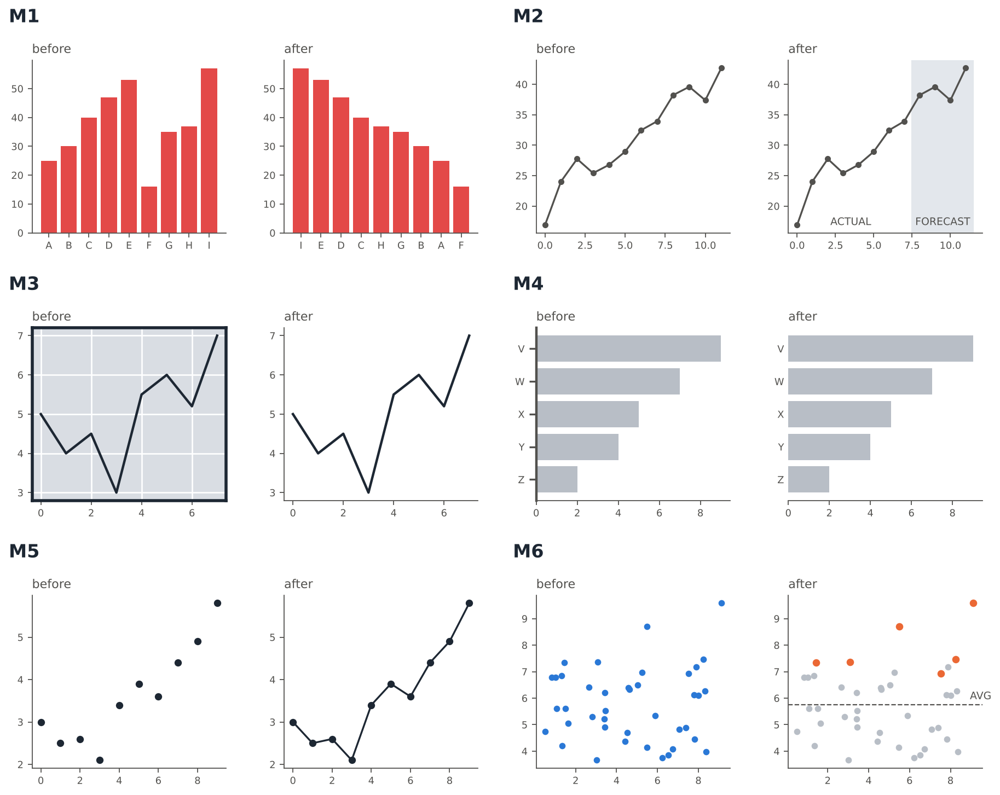{fig-alt="Six before-and-after pairs of small charts labelled M1 to M6."}

<!-- ===================================================================== -->

:::: {.quiz type="classify" options="Simplicity|Enclosure|Closure|Continuity|Connection|Focus point" label="Name that makeover"}
Each pair above shows a chart **before** and **after** a makeover. Which principle does each makeover use?

- M1 :: Simplicity
- M2 :: Enclosure
- M3 :: Closure
- M4 :: Continuity
- M5 :: Connection
- M6 :: Focus point

::: explain
- **M1, simplicity:** the bars are sorted, so the order is easy to read.
- **M2, enclosure:** the shaded area separates the forecast from the actual data.
- **M3, closure:** the border and background shading are removed; the graph still looks complete, and the data stand out more.
- **M4, continuity:** the $y$-axis line is removed; the bars still look aligned because of the consistent white space.
- **M5, connection:** lines connect the dots and help the eye see the order.
- **M6, focus point:** the important points are coloured, the rest are grey, and an average line gives context.
:::
::::

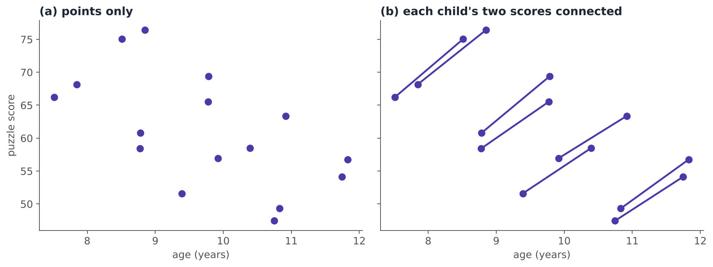{fig-alt="Two scatter plots of puzzle score against age for 8 children each measured twice, one year apart. In panel a, older children seem to score lower. In panel b, each child's two points are connected and every line goes up."}

<!-- ===================================================================== -->

:::: {.quiz type="mc" answer="c"}
Eight children each solved a puzzle test **twice**, one year apart. Panel (a) shows only the points; panel (b) connects each child's two scores. What does the connection reveal?

- Both panels show that children get worse at puzzles as they grow older.
- Connecting the points changes the data, so panel (b) cannot be trusted.
- Panel (a) suggests that older children score lower, but panel (b) shows that **every child improved** over the year; the lower scores belong to children who started lower.
- Panel (b) shows that age and puzzle score are not related.

::: explain
Without connections, the cloud slopes downward ($r \approx -0.59$): the older children in this sample happen to have lower scores. Connecting each child's two measurements uses the **connection** principle: now we see the change **within each child** (every line goes up) separately from the **differences between children** (their starting levels).
:::
::::

<!-- ===================================================================== -->

:::: {.quiz type="ms" answer="a,b,d"}
You are designing a dashboard. Which choices use the Gestalt principles correctly? Select all that apply.

- Put a short explanation text right next to the chart it describes (proximity).
- Use the same colour for the same region in every chart of the dashboard (similarity).
- Spread five related small charts randomly around the page so that each one gets attention.
- Draw a light container around the filters and charts that belong to the same topic (enclosure / common region).
- Keep the default thick border and grey background on every chart so that each chart looks important.

::: explain
- **c is wrong:** related small multiples should be placed **together** (proximity + similarity); if they are spread out randomly, the grouping is less obvious.
- **e is wrong:** by the closure principle, borders and background shading can be removed; the graph still looks complete and the data stand out more.
:::
::::

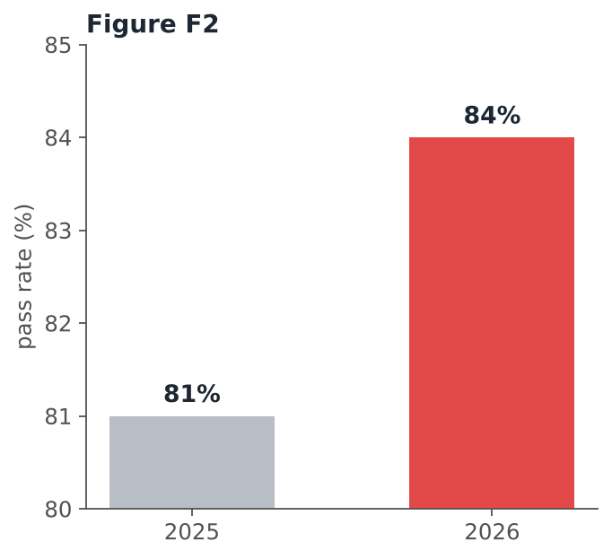{fig-align="center" width="330" fig-alt="Figure F2: bar chart of pass rates, 81% in 2025 and 84% in 2026, with the y-axis from 80 to 85, so the 2026 bar looks four times as tall."}

<!-- ===================================================================== -->

:::: {.quiz type="fill"}
**Figure F2** shows the pass rate of a course in 2025 and 2026. Its $y$-axis starts at **80**, not at 0.

The 2025 bar is 81 − 80 = 1 unit tall and the 2026 bar is []{.blank answer="4" tol="0"} units tall, so the 2026 bar **looks** []{.blank answer="4" tol="0"} times as tall. \
In reality, the pass rate increased by only []{.blank answer="3" tol="0"} percentage points.

::: explain
Because the axis starts at 80, the bars show only the part above 80: 1 vs 4 units, so the 2026 bar looks **four times** as tall. In fact $84/81 \approx 1.04$. Starting a bar chart with a **non-zero baseline** is a classic way to make small differences look huge (the lecture's "Bad examples"). Bars should start at zero:

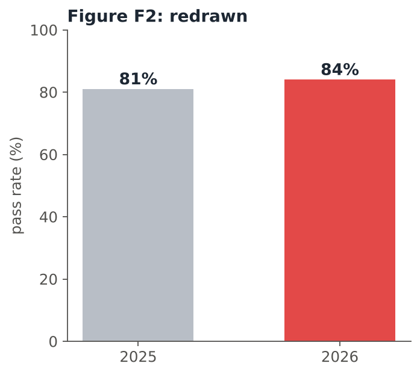{fig-align="center" width="330" fig-alt="The same bar chart with the y-axis from 0 to 100: the two bars look almost the same."}
:::
::::

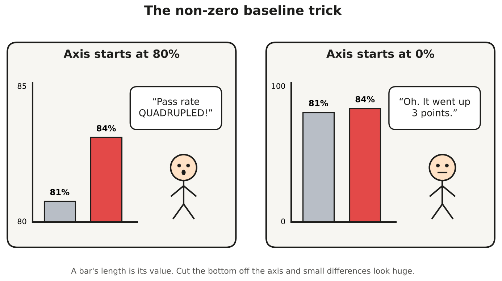{fig-align="center" fig-alt="Comic: with an axis starting at 80% a 3-point increase looks like the pass rate quadrupled; with an axis starting at 0% it is clearly a small increase."}

<!-- ===================================================================== -->

:::: {.quiz type="mc" answer="b"}
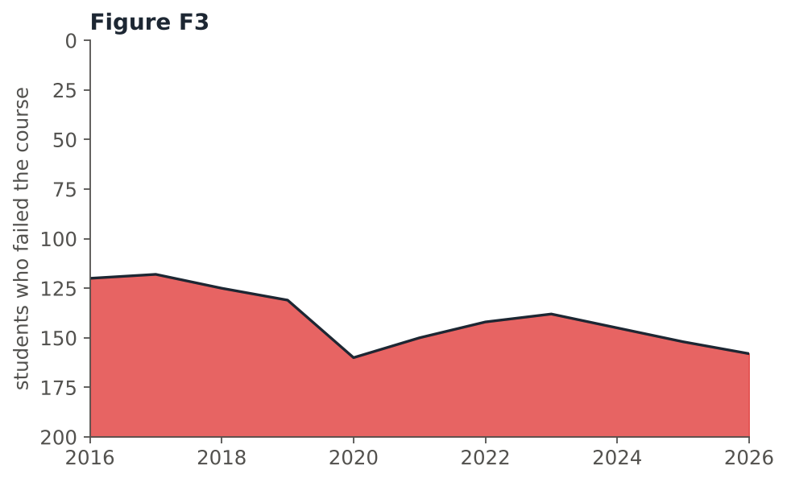{fig-align="center" width="520" fig-alt="Figure F3: area chart of the number of students who failed a course from 2016 to 2026, drawn with the y-axis upside down (0 at the top)."}

**Figure F3** shows the number of students who failed a course each year. Most readers who look at it quickly conclude that the number of failures **decreased**, especially in 2020. Why?

- Because failures really decreased.
- The $y$-axis is upside down (0 at the top), and the filled red area looks like an ordinary chart, so rising values look like falling ones.
- Because the chart has no title.
- Because the chart uses too many colours.

::: explain
In fact the number of failures **increased** (from about 120 to about 160), with a peak in 2020. Our perception organizes the red region as the **figure** and reads its upper edge as "the values", so the inverted orientation leads to misperception. This is the lecture's bad example: the designer did not mean to mislead, but the way we perceive shapes produced the wrong message. Redrawn in the usual orientation:

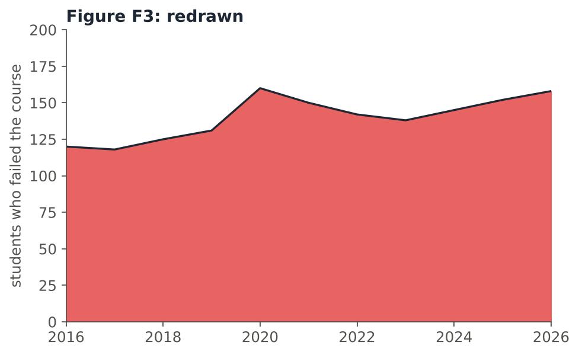{fig-align="center" width="520" fig-alt="The same data with 0 at the bottom: the number of failures clearly increases."}
:::
::::

# Part G — YOUR TURN

<!-- ===================================================================== -->

:::: {.quiz type="classify" label="Question 1" options="Scatter plot matrix|Violin plot|Split violin plot|Lollipop chart|Slope chart|Dumbbell plot|Line chart"}
Choose the most appropriate graph for each task.

- Compare the distribution of exam scores in 4 sections and check whether any section has two peaks :: Violin plot
- Compare the travel times of male and female students at each of 5 dormitories in one graph :: Split violin plot
- Show the number of books borrowed from the library each week during one semester :: Line chart
- Show 12 students' rankings in the midterm and in the final, including who moved up or down :: Slope chart
- Examine all pairwise relationships among 6 continuous variables of a data set :: Scatter plot matrix
- Show the average score of 15 courses with less clutter than a bar chart :: Lollipop chart
- Show the unemployment rate in 2015 and in 2025 for 10 provinces and how much it changed :: Dumbbell plot

::: explain
Distributions with possible multiple peaks → **violin**; two groups within each category → **split violin**; successive points in time → **line chart**; change in value **and ranking** → **slope chart**; many continuous variables → **scatter plot matrix**; a bar chart with less ink → **lollipop**; two time points for each category → **dumbbell**.
:::
::::

<!-- ===================================================================== -->

:::: {.quiz type="open" label="Question2" keywords="sort|order|simplicity; border|background|closure|grid|shading; colour|color|highlight|focus|grey|gray; zero|baseline|0; proximity|label|close|title|text"}
A student made the following bar chart for a presentation: 20 cities in **alphabetical order**, every bar a **different colour**, a **thick black border** and a **grey background with grid lines**, and a $y$-axis that starts at **40**. The message she wants to give is: *"Ankara has the lowest air pollution among these cities."*

Suggest **four** improvements, and name the principle behind each one.

::: explain
**Model answer:**

1. **Simplicity:** sort the bars by value (not alphabetically), so the lowest value is easy to find.
2. **Focus point:** colour only Ankara's bar (e.g. orange) and make all others grey; the eye goes straight to the message.
3. **Closure:** remove the thick border, the grey background and most grid lines; the graph still looks complete and the data stand out.
4. **Bad example (non-zero baseline):** start the $y$-axis at **0**; otherwise the differences between cities are exaggerated.
5. **Proximity:** put a short message title or label close to Ankara's bar, so that the text and the bar are read together.
6. The **workflow** starts with purpose and audience: the story ("Ankara is the lowest") decides the design.
:::
::::

<!-- ===================================================================== -->

:::: {.quiz type="open" label="Question 3" keywords="box|five|5; bimodal|two peaks|two groups|multimodal; density|width|wide; violin|histogram"}
Two classes have **exactly the same** minimum, $Q_1$, median, $Q_3$ and maximum. A student concludes: *"The two classes have the same distribution."* Is the student right? Explain, and suggest a graph that checks the claim.

::: explain
**Model answer:** No. The student only looked at the box plot (five numbers). A box plot's simplicity hides how the values are distributed between those five numbers; for example, one class could be **bimodal** (two groups of students) while the other is unimodal, and the box plots would still be identical. A **violin plot** (box plot + kernel density on each side), or a histogram, shows the density: where the violin is wide, there are many students. Adding the points (violin + strip plot) gives a complete view.
:::
::::

<!-- ===================================================================== -->

:::: {.quiz type="ms" label="Question 4" answer="a,c,d,g"}
Which statements are **true**? Select all that apply. 

- A correlation plot cannot show whether a relationship is nonlinear.
- Cross-sectional data are collected at successive points in time.
- A dumbbell plot shows the difference between two time points for each category.
- By the closure principle, removing chart borders and background shading usually makes the data stand out more.
- The law of Prägnanz says that the eye is captured by the element that is different from its surroundings.
- A lollipop chart shows different information from a bar chart.
- Objects inside the same bounded area are perceived as one group.
- Variables coded as 0/1 should always be treated as numerical variables.

::: explain
- **b is false:** that is **time-series** data; cross-sectional data are collected once.
- **e is false:** that is the **focal point** principle; Prägnanz is the law of **simplicity**.
- **f is false:** a lollipop chart conveys the **same** information as a bar chart, with less clutter.
- **g is true:** common region / enclosure.
- **h is false:** 0/1 codes are categories and should be converted to **factors**.
:::
::::

:::: {.quiz type="classify" options="Proximity|Similarity|Common region|Closure|Continuity|Focal point|Figure-ground|Prägnanz"}
Which principle explains each everyday observation?

- On a phone's home screen, the four app icons inside a folder are seen as one group :: Common region
- In a group photo of a team in identical red shirts, the one person in a yellow shirt is noticed first :: Focal point
- A dashed outline of a parking space is still seen as one rectangle :: Closure
- On a menu, the drinks listed close together under each other are read as one group, separate from the desserts further down :: Proximity
- On a map, all the blue lines are understood as rivers and all the red lines as roads :: Similarity
- When two roads cross on a map, we see two continuous roads, not four separate pieces :: Continuity

::: explain
- **Common region:** the folder's boundary groups the icons.
- **Focal point:** the element that is different from its surroundings captures the eye.
- **Closure:** the brain fills in the gaps of the dashed line.
- **Proximity:** items close together are seen as related.
- **Similarity:** same colour → same kind of thing.
- **Continuity:** the eye follows the smoothest path through the crossing.
:::
::::

<p style="font-size:.85rem;color:#6c757d;margin-top:2rem">All data sets on this page were created for this recitation. The patterns are realistic, but the numbers are not real measurements.</p>
