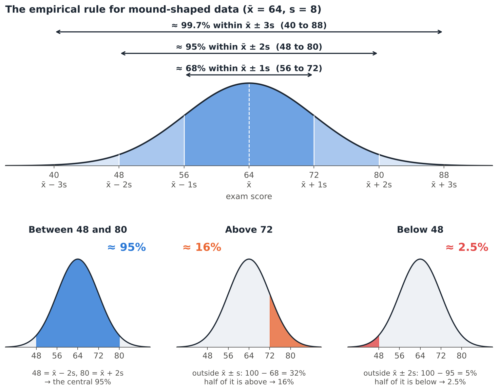
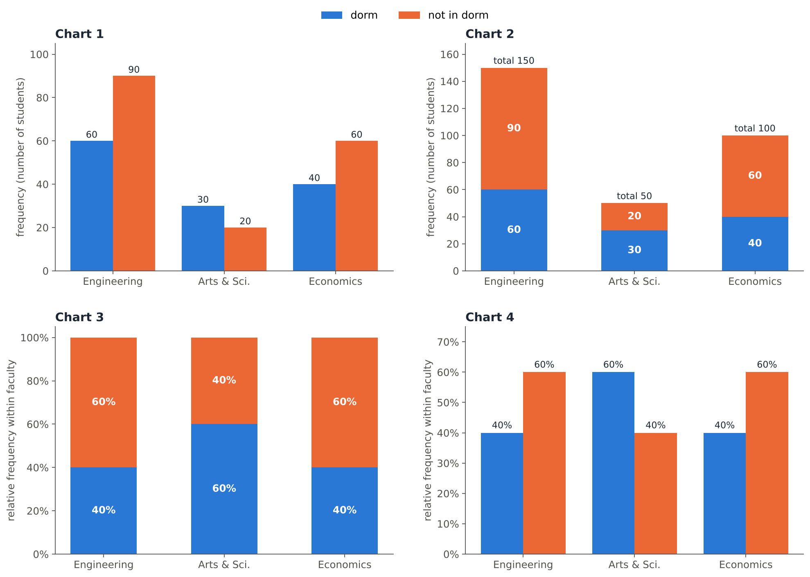

<style>
mjx-container[display="true"] { overflow-x: auto; overflow-y: hidden; max-width: 100%; }
div.quiz.qz-match { display: block; margin-top: 1.6rem; }
@media (max-width: 700px) { main table { display: block; max-width: 100%; overflow-x: auto; } }
.qz-row-ctrls, .qz-row-ctrls > * { min-width: 0; max-width: 100%; }
.qz-row-ctrls select { width: 100%; }
.pts { font-weight: 700; color: #0f7c74; }
</style>


# ⚡ Warm-up: lightning round

```{=html}
<div class="rv rv-lightning" data-time="90">
  <div class="rv-head"><span class="rv-num">Challenge</span><span class="rv-type">Lightning round · 12 statements · 90 seconds</span></div>
  <p>True or false? Answer as fast as you can; the review at the end explains every statement.</p>
  <ol class="rv-items" hidden>
    <li data-a="F">A parameter is a numerical summary of a sample.<span class="why">A <b>parameter</b> describes the <b>population</b>; a <b>statistic</b> describes a sample.</span></li>
    <li data-a="T">Temperature in °C is measured on an interval scale.<span class="why">Differences are meaningful, but 0 °C is not "no temperature": no true zero.</span></li>
    <li data-a="T">The median is more robust to outliers than the mean.<span class="why">The mean uses every value, so one extreme value can pull it far away; the median only depends on the middle.</span></li>
    <li data-a="F">The sample variance divides the sum of squared deviations by n.<span class="why">The sample variance divides by <b>n − 1</b>.</span></li>
    <li data-a="T">If every value is multiplied by 2, the standard deviation is multiplied by 2.<span class="why">For y = a + bx, s<sub>y</sub> = |b| s<sub>x</sub>.</span></li>
    <li data-a="F">A histogram is a good graph for the blood types of 300 donors.<span class="why">Blood type is categorical; histograms are not suitable for qualitative data.</span></li>
    <li data-a="T">In a right-skewed distribution the mean is usually larger than the median.<span class="why">The long right tail pulls the mean up.</span></li>
    <li data-a="F">r = −0.9 shows a weaker linear relationship than r = 0.5.<span class="why">Strength is |r|: 0.9 > 0.5. The sign only gives the direction.</span></li>
    <li data-a="F">A box plot always shows whether a distribution is bimodal.<span class="why">A box plot uses only five numbers; a violin plot is needed to see two peaks.</span></li>
    <li data-a="T">Time-series data are collected at successive points in time.<span class="why">Cross-sectional data are collected once; time-series data at successive points in time.</span></li>
    <li data-a="T">By the proximity principle, objects that are close together are seen as one group.<span class="why">That is the Gestalt law of proximity.</span></li>
    <li data-a="T">Starting a bar chart's y-axis at a non-zero value can exaggerate differences.<span class="why">A bar's length represents its value; cutting the axis makes small differences look huge.</span></li>
  </ol>
  <div class="rv-stage"></div>
</div>
```

<!-- ===================================================================== -->

:::: {.quiz type="classify" options="Parameter|Variable|Population|Sample|Statistic"}
METU wants to know the average weekly study time of **all its 30,000 students**. A survey of **500 students** finds an average of **14.2 hours**. Classify each item.

- All 30,000 METU students :: Population
- The 500 surveyed students :: Sample
- The average weekly study time of all 30,000 students (unknown) :: Parameter
- 14.2 hours :: Statistic
- Weekly study time :: Variable

::: explain
**P**opulation ↔ **P**arameter, **S**ample ↔ **S**tatistic. The 14.2 hours is computed from the sample, so it is a statistic used to estimate the unknown parameter.
:::
::::

```{=html}
<div class="rv tg" id="tg-scales">
  <div class="rv-head"><span class="rv-num">Challenge</span><span class="rv-type">Tick table · Nominal · Ordinal · Interval · Ratio</span></div>
  <p>Tick (✔) a cell whenever the scale <b>provides</b> that property. Click a cell to add or remove a tick, then press <b>Check</b>.</p>
  <div class="tg-scroll">
    <ul class="tg-data" hidden>
      <li data-answer="0111">The “order” of values is known</li>
      <li data-answer="1111">“Counts”, aka “Frequency distribution”</li>
      <li data-answer="1111">Mode</li>
      <li data-answer="0111">Median</li>
      <li data-answer="0011">Mean</li>
      <li data-answer="0011">Can quantify the difference between each value</li>
      <li data-answer="0011">Can add or subtract values</li>
      <li data-answer="0001">Can multiply and divide values</li>
      <li data-answer="0001">Has a “true zero”</li>
    </ul>
  </div>
  <div class="tg-legend" hidden><span><i class="tg-key tg-key-ok">✔</i> correct tick</span><span><i class="tg-key tg-key-bad">✔</i> wrong tick</span><span><i class="tg-key tg-key-miss">✔</i> missing tick</span></div>
  <div class="rv-controls"><button type="button" class="btn btn-sm btn-primary" data-act="check">Check</button><button type="button" class="btn btn-sm btn-outline-secondary" data-act="show">Show answer</button><button type="button" class="btn btn-sm btn-outline-secondary" data-act="reset">Reset</button></div>
  <div class="rv-feedback" role="status" aria-live="polite"></div>
  <div class="rv-explain" hidden>
    <p>Each scale keeps everything the previous one provides and adds one new property:</p>
    <p class="tg-ladder"><b>Nominal</b> (labels, counts, mode) → <b>Ordinal</b> (+ order, median) → <b>Interval</b> (+ measurable differences, mean, + and −) → <b>Ratio</b> (+ true zero, × and ÷)</p>
    <ul>
      <li><b>Nominal</b> (blood type, city): only counts and the mode.</li>
      <li><b>Ordinal</b> (letter grades, satisfaction 1–5): ranked, so the median exists; the gaps are not measurable, so no mean.</li>
      <li><b>Interval</b> (°C, calendar year): 30 °C − 20 °C = 10 °C makes sense, but 40 °C is <i>not</i> twice as hot as 20 °C (no true zero).</li>
      <li><b>Ratio</b> (height, income, time): 0 means "none", so 180 cm <i>is</i> twice 90 cm.</li>
    </ul>
  </div>
</div>
```

<!-- ===================================================================== -->

:::: {.quiz type="classify" options="Nominal|Ordinal|Interval|Ratio ; Qualitative|Quantitative" columns="Scale ; Data type"}
Choose the **scale** and the **type of data** for each variable.

- A student's hometown :: Nominal ; Qualitative
- T-shirt size (S, M, L, XL) :: Ordinal ; Qualitative
- Year of birth :: Interval ; Quantitative
- Monthly rent in ₺ :: Ratio ; Quantitative
- Number of siblings :: Ratio ; Quantitative
- Course evaluation from 1 (poor) to 5 (excellent) :: Ordinal ; Qualitative

::: explain
- **Year of birth** has no true zero (year 0 is not "no time"), so it is interval.
- **Number of siblings** is a count with a true zero (0 = no siblings): ratio, and it is **discrete**.
- A 1–5 rating is ordered, but the gaps between the categories are not measurable: ordinal.
:::
::::

<!-- ===================================================================== -->

:::: {.quiz type="mc" answer="c"}
**Which one doesn't belong?** Three of these variables are measured on the same scale.

- Eye colour
- Marital Status
- Job Seniority 
- Car Brands
- Nationality

::: explain
Job Seniority is **ordinal** (Junior < Mid-level < Senior < Executive); the other four are  **nominal**: categories with no natural order.
:::
::::

<!-- ===================================================================== -->

```{=html}
<div class="rv rv-steps">
  <div class="rv-head"><span class="rv-num">Challenge</span><span class="rv-type">Step by step · each correct step unlocks the next</span></div>
  <p>Six students report how much they spent on coffee last week (₺): <b>40, 55, 35, 70, 45, 55</b>. Type each answer and press <kbd>Enter</kbd>. Round to 2 decimals.</p>
  <div class="rv-step" data-answer="300" data-tol="0.01"><span class="rv-step-n">1</span> The sum of the values, Σx = <input type="text" inputmode="decimal" aria-label="sum"><span class="rv-note">Then x̄ = 300 / 6 = <b>50 ₺</b>.</span></div>
  <div class="rv-step" data-answer="50" data-tol="0.01"><span class="rv-step-n">2</span> The <b>median</b> (order the data first!) = <input type="text" inputmode="decimal" aria-label="median"><span class="rv-note">Ordered: 35, 40, 45, 55, 55, 70. With n = 6 (even), median = (45 + 55) / 2 = <b>50</b>. The <b>mode</b> is 55, the <b>range</b> is 70 − 35 = 35.</span></div>
  <div class="rv-step" data-answer="800" data-tol="0.01"><span class="rv-step-n">3</span> The sum of squared deviations, Σ(x − x̄)² = <input type="text" inputmode="decimal" aria-label="sum of squares"><span class="rv-note">Deviations: −10, 5, −15, 20, −5, 5 (they sum to 0). Squares: 100 + 25 + 225 + 400 + 25 + 25 = <b>800</b>.</span></div>
  <div class="rv-step" data-answer="160" data-tol="0.01"><span class="rv-step-n">4</span> The sample variance, s² = <input type="text" inputmode="decimal" aria-label="variance"><span class="rv-note">s² = 800 / (n − 1) = 800 / 5 = <b>160 ₺²</b>. (Dividing by 6 is the most common exam mistake!)</span></div>
  <div class="rv-step" data-answer="12.65" data-tol="0.01"><span class="rv-step-n">5</span> The standard deviation, s = <input type="text" inputmode="decimal" aria-label="standard deviation"><span class="rv-note">s = √160 = <b>12.65 ₺</b>, in the same units as the data.</span></div>
  <div class="rv-step" data-answer="25.3" data-tol="0.06"><span class="rv-step-n">6</span> The coefficient of variation, CV = <input type="text" inputmode="decimal" aria-label="coefficient of variation"> %<span class="rv-note">CV = 12.65 / 50 × 100% = <b>25.3%</b>: the typical deviation is about a quarter of the mean.</span></div>
  <div class="rv-controls"><button type="button" class="btn btn-sm btn-outline-secondary" data-act="hint">Show this step</button><button type="button" class="btn btn-sm btn-outline-secondary" data-act="reset">Reset</button></div>
  <div class="rv-feedback" role="status" aria-live="polite"></div>
</div>
```

```{=html}
<div class="rv rv-spot">
  <div class="rv-head"><span class="rv-num">Challenge</span><span class="rv-type">Spot the mistake · click the first wrong line</span></div>
  <p>A student found the quartiles and fences of these <b>12</b> ordered values:<br><b>12, 15, 18, 20, 22, 25, 27, 30, 31, 35, 40, 58</b>.<br>Click the <b>first</b> line that contains a mistake.</p>
  <ol class="rv-lines">
    <li>For Q<sub>1</sub>: np = 12 × 0.25 = 3.</li>
    <li data-wrong="1">np = 3 is a whole number, so Q<sub>1</sub> is the 3rd ordered value: Q<sub>1</sub> = 18.</li>
    <li>For Q<sub>3</sub>: np = 12 × 0.75 = 9, a whole number, so Q<sub>3</sub> = (31 + 35) / 2 = 33.</li>
    <li>IQR = 33 − 18 = 15.</li>
    <li>Upper fence = 33 + 1.5 × 15 = 55.5, so 58 is a potential outlier.</li>
  </ol>
  <div class="rv-controls"><button type="button" class="btn btn-sm btn-outline-secondary" data-act="show">Show answer</button><button type="button" class="btn btn-sm btn-outline-secondary" data-act="reset">Reset</button></div>
  <div class="rv-feedback" role="status" aria-live="polite"></div>
  <div class="rv-explain" hidden>
    <p><b>Line 2 is wrong.</b> Q<sub>1</sub> is the median of the lower half of the data, and Q<sub>3</sub> is the median of the upper half of the data. By the lecture rule, when np is <b>an integer</b> we <b>average</b> the np-th and (np+1)-th values: Q<sub>1</sub> = (18 + 20) / 2 = <b>19</b>. Line 3 does this correctly for Q<sub>3</sub>.</p>
    <p><b>Fence formulas:</b><br>
    Lower fence = Q<sub>1</sub> − 1.5 × IQR<br>
    Upper fence = Q<sub>3</sub> + 1.5 × IQR<br>
    Any value below the lower fence or above the upper fence is a potential outlier.</p>
    <p><b>Corrected:</b> IQR = Q<sub>3</sub> − Q<sub>1</sub> = 33 − 19 = <b>14</b>, so 1.5 × IQR = 21.<br>
    Lower fence = 19 − 21 = <b>−2</b><br>
    Upper fence = 33 + 21 = <b>54</b><br>
    No value is below −2, but 58 is above 54, so <b>58 is a potential outlier</b>.</p>
  </div>
</div>
```

<!-- ===================================================================== -->

:::: {.quiz type="fill"}
A box plot is drawn from this five-number summary: minimum **12**, $Q_1$ = **30**, median **38**, $Q_3$ = **46**, maximum **80**.

$IQR =$ []{.blank answer="16" tol="0"}, lower fence $=$ []{.blank answer="6" tol="0"}, upper fence $=$ []{.blank answer="70" tol="0"}. \
The number of potential outliers you can be sure about from this summary is []{.blank answer="1|one" }: the maximum, 80.

::: explain
$IQR = 46 - 30 = 16$; $1.5 \times 16 = 24$; fences $30 - 24 = 6$ and $46 + 24 = 70$. The minimum 12 is inside, the maximum 80 is outside: it is drawn as a separate point.$.
:::
::::

<!-- ===================================================================== -->

:::: {.quiz type="classify" options="Arithmetic mean|Geometric mean|Harmonic mean"}
Which mean should you use?

- The average of your five midterm scores :: Arithmetic mean
- The average yearly growth of an investment that changed by +10%, −5% and +20% :: Geometric mean
- The average speed for a trip with three equal 100 km legs at 60, 90 and 120 km/h :: Harmonic mean
- The average price per litre when you spend exactly ₺1,000 on fuel each week :: Harmonic mean
- The average height of a basketball team :: Arithmetic mean
- The average yearly growth factor of a city's population :: Geometric mean

::: explain
**Values that add up** → arithmetic; **values that multiply** (growth factors 1.10 × 0.95 × 1.20) → geometric; **rates over equal amounts** of the "per" quantity (equal distances, equal money) → harmonic.
:::
::::

<!-- ===================================================================== -->

:::: {.quiz type="fill"}
Daily maximum temperatures in a city have mean $\bar{x} = 20$ °C and standard deviation $s = 5$ °C. Converted with $F = 32 + 1.8\,C$:

mean $=$ []{.blank answer="68" tol="0.01"} °F, standard deviation $=$ []{.blank answer="9" tol="0.01"} °F, variance $=$ []{.blank answer="81" tol="0.01"} °F². \
Can we compare the variability with the coefficient of variation? []{.blank answer="no"} (yes / no)

::: explain
$\bar{y} = 32 + 1.8(20) = 68$; $s_y = |1.8| \times 5 = 9$; $s_y^2 = 1.8^2 \times 25 = 81$. Adding 32 moves the data but does not change the spread.

**No:** temperature in °C or °F is an **interval** scale with no true zero, and the CV is meaningful only for ratio-scale data. (In °C the CV would be 25%, in °F 13.2%: the same data, two different "CVs".)
:::
::::

<!-- ===================================================================== -->

:::: {.quiz type="fill"}
Exam scores are **mound-shaped** with mean 64 and standard deviation 8. By the empirical rule:

About []{.blank answer="95" tol="0"} % of the students scored between 48 and 80. \
About []{.blank answer="16" tol="0"} % scored above 72. \
About []{.blank answer="2.5" tol="0.01"} % scored below 48.

::: explain
- 48 and 80 are $64 \pm 2(8)$: about **95%**.
- 72 is $64 + 8$: 68% lie within $\pm 1s$, so $32\%$ are outside, half of them above: **16%**.
- Below $64 - 2(8) = 48$: half of the 5% outside $\pm 2s$: **2.5%**.
{fig-alt="Top: a bell curve with mean 64 and standard deviation 8, with brackets showing about 68 percent between 56 and 72, about 95 percent between 48 and 80, and about 99.7 percent between 40 and 88. Bottom: three bell curves with shaded regions: between 48 and 80 is about 95 percent, above 72 is about 16 percent, below 48 is about 2.5 percent."}

:::
::::

<!-- ===================================================================== -->

:::: {.quiz type="classify" options="Positively (right) skewed|Negatively (left) skewed|Symmetric"}
Use the mean and the median to decide the shape.

- House prices: mean ₺4.2 M, median ₺3.1 M :: Positively (right) skewed
- Scores on a very easy quiz: mean 8.1, median 8.8 (out of 10) :: Negatively (left) skewed
- Heights of adult women: mean = median = mode = 163 cm :: Symmetric
- Waiting times at a bank: mean 9 min, median 6 min :: Positively (right) skewed

::: explain
The mean is pulled towards the long tail: **mean > median** → right tail; **mean < median** → left tail. Prices and waiting times cannot go below 0 but can be very large; easy-quiz scores have a natural maximum.
:::
::::

<!-- ===================================================================== -->

```{=html}
<div class="rv rv-hot" data-draw="hist" data-freq="4,12,9,8,4,2,1" data-edges="0,10,20,30,40,50,60,70" data-answer="1" data-x="minutes on social media before breakfast" data-msg="Not this one: the modal class has the tallest bar.">
  <div class="rv-head"><span class="rv-num">Challenge</span><span class="rv-type">Click on the graph</span></div>
  <p>40 students reported how many minutes they spend on social media before breakfast. <b>Click the modal class.</b></p>
  <div class="rv-svg"></div>
  <div class="rv-controls"><button type="button" class="btn btn-sm btn-outline-secondary" data-act="show">Show answer</button><button type="button" class="btn btn-sm btn-outline-secondary" data-act="reset">Reset</button></div>
  <div class="rv-feedback" role="status" aria-live="polite"></div>
  <div class="rv-explain" hidden><p>The <b>modal class</b> is the class with the highest frequency: <b>10–20 minutes</b> (12 students). The long tail on the right makes the histogram positively skewed.</p></div>
</div>
```

```{=html}
<div class="rv rv-hot" data-draw="hist" data-freq="4,12,9,8,4,2,1" data-edges="0,10,20,30,40,50,60,70" data-answer="2" data-x="minutes on social media before breakfast" data-msg="Not this one. Add up the frequencies from the left until you pass the 20th and 21st values.">
  <div class="rv-head"><span class="rv-num">Challenge</span><span class="rv-type">Click on the graph</span></div>
  <p>Same histogram (n = 40). <b>Click the class that contains the median.</b></p>
  <div class="rv-svg"></div>
  <div class="rv-controls"><button type="button" class="btn btn-sm btn-outline-secondary" data-act="show">Show answer</button><button type="button" class="btn btn-sm btn-outline-secondary" data-act="reset">Reset</button></div>
  <div class="rv-feedback" role="status" aria-live="polite"></div>
  <div class="rv-explain" hidden><p>With n = 40, the median is the average of the 20th and 21st ordered values. Cumulative frequencies: 4, 16, <b>25</b>, … The first 16 values are below 20 minutes and values 17–25 are in <b>20–30</b>, so the median class is 20–30, one class to the right of the modal class, because of the right skew.</p></div>
</div>
```


```{=html}
<div class="rv rv-slider" data-target="-0.8">
  <div class="rv-head"><span class="rv-num">Challenge</span><span class="rv-type">Estimate r with the slider · within ±0.15 counts as correct</span></div>
  <p>Move the slider to your best guess of the correlation coefficient <i>r</i>, then press <b>Check</b>. <b>New plot</b> gives you another one.</p>
  <div class="rv-svg"></div>
  <div class="rv-slide"><span>−1</span><input type="range" min="-1" max="1" step="0.01" value="0" aria-label="your guess of r"><span>+1</span><output>0.00</output></div>
  <div class="rv-controls"><button type="button" class="btn btn-sm btn-primary" data-act="check">Check</button><button type="button" class="btn btn-sm btn-outline-secondary" data-act="new">New plot</button></div>
  <div class="rv-feedback" role="status" aria-live="polite"></div>
</div>
```

<!-- ===================================================================== -->

:::: {.quiz type="fill"}
Compute $r$ by hand for these four points.

| $x$ | 2 | 4 | 6 | 8 |
|---|:-:|:-:|:-:|:-:|
| $y$ | 3 | 7 | 5 | 9 |

$\bar{x} =$ []{.blank answer="5" tol="0"}, $\bar{y} =$ []{.blank answer="6" tol="0"}, $\sum(x-\bar{x})(y-\bar{y}) =$ []{.blank answer="16" tol="0"}, $\sum(x-\bar{x})^2 =$ []{.blank answer="20" tol="0"}, $\sum(y-\bar{y})^2 =$ []{.blank answer="20" tol="0"} \
$r =$ []{.blank answer="0.8" tol="0.005"}: a strong []{.blank answer="positive|positive linear"} linear relationship.

::: explain
Deviations: $x - \bar{x} = -3, -1, 1, 3$; $y - \bar{y} = -3, 1, -1, 3$. Products: $9 - 1 - 1 + 9 = 16$. $\sum (x-\bar{x})^2 = 20$, $\sum (y-\bar{y})^2 = 20$.

$$r = \frac{16}{\sqrt{20}\sqrt{20}} = \frac{16}{20} = 0.8$$
:::
::::

<!-- ===================================================================== -->

:::: {.quiz type="classify" options="Violin plot|Bubble chart|Comparative scatter plots, same scales|Add jitter|Use more, narrower classes|Line chart|Use relative frequencies"}
Choose the **best** option.

- 500 students' number of siblings vs number of pets: only 20 dots are visible :: Add jitter
- Histograms of a class of 30 and a class of 150 drawn with frequencies :: Use relative frequencies
- Height, weight and age must be shown in one graph :: Bubble chart
- Tip vs bill for cash and card payers, drawn with different y-axes :: Comparative scatter plots, same scales
- A histogram of 400 values with only 3 classes looks flat and boring :: Use more, narrower classes
- 36 monthly sales values were drawn as a histogram :: Line chart
- Two sections with identical box plots; one may have two groups of students :: Violin plot

::: explain
Overplotting → **jitter**; different group sizes → **relative frequencies**; three numerical variables → **bubble chart**; groups compared → **same scales**; too few classes hide the shape → **more classes** (400 values → 9–10); time order matters → **line chart**; a box plot hides bimodality → **violin plot**.
:::
::::

<!-- ===================================================================== -->

A survey asked **300 students** for their faculty and whether they live in a dormitory:

| Faculty | Lives in dorm | Not in dorm | Total |
|---|:-:|:-:|:-:|
| Engineering | 60 | 90 | 150 |
| Arts & Sciences | 30 | 20 | 50 |
| Economics | 40 | 60 | 100 |
| **Total** | **130** | **170** | **300** |

<!-- ===================================================================== -->

:::: {.quiz type="fill"}
Use the table above.

Relative frequency of Engineering students: []{.blank answer="0.5" tol="0.005"}; of Arts & Sciences students: []{.blank answer="0.17|0.167|0.1667" tol="0.005"}; of Economics students: []{.blank answer="0.33|0.333|0.3333" tol="0.005"}. \
Within each faculty, the percentage who live in a dorm: Engineering []{.blank answer="40" tol="0.5"} %, Arts & Sciences []{.blank answer="60" tol="0.5"} %, Economics []{.blank answer="40" tol="0.5"} %. \
Overall, []{.blank answer="43.3|43.33|43" tol="0.4"} % of the 300 students live in a dorm.

::: explain
- Faculty: $150/300 = 0.50$, $50/300 \approx 0.17$, $100/300 \approx 0.33$ (they sum to 1).
- **Within** a faculty, divide by that faculty's total (the row total): $60/150 = 40\%$, $30/50 = 60\%$, $40/100 = 40\%$.
- Overall: $130/300 \approx 43.3\%$.
:::
::::

```{=html}
<div class="rv rv-draw" data-cats="Engineering|Arts & Sci.|Economics" data-target="0.5,0.1667,0.3333" data-tol="0.02" data-mode="bar" data-ylabel="relative frequency">
  <div class="rv-head"><span class="rv-num">Challenge</span><span class="rv-type">Draw the chart · move the sliders to set each bar</span></div>
  <p><b>Draw the relative-frequency bar chart of Faculty</b> (all 300 students). Set the height of each bar, then press <b>Check</b> (±2 percentage points counts as correct).</p>
  <div class="rv-svg"></div>
  <div class="rv-sliders"></div>
  <div class="rv-controls"><button type="button" class="btn btn-sm btn-primary" data-act="check">Check</button><button type="button" class="btn btn-sm btn-outline-secondary" data-act="show">Show answer</button><button type="button" class="btn btn-sm btn-outline-secondary" data-act="reset">Reset</button></div>
  <div class="rv-feedback" role="status" aria-live="polite"></div>
  <div class="rv-explain" hidden><p>Heights: 150/300 = <b>50%</b>, 50/300 ≈ <b>17%</b>, 100/300 ≈ <b>33%</b>. With frequencies the bars would be 150, 50 and 100: exactly the <b>same shape</b>, only the y-axis labels change, because every count is divided by the same n = 300.</p></div>
</div>
```

```{=html}
<div class="rv rv-draw" data-cats="Engineering|Arts & Sci.|Economics" data-target="0.4,0.6,0.4" data-tol="0.02" data-mode="stack" data-ylabel="relative frequency within faculty">
  <div class="rv-head"><span class="rv-num">Challenge</span><span class="rv-type">Draw the chart · 100% stacked bar chart</span></div>
  <p><b>Draw the 100% stacked bar chart</b> of dorm use within each faculty. Each slider sets the <span style="color:#2a78d6;font-weight:700">dorm</span> part; the <span style="color:#eb6834;font-weight:700">not in dorm</span> part fills the rest up to 100%.</p>
  <div class="rv-svg"></div>
  <div class="rv-sliders"></div>
  <div class="rv-controls"><button type="button" class="btn btn-sm btn-primary" data-act="check">Check</button><button type="button" class="btn btn-sm btn-outline-secondary" data-act="show">Show answer</button><button type="button" class="btn btn-sm btn-outline-secondary" data-act="reset">Reset</button></div>
  <div class="rv-feedback" role="status" aria-live="polite"></div>
  <div class="rv-explain" hidden><p>Dorm shares: 60/150 = <b>40%</b>, 30/50 = <b>60%</b>, 40/100 = <b>40%</b>. Every bar is 100% tall, so a 100% stacked bar chart compares the <b>proportions within groups</b>, but it no longer shows how big each group is.</p></div>
</div>
```

{fig-alt="The faculty by dormitory table drawn four ways. Chart 1: clustered bars of counts, with dorm and not-in-dorm side by side (60 and 90, 30 and 20, 40 and 60). Chart 2: stacked bars of counts with totals 150, 50 and 100. Chart 3: 100 percent stacked bars with dorm shares of 40, 60 and 40 percent. Chart 4: clustered bars of the within-faculty percentages."}


```{=html}
<div class="rv rv-hot" data-draw="violin" data-answer="iqr" data-msg="Not this part. Look for the part that spans from Q1 to Q3.">
  <div class="rv-head"><span class="rv-num">Challenge</span><span class="rv-type">Click on the graph</span></div>
  <p>Click the part of this violin plot that shows the <b>interquartile range</b>.</p>
  <div class="rv-svg"></div>
  <div class="rv-controls"><button type="button" class="btn btn-sm btn-outline-secondary" data-act="show">Show answer</button><button type="button" class="btn btn-sm btn-outline-secondary" data-act="reset">Reset</button></div>
  <div class="rv-feedback" role="status" aria-live="polite"></div>
  <div class="rv-explain" hidden><p>Inside a violin: the <b>thick black bar</b> is the IQR, the <b>thin line</b> is the 95% confidence interval, the <b>white dot</b> is the median, and the <b>width</b> of the outline is the density (wide = many values). This violin is bimodal, which a box plot could not show.</p></div>
</div>
```

```{=html}
<div class="rv rv-spot">
  <div class="rv-head"><span class="rv-num">Challenge</span><span class="rv-type">Spot the mistake · click the wrong sentence</span></div>
  <p>A student describes a correlation heatmap and the scatter plot matrix of four variables. <b>One</b> sentence is wrong. Click it.</p>
  <ol class="rv-lines">
    <li>The heatmap shows r = 0.62 for study hours and GPA: a positive linear relationship.</li>
    <li>All values on the diagonal are 1, because each variable is perfectly correlated with itself.</li>
    <li>The heatmap is symmetric: the value for (study, GPA) equals the value for (GPA, study).</li>
    <li data-wrong="1">Since r = 0.03 for sleep and GPA, sleep and GPA are not related in any way.
  </ol>
  <div class="rv-controls"><button type="button" class="btn btn-sm btn-outline-secondary" data-act="show">Show answer</button><button type="button" class="btn btn-sm btn-outline-secondary" data-act="reset">Reset</button></div>
  <div class="rv-feedback" role="status" aria-live="polite"></div>
  <div class="rv-explain" hidden><p><b>Sentence 4 is wrong.</b> r ≈ 0 only means there is no <b>linear</b> relationship. The drawback of correlation plots: they give no information about nonlinearity. The scatter plot could show a strong curved (e.g. upside-down U) relationship.</p></div>
</div>
```

<!-- ===================================================================== -->


:::: {.quiz type="classify" options="Similarity|Common region|Prägnanz|Closure|Continuity|Figure-ground|Proximity|Focal point"}
Which Gestalt principle is at work?

- In a dashboard, three charts inside one light-grey container are read as one topic :: Common region
- A chart without its border and background still looks complete :: Closure
- In a line chart, one country is orange and all others are grey :: Focal point
- Labels placed right next to their bars are read together with them :: Proximity
- The same colour is used for "2026" in every chart of a report :: Similarity
- The eye follows a smooth trend line through the data points :: Continuity
- A white logo shape is seen "cut out" of a dark background :: Figure-ground
- Three overlapping rings are seen as three simple circles :: Prägnanz

::: explain
Common region (enclosure) groups what is inside one boundary; closure fills in missing lines; focal point captures the eye with what is different; proximity groups what is close; similarity groups what looks alike; continuity follows smooth paths; figure–ground separates the object from the background; Prägnanz reduces shapes to the simplest form.
:::
::::

<!-- ===================================================================== -->

:::: {.quiz type="fill"}
A bar chart shows a pass rate of **61%** in 2025 and **64%** in 2026, with the y-axis starting at **60**.

The 2026 bar looks []{.blank answer="4|four" } times as tall as the 2025 bar, although the real increase is only []{.blank answer="3|three" } percentage points. This is the misleading **non-zero** []{.blank answer="baseline|base line|axis|y-axis"} trick.

::: explain
Heights above 60: 1 vs 4 units, so the bar looks **4 times** as tall; $64/61 \approx 1.05$. Bars should start at zero. (The other bad example in Lecture 4: an **upside-down axis**, which makes rising values look like falling ones.)
:::
::::

<!-- ===================================================================== -->


:::: {.quiz type="fill" label="Mock Q1"}
<span class="pts">[18 pts]</span> The waiting times (minutes) of **10** students at the ring-bus stop, ordered:

8, 11, 13, 14, 16, 17, 19, 21, 24, 41

**(a)** Median $=$ []{.blank answer="16.5" tol="0.01"} \
**(b)** $Q_1$: $np = 10 \times 0.25 =$ []{.blank answer="2.5" tol="0.01"}, so $Q_1$ is the []{.blank answer="3rd|3|third"} ordered value: $Q_1 =$ []{.blank answer="13" tol="0"}. \
**(c)** $Q_3$: $np = 7.5$, so $Q_3 =$ []{.blank answer="21" tol="0"}. \
**(d)** $IQR =$ []{.blank answer="8" tol="0"}; lower fence $=$ []{.blank answer="1" tol="0"}; upper fence $=$ []{.blank answer="33" tol="0"}. \
**(e)** Potential outlier(s): []{.blank answer="41"}. \
**(f)** Will the mean be larger or smaller than the median? []{.blank answer="larger|bigger|greater|higher"}

::: explain
**(a)** $n = 10$ is even: $(16 + 17)/2 = 16.5$.

**(b)** $np = 2.5$ is not a whole number, so round **up** to 3: $Q_1$ = 3rd value = **13**.

**(c)** $np = 7.5$ → 8th value = **21**.

**(d)** $IQR = 8$, $1.5 \times 8 = 12$: fences $13 - 12 = 1$ and $21 + 12 = 33$.

**(e)** 41 > 33 → potential outlier.

**(f)** The mean is $184/10 = 18.4$ > 16.5: the outlier pulls the mean up (right skew).

*Marking: (a) 2, (b) 4, (c) 2, (d) 5, (e) 2, (f) 3.*
:::
::::

<!-- ===================================================================== -->

:::: {.quiz type="open" label="Mock Q2" keywords="right|positive|skew; median; histogram|box plot|box-plot|boxplot|violin; outlier|extreme|mansion|tail|pulled"}
<span class="pts">[12 pts]</span> A real-estate report says: *"The average flat in our city costs ₺4.2 million."* The median price is ₺3.1 million.

**(a)** What is the shape of the distribution of prices? **(b)** Which measure of centre would you report, and why? **(c)** Which graph would you draw to show the distribution?

::: explain
**Model answer:**

**(a)** Mean > median, so the distribution is **positively (right) skewed**: a few very expensive flats form a long right tail. *(4 pts)*

**(b)** The **median** (₺3.1 M): it is robust to the few extreme prices, while the mean is pulled up by them and overstates what a typical flat costs. *(4 pts)*

**(c)** A **histogram** (shape, modal class, the long right tail) or a **box plot** (median, IQR, potential outliers beyond the upper fence). A violin plot also works. *(4 pts)*
:::
::::

<!-- ===================================================================== -->

:::: {.quiz type="ms" label="Mock Q3" answer="a,d,e,g"}
<span class="pts">[10 pts]</span> Which statements are **true**? *(+2 for each correct choice, −2 for each wrong choice, minimum 0.)*

- The IQR is not affected by an extreme maximum value.
- The coefficient of variation is suitable for comparing temperatures in °C.
- A histogram should have gaps between its boxes.
- If r = 0, the points can still follow a strong curved pattern.
- Relative frequencies allow you to compare two groups of different sizes.
- A pie chart is the best graph for 36 months of sales.
- In a split violin plot, the two halves of each violin show two groups.

::: explain
- **b is false:** °C is interval (no true zero); the CV needs ratio data.
- **c is false:** a histogram has **adjoining** boxes.
- **f is false:** time-series data → **line chart**.
- **a:** the IQR uses only $Q_1$ and $Q_3$, so the maximum doesn't change it.
:::
::::

<!-- ===================================================================== -->

:::: {.quiz type="open" label="Mock Q4" keywords="sort|order|simplicity; colour|color|highlight|focus|grey|gray; border|background|closure|clutter|grid; zero|baseline; label|proximity|title|text"}
<span class="pts">[12 pts]</span> A student's bar chart compares the **average GPA of 12 faculties**. The bars are in **random order**, each bar has a **different colour**, the chart has a **thick border and a grey background**, and the y-axis **starts at 2.0**. The message should be: *"Our faculty has the highest average GPA."*

Give **four** improvements and name the principle behind each.

::: explain
**Model answer (3 pts each):**

1. **Simplicity:** sort the bars from highest to lowest.
2. **Focus point:** colour only our faculty's bar; make the others grey.
3. **Closure:** remove the border and background shading; the chart still looks complete.
4. **Non-zero baseline** (bad example): start the y-axis at 0 so the differences are not exaggerated.
5. **Proximity:** put the message title / value label right next to our faculty's bar.
:::
::::

<!-- ===================================================================== -->

:::: {.quiz type="classify" label="Mock Q5" options="Scatter plot|Box plots side by side|Histogram|Line chart|Mosaic plot|Bubble chart|Dot diagram"}
<span class="pts">[8 pts]</span> Choose the most appropriate graph.

- Shape of the distribution of 300 students' commute times :: Histogram
- Compare the exam scores of 5 sections (centre, spread, outliers) :: Box plots side by side
- Relationship between hours studied and exam score :: Scatter plot
- Monthly number of library visitors over 3 years :: Line chart
- Size, rent and age of flats in one graph :: Bubble chart
- Are faculty and dormitory use (yes/no) related? :: Mosaic plot
- Unusual values among 12 measurements of a boiling point :: Dot diagram
- Rent vs distance to campus for 160 flats :: Scatter plot

::: explain
1 pt each. One numerical variable → histogram; groups → side-by-side box plots; two numerical variables → scatter plot; three → bubble chart; over time → line chart; two categorical variables → mosaic plot; a small data set and unusual values → dot diagram.
:::
::::


<p style="font-size:.85rem;color:#6c757d;margin-top:2rem">All data sets on this page were created for this recitation. Good luck in the exam! 🍀</p>
