<style>
.pts { font-weight: 700; color: #0f7c74; }
.tb-steps { border: 1px solid #d9e2f0; border-left: 5px solid #4e79a7; border-radius: 10px; padding: .8rem 1.1rem .4rem; margin: 1.2rem 0; background: #f7f9fd; }
.tb-steps > p:first-child { font-weight: 700; color: #2b4f7e; margin-bottom: .4rem; }
.tb-steps code { background: #eaf0f9; color: #1f3d66; }
main :not(pre) > code { white-space: pre-wrap; overflow-wrap: anywhere; }
.tb-shelf { display: inline-block; font-size: .78rem; font-weight: 700; padding: 0 .45rem; border-radius: 4px; background: #e3eefb; color: #174a85; }
.tb-shelf.m { background: #e2f4e9; color: #17643a; }
.r7-data { display: grid; grid-template-columns: repeat(auto-fit, minmax(240px, 1fr)); gap: 12px; margin: 1rem 0 1.5rem; }
.r7-card { display: flex; align-items: center; gap: 10px; padding: 12px 14px; border: 1px solid #e3e3e3; border-radius: 12px; text-decoration: none; color: inherit; background: #fff; transition: transform .15s, box-shadow .15s, border-color .15s; }
.r7-card:hover { transform: translateY(-2px); box-shadow: 0 6px 18px rgba(0,0,0,.08); border-color: var(--bs-primary); color: inherit; }
.r7-card .ico { font-size: 1.6rem; }
.r7-card .txt { display: flex; flex-direction: column; flex: 1; min-width: 0; }
.r7-card .txt strong { font-size: .92rem; word-break: break-word; }
.r7-card .txt small { color: #6c757d; font-size: .8rem; }
.r7-card .dl { width: 30px; height: 30px; border-radius: 50%; display: grid; place-items: center; background: var(--bs-primary); color: #fff; font-weight: 700; flex: none; }
@media (max-width: 700px) { main table { display: block; max-width: 100%; overflow-x: auto; } }
</style>

## What we do today

This week we learn:

- **Part A — Data cleaning.** The five data quality criteria, the cleaning workflow, and a full cleaning session in Tableau on a messy student survey.
- **Part B — Making charts better.** Graphic design, Tufte's data-ink ratio, ugly/bad/wrong figures, colour palettes and colour-vision deficiency, tables and heatmaps, what to avoid, contrast, preattentive attributes and decluttering, again with the Tableau steps.
- **Part C — Two useful charts in Tableau.** A treemap and a slope chart.
- **Part D — Make it better challenge.** Redesign a bad chart from start to finish.
- **Part E — Flourish.** Read and criticise a radar chart made in Flourish, suggest better charts, then answer four research questions with your own Flourish visualizations.


Download the data sets and follow along in Tableau Public. All data on this page were created for this recitation.

```{=html}
<div class="r7-data">
  <a class="r7-card" href="files/recitation7/r7_survey_dirty.csv" download>
    <span class="ico">🧹</span><span class="txt"><strong>r7_survey_dirty.csv</strong><small>Part A · 50 survey responses with problems to clean</small></span><span class="dl">⬇</span></a>
  <a class="r7-card" href="files/recitation7/r7_applications.csv" download>
    <span class="ico">📈</span><span class="txt"><strong>r7_applications.csv</strong><small>Part B · applications received vs processed, 2025</small></span><span class="dl">⬇</span></a>
  <a class="r7-card" href="files/recitation7/r7_cafeteria.csv" download>
    <span class="ico">🍲</span><span class="txt"><strong>r7_cafeteria.csv</strong><small>Part C · cafeteria orders for the treemap</small></span><span class="dl">⬇</span></a>
  <a class="r7-card" href="files/recitation7/r7_pass_rates.csv" download>
    <span class="ico">↗️</span><span class="txt"><strong>r7_pass_rates.csv</strong><small>Part C · pass rates of 8 courses for the slope chart</small></span><span class="dl">⬇</span></a>
  <a class="r7-card" href="files/recitation7/r7_rent.csv" download>
    <span class="ico">🏠</span><span class="txt"><strong>r7_rent.csv</strong><small>Part D · average rents of 10 cities for the makeover</small></span><span class="dl">⬇</span></a>
</div>
```

::: quiz-scoreboard
Progress
:::

# ⚡ Warm-up: lightning round

```{=html}
<div class="rv rv-lightning" data-time="90">
  <div class="rv-head"><span class="rv-num">Challenge</span><span class="rv-type">Lightning round · 12 statements · 90 seconds</span></div>
  <p>True or false? Answer as fast as you can; the review at the end explains every statement.</p>
  <ol class="rv-items" hidden>
    <li data-a="T">If the data are dirty, a chart can look correct and still be wrong.<span class="why">Lecture 6: with incorrect data, outcomes are unreliable "even though they may look correct".</span></li>
    <li data-a="F">Every outlier is a data error and should be deleted.<span class="why">An outlier is not necessarily incorrect. First decide whether it is valid; remove it only if it is a mistake or irrelevant.</span></li>
    <li data-a="T">"m", "Male" and "MALE" are counted as three different categories until they are cleaned.<span class="why">Every different string is a separate class, so a bar chart shows three bars.</span></li>
    <li data-a="F">A valid value is always an accurate value.<span class="why">Validity means the value follows the rules; accuracy means it is close to the true value. Blue eyes can be valid but not true.</span></li>
    <li data-a="T">Heights recorded partly in metres and partly in centimetres are a uniformity problem.<span class="why">Uniformity: the same unit or format for every record.</span></li>
    <li data-a="F">Data cleaning is a strictly one-way, step-by-step process.<span class="why">It is iterative: after verifying you can go back to inspection when you find new flaws.</span></li>
    <li data-a="T">A diverging palette needs a meaningful midpoint, such as 0 or 50%.<span class="why">Two sequential palettes meet at the central value.</span></li>
    <li data-a="F">Red and green are a safe colour pair for colour-blind readers.<span class="why">Red–green is the most problematic pair; use blue–orange instead.</span></li>
    <li data-a="T">A bar chart must start at zero.<span class="why">We compare the lengths of bars, so a non-zero baseline gives a false comparison.</span></li>
    <li data-a="F">Data-ink ratio says: add decoration so the chart is not boring.<span class="why">Tufte: maximise the ink that shows data and minimise non-data ink.</span></li>
    <li data-a="T">A chart for your own exploration can be less polished than one for an audience.<span class="why">Exploratory charts are for the analyst; explanatory charts communicate to others and need clarity and design.</span></li>
    <li data-a="F">A pie chart is the easiest way to compare four shares that are close in size.<span class="why">Our eyes are poor at comparing angles and areas; a sorted bar chart is easier.</span></li>
  </ol>
  <div class="rv-stage"></div>
</div>
```

# Part A — Data cleaning 

## A1. Five criteria of data quality

| Criterion | The question it asks | Example of a problem |
|---|---|---|
| **Validity** | Does the value follow the rules of the field? | Age = 180; CGPA = 5.1 on a 0–4 scale |
| **Accuracy** | Is the value close to the true value? | A valid but wrong address |
| **Completeness** | Is everything we need there? | An empty monthly spending cell |
| **Consistency** | Do the values agree with each other? | Age 10 and marital status "divorced" |
| **Uniformity** | Are the units and formats the same? | Heights in metres and in centimetres |

<!-- ===================================================================== -->

:::: {.quiz type="classify" options="Accuracy|Uniformity|Completeness|Consistency|Validity"}
A dormitory office checks its residents' records. Which quality criterion does each problem break?

- A resident's room number is 9999, but the dorm only has rooms 1–450 :: Validity
- The system lists a resident's blood type as A+, but her real blood type is 0+ :: Accuracy
- 37 residents have no emergency contact phone number :: Completeness
- A resident's check-in date is in the dorm system and a different date is in the payment system :: Consistency
- Monthly fees are entered in TL for some residents and in euros for others :: Uniformity
- Two residents have the same student ID :: Validity

::: explain
- **Room 9999** breaks a *range constraint*, so the value is invalid.
- **A+ instead of 0+** is a valid blood type, but not the true one: an accuracy problem.
- **Missing phone numbers:** completeness.
- **Two systems with different dates:** consistency (data contradict each other across data sets).
- **TL and euros:** uniformity (one unit for everyone).
- **Same student ID twice** breaks a *unique constraint*, which is part of validity.
:::
::::

<!-- ===================================================================== -->

:::: {.quiz type="match"}
Validity is checked with **constraints**. Match each rule from a student database with the type of constraint.

- CGPA must be a number, not text :: Data-type constraint
- CGPA must be between 0 and 4 :: Range constraint
- Every record must have a Student ID :: Mandatory constraint
- No two students may have the same Student ID :: Unique constraint
- Faculty must be one of the university's faculties :: Set-membership constraint
- A grade's course code must exist in the Courses table :: Foreign-key constraint
- A phone number must look like (999) 999-9999 :: Regular expression pattern
- The graduation year cannot be before the enrolment year :: Cross-field validation

::: explain
Cross-field validation checks a condition that involves **two or more fields** (enrolment and graduation year), like the hospital example in the lecture: the discharge date cannot be earlier than the admission date. A foreign key must point to a value that exists in the referenced table.
:::
::::

## A2. Find the dirty cells

```{=html}
<style>
#r7-dirty .r7-tbl thead th {
  background: #14223f !important;
  color: #ffffff !important;
  font-weight: 700 !important;
  font-size: .82rem;
  letter-spacing: .02em;
  padding: .5rem .55rem !important;
  border-bottom: 0 !important;
  white-space: nowrap;
}
#r7-dirty .r7-tbl thead th:first-child { border-top-left-radius: 8px; }
#r7-dirty .r7-tbl thead th:last-child  { border-top-right-radius: 8px; }
#r7-dirty .r7-tbl tbody td { color: #1d2433 !important; }
#r7-dirty .r7-tbl tbody tr:nth-child(even) td { background-color: #f7f8fb; }
</style>
<div class="rv r7-dirty" id="r7-dirty">
  <div class="rv-head"><span class="rv-num">Challenge</span><span class="rv-type">Inspection · click every cell with a problem</span></div>
  <p>These 11 rows come from <b>r7_survey_dirty.csv</b>. The data must follow these rules: Student ID has <b>6 digits</b>, Age is between <b>18 and 100</b>, CGPA is between <b>0 and 4</b>, Height is in <b>cm</b>, and every student appears <b>once</b>. Click every cell that breaks a rule or needs cleaning.</p>
  <div class="r7-tablewrap"><table class="r7-tbl">
    <thead><tr><th>Response</th><th>Student ID</th><th>Faculty</th><th>Gender</th><th>Age</th><th>Height</th><th>CGPA</th><th>Enroll year</th><th>Exp. grad year</th><th>Spending (₺)</th></tr></thead>
    <tbody>
      <tr><td>6</td><td>313474</td><td>Engineering</td><td>Male</td><td>26</td><td data-err="Uniformity: 1.76 is in metres; every other height is in cm. Convert it: 1.76 × 100 = 176 cm.">1.76</td><td>2.89</td><td>2023</td><td>2027</td><td>8900</td></tr>
      <tr><td>7</td><td>733519</td><td>Engineering</td><td>Male</td><td>23</td><td>181</td><td>2.59</td><td>2023</td><td>2027</td><td>11700</td></tr>
      <tr><td>9</td><td data-err="Syntax: the ID lost its leading zeros (it should be 004021). Pad it to 6 digits.">4021</td><td>Engineering</td><td>Male</td><td>23</td><td>183</td><td>3.33</td><td>2025</td><td>2029</td><td>9100</td></tr>
      <tr><td>13</td><td>170574</td><td>Engineering</td><td>Male</td><td>22</td><td>178</td><td>2.58</td><td>2022</td><td>2026</td><td data-trap="Unusual, but not necessarily wrong! ₺48,000 is far above the others, but a student may really spend this much. Investigate it, don't delete it automatically.">48000</td></tr>
      <tr><td>16</td><td>551953</td><td>Arts &amp; Sciences</td><td data-err="Structural error (typo): 'Fmale' should be 'Female', otherwise it becomes a separate category.">Fmale</td><td>24</td><td>182</td><td>3.94</td><td>2022</td><td>2026</td><td>11900</td></tr>
      <tr><td>18</td><td data-err="Syntax: 28568 lost its leading zero (028568). Pad it to 6 digits.">28568</td><td data-err="Syntax: '  Economics' starts with two white spaces, so Tableau shows it as a different member from 'Economics'.">&nbsp;&nbsp;Economics</td><td>Female</td><td>23</td><td>168</td><td>3.15</td><td>2025</td><td>2029</td><td>9400</td></tr>
      <tr><td>22</td><td>764220</td><td>Engineering</td><td>Male</td><td>24</td><td>180</td><td>2.68</td><td>2023</td><td data-err="Cross-field validation: the expected graduation year (2022) is before the enrolment year (2023).">2022</td><td>8600</td></tr>
      <tr><td>27</td><td>204784</td><td>Arts &amp; Sciences</td><td>Female</td><td>22</td><td>153</td><td>2.60</td><td>2023</td><td>2027</td><td data-err="Completeness: the spending value is missing. Find out why, then drop or impute.">&nbsp;</td></tr>
      <tr><td>31</td><td data-err="Duplicate: response 31 is an exact copy of response 7 (same student, same answers). The form was submitted twice; remove one copy.">733519</td><td>Engineering</td><td>Male</td><td>23</td><td>181</td><td>2.59</td><td>2023</td><td>2027</td><td>11700</td></tr>
      <tr><td>35</td><td>175562</td><td>Economics</td><td>Female</td><td data-err="Validity (range constraint): age 150 is outside 18–100.">150</td><td>175</td><td>1.70</td><td>2024</td><td>2028</td><td>13300</td></tr>
      <tr><td>46</td><td data-err="Syntax: 71885 lost its leading zero (071885). Pad it to 6 digits.">71885</td><td>Engineering</td><td>Male</td><td>26</td><td>183</td><td data-err="Validity (range constraint): a CGPA of 4.6 is impossible on a 0–4 scale.">4.6</td><td>2021</td><td>2025</td><td>8700</td></tr>
    </tbody>
  </table></div>
  <div class="rv-controls"><button type="button" class="btn btn-sm btn-outline-secondary" data-act="show">Show all problems</button><button type="button" class="btn btn-sm btn-outline-secondary" data-act="reset">Reset</button></div>
  <div class="rv-feedback" role="status" aria-live="polite"></div>
  <div class="r7-log"></div>
</div>
```

## A3. The workflow and the five steps

:::: {.quiz type="order"}
Put the stages of the data cleaning **workflow** in order.

- Inspection: detect unexpected, incorrect and inconsistent data
- Cleaning: fix or remove the anomalies
- Verifying: inspect the results to check that they are correct
- Reporting: record the changes made and the quality of the data

::: explain
The lecture warns that this sequence is **iterative**: when verifying reveals new flaws, you go back to inspection.
:::
::::


:::: {.quiz type="ms" answer="a,c,e"}
Which questions belong to the final **validation** step? Select all that apply.

- Does the data make sense?
- Which colour palette should the dashboard use?
- Does the data follow the appropriate rules for its field?
- How many decimals should the axis labels show?
- Can you find trends that help you form your next theory, and if not, is that because of a data quality issue?

::: explain
Colour palettes and decimals are design questions (Lecture 7). Validation asks whether the data make sense, follow the rules, support or disprove your working theory, and reveal trends, and whether a missing pattern is caused by a data quality issue.
:::
::::

## A4. Cleaning the survey in Tableau

Connect to **r7_survey_dirty.csv** (Connect › To a File › **Text file**). Tableau reports **11 fields and 50 rows**. We follow the five steps.

### Step 0: Inspect with profiling and charts

::: tb-steps
Tableau steps

1. On the **Data Source** page, look at every type icon. `Student ID` is read as a **number** (#), so Tableau will SUM it. Click the icon › **String**, because an ID is a label, not a quantity. *(type conversion)*
2. Open a sheet. Drag `Gender` to <span class="tb-shelf">Rows</span> and `Gender` again to <span class="tb-shelf m">Columns</span>, then **Measure › Count**. A bar chart is the quickest way to see all the unique values.
3. Drag `Height` to <span class="tb-shelf m">Columns</span>, untick **Analysis › Aggregate Measures**, and look at the points. Do the same for `Age` and `CGPA`, or hover over the axis to read the minimum and maximum.
:::

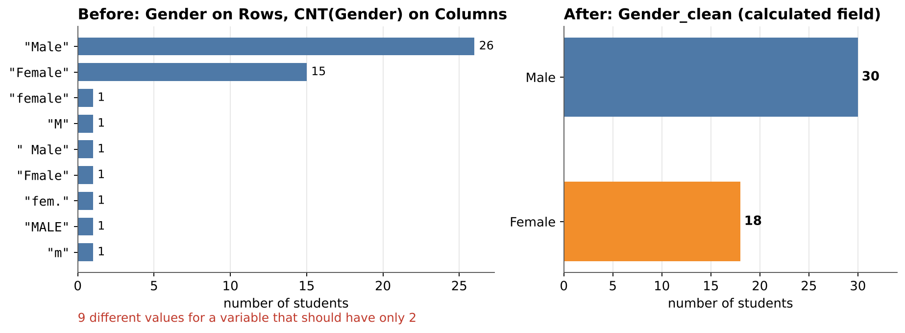{fig-alt="Two horizontal bar charts. Left: the raw Gender field has nine values: Male 26, Female 15, and seven values with one student each: female, M, space Male, Fmale, fem., MALE and m. Right: after cleaning, Male has 30 students and Female 18."}

:::: {.quiz type="fill"}
Use the left chart above.

The variable Gender should have []{.blank answer="2|two"} classes, but Tableau finds []{.blank answer="9|nine"}. The value `" Male"` differs from `"Male"` only by a leading []{.blank answer="space|white space|whitespace|blank"}, and `"MALE"` differs only by []{.blank answer="capitalization|capitalisation|case|upper case|uppercase"}. These are called []{.blank answer="structural|syntax|structural errors|syntax errors"} errors.

::: explain
Every different string is a separate class, exactly like the lecture's *m, Male, fem., FemalE, Femle* example. Leading or trailing spaces and capitalization are **syntax errors**; Tableau's guide calls such mistakes **structural errors**.
:::
::::

### Step 1: Remove duplicate or irrelevant observations

::: tb-steps
Tableau steps

1. Drag `Student ID` (now a string dimension) to <span class="tb-shelf">Rows</span> and `Response No` to <span class="tb-shelf">Text</span>, set it to **Measure › Count**, and sort descending. Two students appear **twice**: 733519 (responses 7 and 31) and 368717 (responses 26 and 50).
2. Quick check: drag `Student ID` onto a new sheet's Text, choose **Measure › Count** and then **Count (Distinct)**: CNT = **50** rows, CNTD = **48** students.
3. Remove the second copy: drag `Response No` to <span class="tb-shelf">Filters</span> (as a dimension), untick **31** and **50**.
4. **Irrelevant column:** `Shoe Size` has nothing to do with CGPA or spending. Right-click it in the Data pane › **Hide**.
:::

:::: {.quiz type="fill"}
After removing the duplicates the data have []{.blank answer="48"} rows. Hiding `Shoe Size` removes irrelevant data **column**-wise; keeping only Engineering students for an Engineering report would remove irrelevant data []{.blank answer="row-wise|row|rows|row wise"}.

::: explain
50 − 2 = **48** responses, one per student. The lecture's examples: shoe size is not needed when analysing CGPA (column-wise); studying only surgery patients means not including everyone (row-wise). Drop a column only if you are sure it is unimportant, and ask a domain expert when unsure.
:::
::::

### Step 2: Fix structural errors

::: tb-steps
Tableau steps

1. **Gender:** right-click in the Data pane › **Create › Calculated Field…**, name it `Gender_clean`:

    ```
    IF LEFT(UPPER(TRIM([Gender])), 1) = "F" THEN "Female"
    ELSEIF LEFT(UPPER(TRIM([Gender])), 1) = "M" THEN "Male"
    END
    ```

    `TRIM` removes the spaces, `UPPER` standardizes the case, and the first letter decides the class.
2. **Faculty:** create `Faculty_upper` = `UPPER(TRIM([Faculty]))`. This merges "Economics", "Economics␣" (with a trailing space) and "ECONOMICS". Then right-click `Faculty_upper` › **Create › Group…**: select ENGINEERING and ENG. › **Group**, name it *Engineering*; group ARTS & SCIENCES with ARTS AND SCIENCES.
3. **Student ID:** pad the IDs back to 6 digits: `ID_6` = `RIGHT("000000" + STR([Student ID]), 6)`. (If you already changed the type to String, use `[Student ID]` instead of `STR([Student ID])`.)
4. **Height (uniformity):** `Height_cm` = `IF [Height] < 3 THEN [Height] * 100 ELSE [Height] END`.
:::

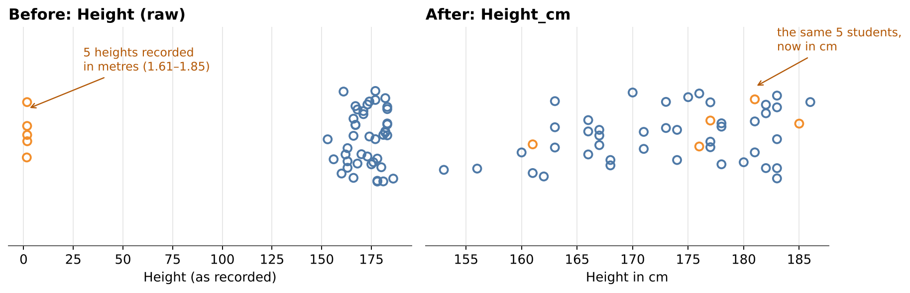{fig-alt="Two dot plots of height. Left: 43 students between 153 and 186 and five students near zero, recorded in metres (1.61 to 1.85). Right: after conversion all 48 students lie between 153 and 186 cm; the five converted values are highlighted in orange."}

:::: {.quiz type="fill"}
Before cleaning, the average height is 154.9; after `Height_cm` it is 173.1. The 5 values recorded in metres pulled the mean **down** by about []{.blank answer="18.2|18" tol="0.3"} cm. `RIGHT("000000" + STR(4021), 6)` returns []{.blank answer="004021"}. After `UPPER(TRIM([Faculty]))` the 8 raw faculty values shrink to []{.blank answer="5|five"}, and after grouping to []{.blank answer="3|three"}.

::: explain
- 173.1 − 154.9 = **18.2 cm**: a few unit errors can move the mean a lot, and the chart still "looks" fine.
- "000000" + "4021" = "0000004021"; the right-most 6 characters are **004021**.
- Raw faculty values: Engineering, engineering, Eng., Arts & Sciences, Arts and Sciences, Economics, "Economics ", ECONOMICS (8). After TRIM + UPPER: ENGINEERING, ENG., ARTS & SCIENCES, ARTS AND SCIENCES, ECONOMICS (5). Grouping fixes the last two typos: **3**.
:::
::::

### Step 3: Filter unwanted outliers

::: tb-steps
Tableau steps

1. **Range constraints:** drag `Age` to <span class="tb-shelf">Filters</span> › **All values** › **Range of values** from 18 to 100. One response (age 150) leaves. Do the same for `CGPA` (0 to 4): one response (4.6) leaves.
2. **Cross-field check:** create `Years_ok` = `[Expected Grad Year] >= [Enroll Year]` and drop it on <span class="tb-shelf">Color</span> of a text table of students: one response is **False** (enrolled 2023, graduating 2022). Fix it at the source or exclude it.
3. **True outliers:** a box plot of `Monthly Spending` shows one student at **₺48,000**. That is not impossible, so we keep it and note it. Removing it just because it is far away would hide real information.
:::

:::: {.quiz type="mc" answer="b"}
After the range filter on Age, the average age of the 48 students drops from **25.06** to **22.40**. What is the best way to describe the age 150?

- A true outlier: a valid but extreme age that must be kept
- An invalid value that breaks a range constraint; probably a typing mistake
- A missing value, so it should be imputed with the mean
- A uniformity problem, because it is measured in months

::: explain
Nobody at university is 150, so the value is **invalid**, not just extreme. A single invalid value moved the mean by more than 2.5 years. The ₺48,000 spending is different: unusual, but possible, so it is kept and investigated.
:::
::::

### Step 4: Handle missing data

::: tb-steps
Tableau steps

1. Drag `Monthly Spending` to <span class="tb-shelf m">Columns</span>, aggregation off. A small **"4 nulls"** indicator appears at the bottom right of the view. Click it to filter them out or show them at the default position.
2. `AVG(Monthly Spending)` already **ignores** the 4 nulls: it averages the 44 known values.
3. To impute with the mean (one of the lecture's methods): `Spending_imp` = `IFNULL([Monthly Spending], {AVG([Monthly Spending])})`.
:::

```{=html}
<div class="rv rv-spot">
  <div class="rv-head"><span class="rv-num">Challenge</span><span class="rv-type">Spot the mistake · click the wrong line</span></div>
  <p>A student handles the 4 missing spending values. <b>One</b> line is wrong. Click it.</p>
  <ol class="rv-lines">
    <li>Of the 48 students, 44 reported their monthly spending and 4 did not.</li>
    <li>Before deciding, I ask why the values are missing: did very high or very low spenders skip the question?</li>
    <li>AVG(Monthly Spending) in Tableau gives ₺9,670, the mean of the 44 known values.</li>
    <li data-wrong="1">To keep all 48 students, I replace the nulls with ZN([Monthly Spending]); the mean becomes ₺8,865, which is more accurate because it uses everyone.</li>
    <li>Dropping the 4 students is acceptable here, but with a small data set it loses information.</li>
  </ol>
  <div class="rv-controls"><button type="button" class="btn btn-sm btn-outline-secondary" data-act="show">Show answer</button><button type="button" class="btn btn-sm btn-outline-secondary" data-act="reset">Reset</button></div>
  <div class="rv-feedback" role="status" aria-live="polite"></div>
  <div class="rv-explain" hidden><p><b>Line 4 is wrong.</b> <code>ZN()</code> turns a null into <b>zero</b>, as if those 4 students spent nothing. That is a made-up value, and it pulls the mean down to 425,500 / 48 = ₺8,865. Mean imputation, <code>IFNULL([Monthly Spending], {AVG([Monthly Spending])})</code>, keeps the mean at ₺9,670 (but makes the spread look a little smaller).</p></div>
</div>
```

:::: {.quiz type="mc" answer="c"}
A survey on income has many missing answers, mostly from very rich people. Why is it important to know this **before** handling the missing data?

- Because Tableau cannot draw charts with nulls
- Because the missing values must then be replaced with 0
- Because dropping or mean-imputing would make the average income look lower than it really is
- Because missing data only matters in data sets with more than 1,000 rows

::: explain
The lecture asks: *"Is the income variable missing for very rich people?"* If yes, the missingness is not random: the known values are mostly lower incomes, so both dropping and mean imputation bias the average downward. Understanding the **reason** for missingness comes first.
:::
::::

### Step 5: Scale, transform and validate

::: tb-steps
Tableau steps

1. **Scaling:** `CGPA_pct` = `[CGPA] / 4 * 100` turns CGPA (0–4) into a percentage (0–100).
2. **Transformation:** `Log_Spending` = `LOG([Monthly Spending])` pulls in the long right tail caused by the ₺48,000 student, so the histogram is easier to read.
3. **Validate:** rebuild the Gender, Height and Age charts with the clean fields. Two genders, three faculties, all heights in 153–186 cm, all ages 18–27, and CNT = CNTD = 46 after the filters.
:::

:::: {.quiz type="fill"}
A student's CGPA is 3.2. On the 0–100 scale, `CGPA_pct` = []{.blank answer="80" tol="0.01"}. An SAT score of 1000 on the 400–1600 scale, rescaled to 0–1 with (score − 400) / (1600 − 400), is []{.blank answer="0.5" tol="0.001"}, so it can be compared with an ACT score rescaled the same way.

::: explain
3.2 / 4 × 100 = **80**. (1000 − 400) / 1200 = **0.5**. SAT (400–1600) and ACT (1–36) are on different scales, so they can only be compared after rescaling, as in the lecture.
:::
::::

:::: {.quiz type="open" keywords="duplicate; trim|upper|typo|structural|group; metre|meter|unit|uniform|cm; 150|range|invalid|cgpa; null|missing|imput"}
Write a short **cleaning report** (the last stage of the workflow) for r7_survey_dirty.csv: list the problems you found and what you did with each.

::: explain
**Model answer:**

1. **Duplicates:** 50 rows but 48 distinct IDs. Responses 31 and 50 were second submissions; removed.
2. **Irrelevant data:** Shoe Size hidden.
3. **Structural errors:** 9 Gender values and 8 Faculty values. Cleaned with TRIM, UPPER and a group, leaving 2 genders and 3 faculties. Student IDs padded to 6 digits.
4. **Uniformity:** 5 heights in metres converted to cm (mean 154.9 → 173.1).
5. **Validity:** age 150 and CGPA 4.6 removed by range filters; one graduation year before the enrolment year flagged.
6. **Outlier kept:** ₺48,000 spending is plausible; kept and noted.
7. **Missing data:** 4 spending values missing; mean of the 44 known values is ₺9,670. Not replaced with 0.
8. **Verification:** all charts rebuilt with the clean fields; 46 students remain.
:::
::::

# Part B — Making your visualizations better 

:::: {.quiz type="ms" answer="a,b,d"}
You build a dashboard with four views in Tableau. Which choices follow the lecture's **grid and alignment** advice? Select all that apply.

- Put the most important view in the top left corner
- Place the title at the top left
- Draw a thick border around every view so the grid is clearly visible
- Put the least important information (e.g. data source note) at the bottom right
- Arrange the views in a circle so the eye can start anywhere

::: explain
Readers of left-to-right languages start at the **top left** and finish at the **bottom right**. The grid should be **invisible**: borders around every element give a "boxy" design and add non-data ink.
:::
::::

:::: {.quiz type="match"}
Match each of Tufte's ideas with what it means for your Tableau chart.

- Data-ink ratio :: Remove borders, heavy gridlines and decoration that show no data
- Data-dense graphs :: Show a lot of information in a simple chart
- Strategic use of colour :: Colour only what matters, not everything for decoration
- Importance of context :: Add a title and notes that say what the data mean and why they matter

::: explain
These four ideas are the backbone of the decluttering steps in B6.
:::
::::


:::: {.quiz type="mc" answer="c"}
A chart shows the **monthly** mean temperature (colour) of **four cities**, with month on the x-axis and city on the y-axis. Which statement is correct?

- Both position scales are continuous, so the months should be spaced by their number of days
- The city axis must be in alphabetical order, because it is an ordered factor
- Both position scales are discrete: months must keep their natural order, but the cities can be placed in any order
- Temperature can't be shown as colour, only on a position scale

::: explain
Month is an **ordered** factor with 12 levels and city an **unordered** factor with 4 levels, so both axes are discrete with equal spacing. The months need their natural order; the order of the cities is our choice (for example sorted by temperature). Mapping the key variable to colour is allowed, but then the coloured areas must be large enough to read.
:::
::::

:::: {.quiz type="tf" answer="true"}
In a correct one-to-one mapping, each data value corresponds to exactly one aesthetic value (for example one colour), and each colour corresponds to exactly one data value.

::: explain
That is the definition of a one-to-one scale. Reusing a colour for two categories ("colour looping") breaks it, which is why qualitative palettes should not repeat colours.
:::
::::

## B1. Colour

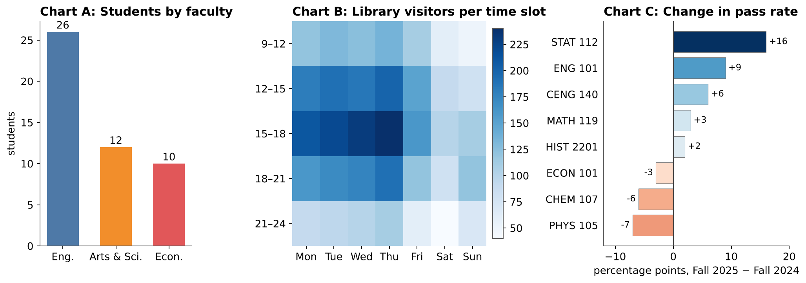{fig-alt="Chart A: bars for students by faculty in three distinct colours, blue, orange and red. Chart B: a heatmap of library visitors by weekday and time slot in shades of blue from light (few) to dark (many). Chart C: horizontal bars of the change in pass rate of eight courses, from plus 16 for STAT 112 to minus 7 for PHYS 105; gains are blue, losses are red, and values close to zero are pale."}

:::: {.quiz type="classify" options="Qualitative|Sequential|Diverging"}
Which palette type does each chart above use, and which would you use for the other situations?

- Chart A: students by faculty :: Qualitative
- Chart B: library visitors by day and time :: Sequential
- Chart C: change in pass rate (+ and −) :: Diverging
- Ways of coming to campus: bus, ring, walk, car :: Qualitative
- Satisfaction levels from "very low" to "very high" :: Sequential
- Percentage of female students per department, centred on 50% :: Diverging

::: explain
- **Categorical** variable → qualitative (distinct colours, at most about 10).
- **Ordinal** or numerical without a meaningful centre → sequential (light = low, dark = high).
- Numerical **with a meaningful midpoint** (0 change, or 50% as in the lecture's Texas map) → diverging.
:::
::::

```{=html}
<div class="rv r7-pal" id="r7-pal">
  <div class="rv-head"><span class="rv-num">Challenge</span><span class="rv-type">Pick the palette · watch the chart change</span></div>
  <p>For each data set, choose the palette type. The chart recolours immediately, so you can see why the right choice reads better.</p>
  <div class="r7-pal-grid"></div>
  <div class="rv-feedback" role="status" aria-live="polite"></div>
</div>
```

::: tb-steps
Colour in Tableau

- **Change a palette:** click <span class="tb-shelf">Color</span> on the Marks card › **Edit Colors…**. For a dimension pick a categorical palette such as *Tableau 10*; for a measure pick a sequential palette (*Blue*) or a diverging one (*Orange-Blue Diverging*).
- **Centre a diverging palette:** in Edit Colors tick **Advanced** › **Center:** and type the midpoint (0 or 50).
- **Colour-blind friendly:** choose the built-in **Color Blind** palette (blue and orange tones).
- **Highlight one thing:** create `Highlight` = `IF [Course] = "STAT 112" THEN "STAT 112" ELSE "Other" END`, drop it on Color, and set *Other* to light grey and *STAT 112* to a strong colour.
:::

:::: {.quiz type="ms" answer="a,c,d,f"}
Which pieces of colour advice come from the lecture? Select all that apply.

- Use 10 or fewer colours in a qualitative palette; bundle the rest into "Other"
- Use a different bright colour for every bar so the chart looks lively
- Keep the baseline colours subtle so they don't compete with the highlight colour
- Avoid red–green combinations; blue–orange is the safest pair
- Re-use the same colour for two categories when you run out of colours
- Colours are easier to tell apart on large areas than on small points or thin lines

::: explain
- **b** is the opposite of "use colour purposefully, not just for decoration".
- **e** is colour looping, which leads to misinterpretation.
- **f:** small marks and thin lines make colours hard to distinguish, and colour-vision deficiency makes it worse.
:::
::::

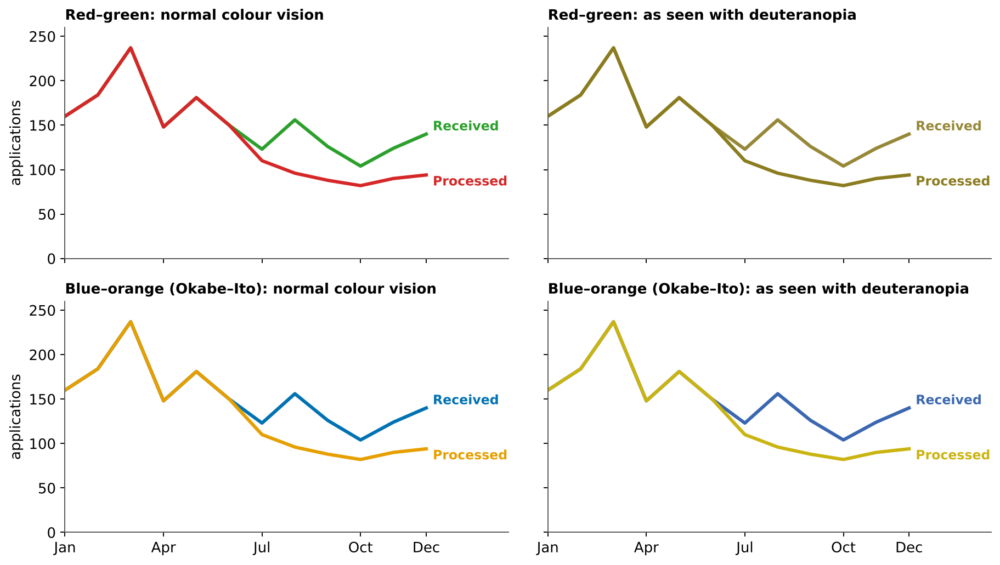{fig-alt="Four line charts of applications received and processed by month. Top row, red and green lines: with normal vision they are easy to tell apart, but in the deuteranopia simulation both lines become a similar olive brown. Bottom row, Okabe–Ito blue and orange lines: they stay clearly different in both versions."}

:::: {.quiz type="fill"}
In the simulation above, the red and green lines turn into almost the same []{.blank answer="brown|olive|olive brown|yellow|khaki|mustard"} colour, while the blue and []{.blank answer="orange|yellow"} lines stay different. Besides colour, we can help colour-blind readers with patterns, shapes or text []{.blank answer="labels|label"}, for example labelling each line directly.

::: explain
Deuteranopia (no green-sensitive cones) is the most common form of colour-vision deficiency, especially among males. Blue–orange (Okabe & Ito) survives it; red–green does not. Direct labels make the colour itself unnecessary.
:::
::::

## B2. Text, tables and heatmaps

:::: {.quiz type="mc" answer="d"}
The student council wants to share one fact: *"In 2026, 38% of students used the ring bus, compared to 61% in 2016."* What is the best visual?

- A clustered bar chart of the two percentages
- A pie chart for each year
- A line chart with two points
- Simple text: the two numbers in large font with a short sentence

::: explain
**Simple text.** "The fact that you have some numbers does not mean that you need a graph!" With one or two numbers, use the numbers directly. In Tableau: put the value on Text and make the font large (a "big number").
:::
::::

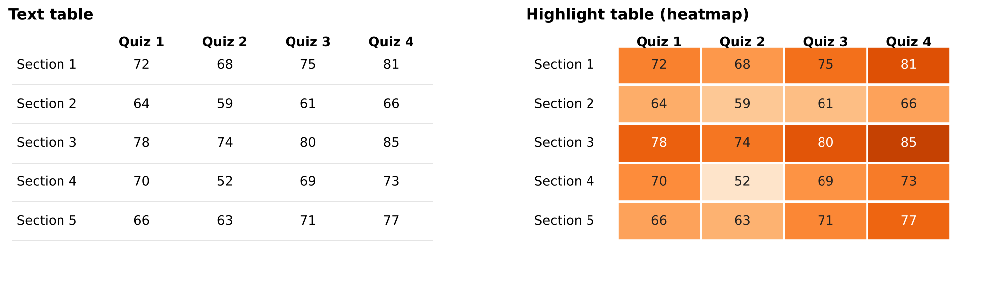{fig-alt="Left: a text table of average quiz scores for five sections and four quizzes, with light grey lines between rows. Right: the same numbers as a highlight table where darker orange cells mean higher scores; Section 3 is darkest and the Section 4, Quiz 2 cell (52) is very pale."}

:::: {.quiz type="fill"}
Use the highlight table. The highest average is in Section []{.blank answer="3|three"}, Quiz []{.blank answer="4|four"}. The cell that stands out as unusually low is Section []{.blank answer="4|four"}, Quiz 2 with a score of []{.blank answer="52"}.

::: explain
Colour saturation helps the eye target the points of interest quickly: the dark cell (85) and the pale cell (52) jump out in the heatmap, while in the text table you must read every number. Always add a legend to explain the colour scale.

**In Tableau:** Section on Rows, Quiz on Columns, AVG(Score) on Text, then **Show Me › highlight table** (or set the mark type to Square and drop AVG(Score) on Color).
:::
::::


## B3. What to avoid

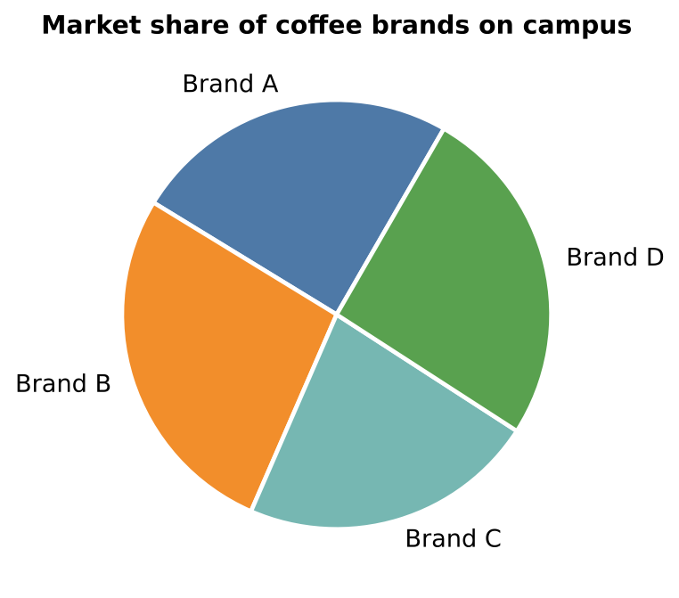{fig-alt="A pie chart with four slices for Brand A, Brand B, Brand C and Brand D, with no numbers. The slices look roughly the same size."}

:::: {.quiz type="mc" answer="b"}
Look at the pie chart above for a few seconds. Which brand has the largest market share?

- Brand A
- Brand B
- Brand D
- They are all exactly equal

::: explain
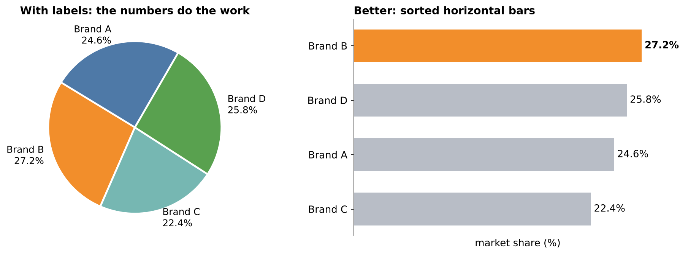{fig-alt="Left: the same pie with labels: Brand A 24.6 percent, Brand B 27.2 percent, Brand C 22.4 percent, Brand D 25.8 percent. Right: a sorted horizontal bar chart with Brand B (27.2 percent) highlighted in orange and the others in grey."}

**Brand B (27.2%)**, but very few people can tell from the slices alone, because the human eye is poor at comparing angles and areas. Labels fix it, but then the numbers do all the work and the pie isn't worth its space. A **sorted horizontal bar chart** shows the ranking instantly. *(In Recitation 6 we built a donut chart in Tableau as practice; Lecture 7 explains why donuts are even harder to read: comparing arc lengths.)*
:::
::::

:::: {.quiz type="match"}
Match each thing to avoid with the lecture's better alternative.

- Pie chart :: A sorted horizontal bar chart
- Donut chart :: A bar chart; arc lengths are hard to compare
- 3D chart :: The same chart in 2D, unless a third dimension is really plotted
- Secondary y-axis :: Label the second series directly, or pull the charts apart with a shared x-axis
- Bar chart with the y-axis starting at 60 :: The same bar chart with a zero baseline
- Long category names on a vertical bar chart :: A horizontal bar chart

::: explain
In Tableau: avoid **Dual Axis** for two different units. If you must, use two separate rows with the same x-axis instead. For a zero baseline: right-click the axis › **Edit Axis…** › tick **Include zero**.
:::
::::

:::: {.quiz type="tf" answer="false"}
For bar charts, the bars should be narrower than the white space between them, so that the chart looks light.

::: explain
**False.** In general the bars should be **wider** than the gaps between them, but not so wide that readers compare areas instead of lengths. In Tableau, drag the **Size** slider on the Marks card.
:::
::::


## B4. Decluttering, step by step

Your student-affairs office lost two staff members in June. You want a chart that supports hiring new staff, using **r7_applications.csv**. Turn on the steps one by one and watch the chart change.

```{=html}
<div class="rv r7-dec" id="r7-dec">
  <div class="rv-head"><span class="rv-num">Interactive</span><span class="rv-type">Declutter · tick each step</span></div>
  <div class="r7-dec-steps"></div>
  <div class="r7-dec-chart"></div>
  <div class="r7-dec-note"></div>
  <div class="rv-controls"><button type="button" class="btn btn-sm btn-outline-secondary" data-act="all">Apply all steps</button><button type="button" class="btn btn-sm btn-outline-secondary" data-act="none">Back to the original</button></div>
</div>
```

::: tb-steps
The same steps in Tableau

0. `Month` to <span class="tb-shelf">Columns</span> (as an exact date, continuous), `Measure Values` to <span class="tb-shelf m">Rows</span>, `Measure Names` to <span class="tb-shelf">Color</span>; keep only Received and Processed.
1. **Remove the border:** Format › **Borders** › Sheet › Row and Column Divider: *None*.
2. **Remove gridlines:** right-click the view › **Format…** › Lines icon › Grid Lines: *None* (or a thin light grey).
3. **Remove data markers:** click <span class="tb-shelf">Color</span> › Markers: choose the option *without* markers.
4. **Clean up the axes:** right-click the date axis › Format › Dates: custom `mmm` (Jan, Feb, …); right-click the value axis › Format › Numbers: *Number (Custom)* with 0 decimals.
5. **Label the data directly:** <span class="tb-shelf">Label</span> › **Show mark labels** › Marks to Label: **Line Ends**, and tick *Label end of line* only for the name; then hide the legend.
6. **Consistent colour:** Label › Font › **Match Mark Color**. Make *Received* grey and *Processed* a strong blue, and write a title that states the message.
:::


# Part C — Two useful charts in Tableau

## C1. Treemap

A **treemap** shows a part-to-whole relationship with nested rectangles: the **area** of each rectangle is proportional to its value, and groups (parents) contain their subgroups (children). It works well when there are **many categories**, the data are **hierarchical**, and **precise** comparisons are not important.

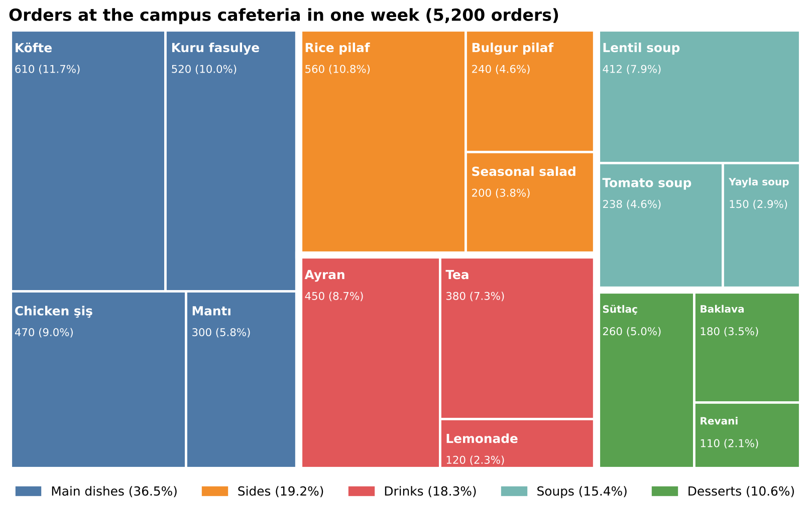{fig-alt="A treemap of 5,200 cafeteria orders. Main dishes (blue, 36.5 percent) is the largest block, split into Köfte 610, Kuru fasulye 520, Chicken şiş 470 and Mantı 300. Sides (orange, 19.2 percent): Rice pilaf 560, Bulgur pilaf 240, Seasonal salad 200. Drinks (red, 18.3 percent): Ayran 450, Tea 380, Lemonade 120. Soups (teal, 15.4 percent): Lentil 412, Tomato 238, Yayla 150. Desserts (green, 10.6 percent): Sütlaç 260, Baklava 180, Revani 110."}

::: tb-steps
Tableau steps

1. Connect to **r7_cafeteria.csv**. Ctrl/Cmd-click `Category`, `Item` and `Orders` in the Data pane, open **Show Me** and click **Treemap**.
2. Tableau puts `SUM(Orders)` on <span class="tb-shelf m">Size</span> and <span class="tb-shelf m">Color</span>. Drag `Category` onto <span class="tb-shelf">Color</span> instead, so each category gets one colour and its items are grouped together.
3. Drag `Item` and `SUM(Orders)` onto <span class="tb-shelf">Label</span>. Add `Orders` once more to Label and choose **Quick Table Calculation › Percent of Total**.
4. Give it a title that says what to look at, for example *"Main dishes make up over a third of all orders"*.
:::

:::: {.quiz type="fill"}
Read the treemap. Main dishes account for []{.blank answer="36.5" tol="0.1"} % of all orders. The single most ordered item is []{.blank answer="Köfte|kofte|köfte"}. Within Soups, lentil soup makes up about []{.blank answer="51.5|52|51" tol="0.6"} % of the soup orders (412 of 800).

::: explain
Main dishes: 1,900 / 5,200 = **36.5%**. Köfte has the largest rectangle (610). Lentil: 412 / 800 = **51.5%**: more than half of the soups. Note how the hierarchy lets us tell a story at two levels (category, then item).
:::
::::

:::: {.quiz type="tf" answer="false"}
A treemap is the best chart when we need to tell whether Tea (380) or Lentil soup (412) was ordered more often.

::: explain
**False.** Treemaps are for part-to-whole views of many hierarchical categories, when **precise comparisons are not important**. Comparing two rectangles of different shapes is hard; a sorted bar chart answers this question better.
:::
::::

## C2. Slope chart

A **slope chart** is a line chart that keeps only **two points in time**. Each category is one line, so it shows the change in **value**, the change in **ranking**, and who grew or fell the most: ideal for "before and after" stories.

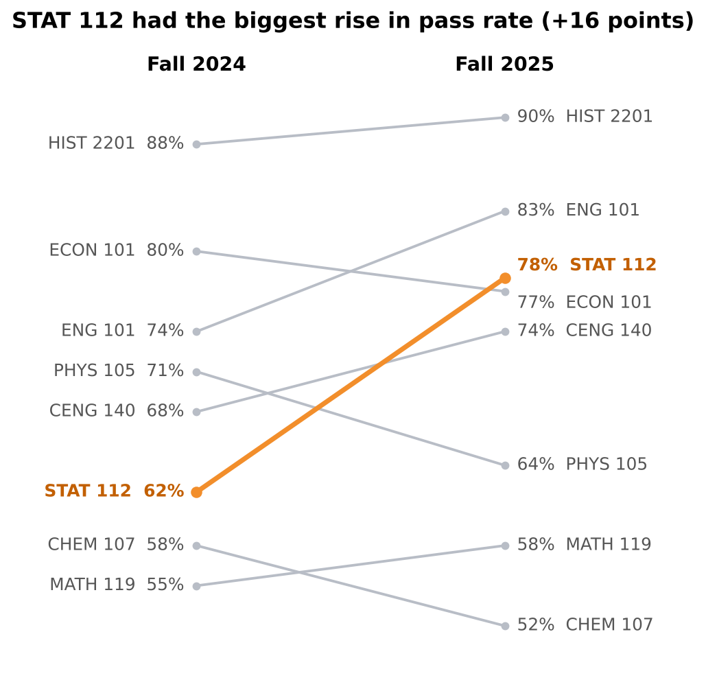{fig-alt="A slope chart with eight grey lines and one orange line. STAT 112 rises from 62 percent in Fall 2024 to 78 percent in Fall 2025. HIST 2201 rises from 88 to 90, ENG 101 from 74 to 83, CENG 140 from 68 to 74 and MATH 119 from 55 to 58. ECON 101 falls from 80 to 77, PHYS 105 from 71 to 64 and CHEM 107 from 58 to 52."}

::: tb-steps
Tableau steps

1. Connect to **r7_pass_rates.csv**. Drag `Term` to <span class="tb-shelf">Columns</span> and `Pass Rate` to <span class="tb-shelf m">Rows</span>.
2. Drag `Course` onto <span class="tb-shelf">Detail</span>: one line per course. Set the mark type to **Line**.
3. Drag `Course` and `Pass Rate` onto <span class="tb-shelf">Label</span>. In Label choose **Line Ends**, and untick *Allow labels to overlap other marks*.
4. **Contrast:** create `Highlight` = `IF [Course] = "STAT 112" THEN "STAT 112" ELSE "Other" END`, put it on Color, make *Other* light grey and *STAT 112* orange.
5. Hide the vertical axis (right-click › untick **Show Header**) and remove the gridlines, as in B8.
:::


:::: {.quiz type="fill"}
STAT 112 rose by []{.blank answer="16"} percentage points and moved from rank []{.blank answer="6|6th|sixth"} to rank []{.blank answer="3|3rd|third"} among the 8 courses. The largest fall was in []{.blank answer="PHYS 105|PHYS105|phys 105"} ([]{.blank answer="-7|7|−7"} points).

::: explain
78 − 62 = **16**. Ranks in Fall 2024: HIST 88, ECON 80, ENG 74, PHYS 71, CENG 68, **STAT 62 (6th)**, CHEM 58, MATH 55. In Fall 2025: HIST 90, ENG 83, **STAT 78 (3rd)**, ECON 77, … PHYS 105 fell from 71 to 64 (**−7**).
:::
::::

# Part D — Make it better challenge

The chart below was made with a data visualization tool. The message it should send: **"Ankara's rent is above the average of the 10 cities."**

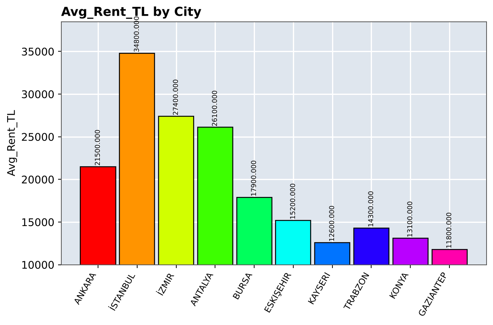{fig-alt="A vertical bar chart titled Avg_Rent_TL by City. Each of the 10 bars has a different bright rainbow colour with a black outline, the background is light blue-grey with white gridlines, the y-axis starts at 10,000, city names are in capitals and rotated 60 degrees, and each bar has a rotated label with three decimals such as 21500.000. The bars are in no particular order."}

:::: {.quiz type="open" keywords="sort|order|rank; horizontal|rotat|turn|head|diagonal; zero|baseline|10000|10,000; colour|color|rainbow|grey|gray|highlight|ankara; decimal|precision|label|format|k; title|message|average|reference|line; grid|background|border|clutter"}
List **at least five** problems in this chart, name the principle behind each, and say how you would fix it in Tableau.

::: explain
**Model answer:**

| Problem | Principle | Fix in Tableau |
|---|---|---|
| y-axis starts at 10,000 | Bars need a **zero baseline** (bad figure) | Edit Axis › Include zero |
| Bars in random order | Easy comparison, simplicity | Sort descending |
| Rotated, capitalized city names | Don't make readers turn their heads | Swap to **horizontal bars**; keep normal case |
| Ten rainbow colours | Colour purposefully; **contrast** | `Highlight` calc: Ankara orange, others grey |
| Labels with 3 decimals, rotated | No unnecessary precision | Format › Numbers › Currency (Custom): ₺ prefix, Thousands (K), 1 decimal |
| No reference to the average | **Context** | Analytics pane › **Average Line** |
| Title "Avg_Rent_TL by City" | Explanatory charts state the message | Title: *"Ankara's average rent is 10% above the 10-city average"* |
| Grey background, gridlines, outlines | **Data-ink ratio**, clutter | Format › Shading: None; Lines: None; Borders: None |
:::
::::

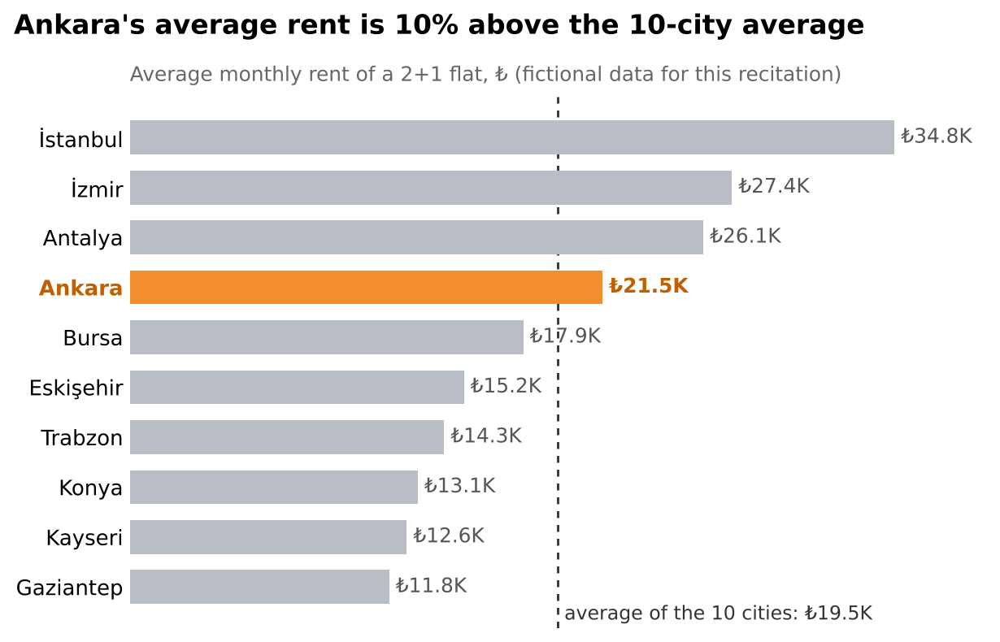{fig-alt="A sorted horizontal bar chart with the message title Ankara's average rent is 10 percent above the 10-city average and the subtitle average monthly rent of a 2+1 flat in TL, fictional data. İstanbul 34.8K, İzmir 27.4K and Antalya 26.1K are grey, Ankara 21.5K is orange with an orange bold name, then grey bars for Bursa 17.9K, Eskişehir 15.2K, Trabzon 14.3K, Konya 13.1K, Kayseri 12.6K and Gaziantep 11.8K. A dashed vertical line marks the 10-city average of 19.5K."}

::: tb-steps
Tableau steps for the makeover

1. Connect to **r7_rent.csv**. `City` to <span class="tb-shelf">Rows</span>, `Avg Rent TL` to <span class="tb-shelf m">Columns</span>: horizontal bars with a zero baseline by default. Sort descending.
2. Create `Highlight` = `IF [City] = "Ankara" THEN "Ankara" ELSE "Other" END` › <span class="tb-shelf">Color</span>; Edit Colors: Ankara orange, Other light grey.
3. Analytics pane › drag **Average Line** onto the view (Table). Edit it: label *"average of the 10 cities"*, dashed, dark grey.
4. `Avg Rent TL` onto <span class="tb-shelf">Label</span>; right-click a label › **Format…** › Numbers › Currency (Custom): prefix ₺, Display Units *Thousands (K)*, 1 decimal.
5. Right-click the bottom axis › untick **Show Header** (the labels carry the numbers). Right-click the *City* field label › **Hide Field Labels for Rows**.
6. Format › Shading: *None*; Lines: Grid Lines *None*; Borders: *None*.
7. Double-click the title: *"Ankara's average rent is 10% above the 10-city average"* (bold), with the data note in small grey text below.
:::

:::: {.quiz type="fill"}
Check the title: the 10-city average is ₺[]{.blank answer="19470|19,470|19.47K|19.5K|19500"} and Ankara's rent is ₺21,500, so Ankara is about []{.blank answer="10|10.4" tol="0.5"} % above the average. In the ranking, Ankara is in []{.blank answer="4th|4|fourth"} place.

::: explain
Average = 194,700 / 10 = **₺19,470**. (21,500 − 19,470) / 19,470 ≈ **10.4%**. Ankara is 4th after İstanbul, İzmir and Antalya. Always check that a message title is supported by the numbers.
:::
::::


# Part E — Flourish

Flourish is a **browser-based, drag-and-drop** tool for tidy tables, built for **storytelling with data**. In this part you first **read and criticise** a chart made in Flourish, then build your own charts for four new research questions. All data sets are clean and fictional, created for this recitation.

```{=html}
<div class="r7-data">
  <a class="r7-card" href="files/recitation7/r7f_social_media.csv" download><span class="ico">🕸️</span><span class="txt"><strong>r7f_social_media.csv</strong><small>E2 · daily use of 12 apps, 2014–2025</small></span><span class="dl">⬇</span></a>
  <a class="r7-card" href="files/recitation7/r7f_semester_life.csv" download><span class="ico">😴</span><span class="txt"><strong>r7f_semester_life.csv</strong><small>E3 · sleep, study, coffee over 16 weeks</small></span><span class="dl">⬇</span></a>
  <a class="r7-card" href="files/recitation7/r7f_satisfaction.csv" download><span class="ico">📊</span><span class="txt"><strong>r7f_satisfaction.csv</strong><small>E3 · satisfaction with 8 services, 2024–2025</small></span><span class="dl">⬇</span></a>
  <a class="r7-card" href="files/recitation7/r7f_international_students.csv" download><span class="ico">🌍</span><span class="txt"><strong>r7f_international_students.csv</strong><small>E3 · 2,458 students from 30 countries</small></span><span class="dl">⬇</span></a>
  <a class="r7-card" href="files/recitation7/r7f_student_journeys.csv" download><span class="ico">🔀</span><span class="txt"><strong>r7f_student_journeys.csv</strong><small>E3 · high school → faculty → first job</small></span><span class="dl">⬇</span></a>
</div>
```

::: {.callout-warning}
## Free accounts are public
Anything published from a free account can be seen by anyone with the link, so use only non-sensitive data.
:::

## E1. The workflow for every chart

1. Log in at **app.flourish.studio** › **New visualization** › choose a **template**. Look at its sample data first.
2. Switch **Preview / Data** to *Data* › **Upload data** › choose the CSV (Flourish also reads Excel, TSV, JSON and GeoJSON). Flourish reads the **first row as headings**.
3. On the right, assign the **columns** (e.g. Labels/time, Values). These change from template to template.
4. Switch back to **Preview** and improve the chart in the settings panel: **Colours**, **Labels**, **Legend**, **Controls & filters**, **Header** (title, subtitle) and **Footer** (source).
5. **Export & publish** › **Publish to share and embed**. 


## E2. Read it, then beat it: a radar chart

Data: **r7f_social_media.csv**, the share of students (%) who use each of 12 apps daily, 2014–2025, with each app's **Type** (Social network, Photo & video, News & text, Messaging, Career).

> **Research question:** *How did students' daily use of social media apps change between 2014 and 2025?*

I answered this research question in Flourish with a **radar chart**: one polygon per app, one spoke per year, and one small chart per app type (the *Separate* view).

Five radar charts made in Flourish, one per app type, with spokes for the years 2014 to 2023 and rings at 0, 20, 40, 60 and 80 percent. Social network: one polygon that is large at 2014 to 2017 and shrinks to about 20 by 2023. Photo and video: six overlapping blue polygons that cannot be told apart. News and text: one fairly round polygon between about 40 and 58. Messaging: one very large polygon near 90 in every year and two small ones. Career: one small polygon that grows towards 2022 and 2023."

Explore the interactive version below:

```{=html}
<iframe src="https://flo.uri.sh/visualisation/31036809/embed" title="Radar chart of daily app use (Flourish)"
        style="width:100%;height:650px;border:0" scrolling="no"></iframe>
```


### Interpret the chart

:::: {.quiz type="mc" answer="c"}
In the **Social network** panel (Facebook only), the polygon is large on the 2014–2017 spokes and small on the 2021–2023 spokes. What does that mean?

- Facebook use was low at first and grew over time
- Facebook use stayed about the same
- Facebook use was high at first and fell steadily
- Facebook was used more in winter than in summer

::: explain
On a radar chart the **distance from the centre** is the value. Facebook is near 80–90% on the early spokes and near 20% on the late ones: daily use fell steadily (from 88% in 2014 to 21% in 2023). The last option is a trap: the spokes are **years**, not seasons, even though the circle makes time look like a cycle.
:::
::::

:::: {.quiz type="tf" answer="false"}
In the **Messaging** panel, the large polygon close to the outer ring tells us that every messaging app was used by about 90% of students.

::: explain
**False.** Only **one** app (WhatsApp, 70% → 97%) draws the large polygon. The two small polygons are Telegram and Discord, which stay below 50%. Without app labels the reader can't tell which polygon belongs to which app, which is one of the chart's main problems.
:::
::::

:::: {.quiz type="ms" answer="a,b,c,e"}
Which **problems** does this radar chart have? Select all that apply.

- In *Photo & video*, six overlapping polygons can't be told apart, and the apps aren't labelled
- The spokes only go up to 2023, so 2024 and 2025 are missing even though the research question asks about 2014–2025
- Time is drawn as a circle, so 2023 is joined back to 2014 as if the years formed a cycle
- Each panel uses the same scale (0–80), so values can't be compared
- The **area** of a polygon grows much faster than the values, so changes look bigger than they are

::: explain
- **Overlap and missing labels:** the eye can't follow six lines on a web.
- **Missing years:** the Values setting probably included only the 2014–2023 columns. Always check the **column settings** in the Data tab!
- **Circular time:** the closing line from 2023 back to 2014 means nothing.
- **Area exaggerates:** a polygon's area grows roughly with the *square* of the values.
- **The same scale in every panel is not a problem;** it is what makes the panels comparable.
:::
::::

### Suggest better charts

:::: {.quiz type="open" keywords="line; small multiple|grid|panel|facet; highlight|grey|gray|colour|color; race|rank; slope|2014 vs 2025|two years; label|legend"}
<span class="pts">Discussion</span> I answered the research question with a radar chart. Which **other charts** would answer it better for these variables (App, Type, one value per year)? Say **why**, and how you would build each in Flourish.

::: explain
**Model answer:**

| Better chart | Why it is better | In Flourish |
|---|---|---|
| **Line chart** (years on the x-axis), with 2–3 apps highlighted and the rest grey | Time stays a straight, ordered axis; trends and crossings (WhatsApp passing Facebook in 2016) are easy to see | *Line, bar and pie charts* › Line chart. Flourish wants each **line as a column**, so first transpose the table (Year as rows, apps as columns). Then colour overrides, line labels, no legend. |
| **Small multiples of line charts** (one panel per app or type) | No overlap at all; every app is readable | Same template, with *Type* in **Charts grid** |
| **Bar chart race** | The question is about **changing rankings**; the race shows who passes whom | *Bar chart race*: Label = App, Values = 2014…2025, Category = Type |
| **Slope chart** of 2014 vs 2025 | Compares start and end for all 12 apps at once | *Slope chart* template, or a line chart with only the two years |

Common to all of them: include **all years (2014–2025)**, label the apps directly, and write a message title such as *"Facebook fell from 1st to 11th while TikTok rose from 0% to 77%"*.
:::
::::


## E3. Your turn: four research questions

Answer each research question with **one** Flourish visualization. For each one:

1. Choose the template.
2. Assign the columns.
3. Improve the chart: colours, labels, title, source.
4. Write two or three sentences that answer the question.

Open the model answer only after you have tried.

:::: {.quiz type="open" keywords="line; week|time; sleep; coffee; midterm|final|exam|annotation|highlight"}
**RQ 1 · r7f_semester_life.csv.** *How do sleep and coffee consumption change during exam weeks?*

::: explain
**Chart:** *Line, bar and pie charts* › **Line chart**.

- **Columns:** Labels/time = Week; Values = Sleep and Coffee only. Four measures with different units on one axis would mislead. To show all four, use **Charts grid** instead.
- **Improve:** line labels, annotations or axis highlights at week 8 (*Midterms*) and weeks 15–16 (*Finals*), y-axis titles with units.

**Answer:** sleep falls from 7.6 hours (week 1) to 5.6 in midterm week and 5.1 in the last week of finals, while coffee rises from 1.4 to 4.1 cups a day. The two move in opposite directions and react sharply at exam times. This is an association, not proof that coffee causes less sleep.
:::
::::

:::: {.quiz type="open" keywords="stacked|100|likert; diverging|red|blue; library; wi-fi|wifi; student affairs; 2024|2025|filter|button"}
**RQ 2 · r7f_satisfaction.csv.** *Which campus services are students most and least satisfied with, and what changed from 2024 to 2025?*

::: explain
**Chart:** *Line, bar and pie charts* › **Bar chart (stacked %)**, also called a Likert chart.

- **Columns:** Labels/time = Service; Values = the 5 levels in order; Row filter = Year, shown as **buttons**.
- **Improve:** diverging colours (dark red → grey → dark blue) with custom overrides; the rows are already sorted by 2025 satisfaction; data point labels with %.

**Answer:**
- **Most satisfied:** Library (75% satisfied or very satisfied), Sports centre (67%).
- **Least satisfied:** Wi-Fi (27%), the ring buses (32%) and the cafeteria (33%).
- **Biggest changes:** Wi-Fi fell from 44% to 27% satisfied, while student affairs rose from 32% to 44%.
:::
::::

:::: {.quiz type="open" keywords="map|projection; point|bubble|size; asia; azerbaijan; bar|sorted"}
**RQ 3 · r7f_international_students.csv.** *Which countries and regions do the university's international students come from?*

::: explain
**Chart:** *Projection map* with **points**.

- **Columns:** Latitude/Longitude = the coordinates; Name = Country; Size = Students; Color = Region.
- **Improve:** a size legend, labels for the largest countries only, and a sorted **bar chart** of the top 15 next to the map for exact comparisons.

**Answer:**
- Asia sends 77.7% of the 2,458 students (1,910).
- The top three countries are Azerbaijan (412), Turkmenistan (265) and Pakistan (198), together 35.6%.
- Africa (263) and Europe (253) each send about 10%; the Americas only 32.
:::
::::

:::: {.quiz type="open" keywords="sankey|flow; science; engineering; technology|software; graduate"}
**RQ 4 · r7f_student_journeys.csv.** *How do students flow from their high-school track to their faculty and their first destination after graduation?*

::: explain
**Chart:** **Sankey**.

- **Columns:** Source, Target, Value = Students.
- **Improve:** colour the links by their source, keep the stages in order (tracks → faculties → destinations), show values on the nodes.

**Answer:**
- 590 of the 1,000 students come from the science track, which feeds mainly engineering (310 students in total).
- The largest first destination is technology & software (235): 150 from engineering, 55 from arts & sciences, 30 from economics.
- Finance & consulting is second (180), and 165 students go on to graduate school.
:::
::::


<p style="font-size:.85rem;color:#6c757d;margin-top:2rem">All data sets and charts on this page were created for this recitation.</p>

```{=html}
<style>
.r7-tablewrap { overflow-x: auto; margin: .6rem 0; }
.r7-tbl { border-collapse: collapse; font-size: .86rem; width: 100%; min-width: 680px; }
.r7-tbl th { background: #f1f3f7; padding: .35rem .45rem; text-align: left; border-bottom: 2px solid #cfd5e1; white-space: nowrap; }
.r7-tbl td { padding: .32rem .45rem; border-bottom: 1px solid #e6e9ef; cursor: pointer; white-space: pre; font-family: ui-monospace, SFMono-Regular, Menlo, monospace; }
.r7-tbl td:hover { background: #fff7df; }
.r7-tbl td.r7-ok { background: #dff3e6; box-shadow: inset 0 0 0 2px #1a7f37; }
.r7-tbl td.r7-no { background: #fdecec; }
.r7-tbl td.r7-trap { background: #fff1d6; box-shadow: inset 0 0 0 2px #b9770e; }
.r7-tbl td.r7-show { box-shadow: inset 0 0 0 2px #1a7f37; background: #eef9f2; }
.r7-log { margin-top: .5rem; font-size: .9rem; }
.r7-log ol { margin: .3rem 0 0 1.1rem; padding: 0; }
.r7-log li { margin: .15rem 0; }
.r7-pal-grid { display: grid; grid-template-columns: repeat(auto-fit, minmax(250px, 1fr)); gap: 14px; margin: .6rem 0; }
.r7-pal-card { border: 1px solid var(--rv-border, #dee2e6); border-radius: 10px; padding: .6rem .7rem; }
.r7-pal-card h5 { font-size: .92rem; margin: 0 0 .3rem; }
.r7-pal-card svg { width: 100%; height: auto; display: block; }
.r7-pal-btns { display: flex; flex-wrap: wrap; gap: 4px; margin-top: .4rem; }
.r7-pal-btns button { font-size: .78rem; padding: .15rem .5rem; }
.r7-pal-msg { font-size: .83rem; margin-top: .35rem; min-height: 2.4em; }
.r7-pre-box { font-family: ui-monospace, SFMono-Regular, Menlo, monospace; font-size: 1.15rem; letter-spacing: .18em; line-height: 1.7; background: #f7f8fa; border-radius: 8px; padding: .8rem 1rem; margin: .6rem 0; min-height: 4.5rem; word-break: break-all; }
.r7-pre-box b { color: #e8663a; font-weight: 800; }
.r7-dec-steps { display: grid; grid-template-columns: repeat(auto-fit, minmax(220px, 1fr)); gap: 4px 14px; margin: .4rem 0 .6rem; font-size: .9rem; }
.r7-dec-steps label { display: flex; gap: .45rem; align-items: flex-start; cursor: pointer; }
.r7-dec-steps input { margin-top: .25rem; }
.r7-dec-chart svg { width: 100%; height: auto; display: block; }
.r7-dec-note { font-size: .88rem; color: #4a5263; min-height: 2.6em; margin-top: .4rem; }
</style>
<script>
(function () {
  function q(s, r) { return (r || document).querySelector(s); }
  function qa(s, r) { return Array.prototype.slice.call((r || document).querySelectorAll(s)); }
  function mk(el) { var b = el && el.closest ? el.closest(".rv") : null; return b; }

  /* ---------- A2: find the dirty cells ---------- */
  var D = q("#r7-dirty");
  if (D && !D.dataset.ready) {
    D.dataset.ready = "1";
    var errs = qa("td[data-err]", D), log = q(".r7-log", D), fb = q(".rv-feedback", D), found = [];
    function render() {
      fb.className = "rv-feedback" + (found.length === errs.length ? " ok" : "");
      fb.textContent = found.length === errs.length ? "✓ All " + errs.length + " problems found!" : found.length + " / " + errs.length + " problems found.";
      log.innerHTML = found.length ? "<ol>" + found.map(function (td) { return "<li>" + td.getAttribute("data-err") + "</li>"; }).join("") + "</ol>" : "";
    }
    qa("tbody td", D).forEach(function (td) {
      td.addEventListener("click", function () {
        if (td.hasAttribute("data-err")) {
          if (found.indexOf(td) < 0) { found.push(td); td.classList.add("r7-ok"); }
          render();
        } else if (td.hasAttribute("data-trap")) {
          td.classList.add("r7-trap"); fb.className = "rv-feedback"; fb.textContent = td.getAttribute("data-trap");
        } else {
          td.classList.add("r7-no"); setTimeout(function () { td.classList.remove("r7-no"); }, 600);
          fb.className = "rv-feedback bad"; fb.textContent = "This cell follows the rules. " + found.length + " / " + errs.length + " problems found.";
        }
      });
    });
    q('[data-act="show"]', D).addEventListener("click", function () { errs.forEach(function (td) { if (found.indexOf(td) < 0) { found.push(td); td.classList.add("r7-show"); } }); render(); });
    q('[data-act="reset"]', D).addEventListener("click", function () { found = []; qa("td", D).forEach(function (td) { td.classList.remove("r7-ok", "r7-no", "r7-trap", "r7-show"); }); fb.textContent = ""; log.innerHTML = ""; });
  }

  /* ---------- B4: palette picker ---------- */
  var P = q("#r7-pal");
  if (P && !P.dataset.ready) {
    P.dataset.ready = "1";
    var QUAL = ["#4e79a7", "#f28e2b", "#e15759", "#76b7b2", "#59a14f", "#edc948"];
    function seq(t) { var a = [239, 243, 255], b = [8, 69, 148]; return "rgb(" + a.map(function (v, i) { return Math.round(v + (b[i] - v) * t); }).join(",") + ")"; }
    function div(t) { /* t in [-1,1]: orange(-) → light → blue(+) */
      var mid = [247, 247, 247], neg = [230, 97, 1], pos = [33, 102, 172], e = t < 0 ? neg : pos, s = Math.abs(t);
      return "rgb(" + mid.map(function (v, i) { return Math.round(v + (e[i] - v) * s); }).join(",") + ")"; }
    var SETS = [
      { title: "Way to campus (share of students, %)", cats: ["Bus", "Ring", "Walk", "Car"], vals: [38, 27, 22, 13], want: "Qualitative", why: { Qualitative: "✓ Right: four unordered categories, so four distinct colours.", Sequential: "Light-to-dark suggests Car < Walk < Ring < Bus in some order, but the modes have no natural order.", Diverging: "There is no midpoint: 'Ring' is not a neutral centre between bus and car." } },
      { title: "Average daily study hours by year of study", cats: ["Prep", "1st", "2nd", "3rd", "4th"], vals: [2.1, 2.6, 3.0, 3.4, 4.2], want: "Sequential", why: { Qualitative: "Five unrelated colours hide the order: the reader can't see that the values increase.", Sequential: "✓ Right: light = few hours, dark = many hours, following the natural order.", Diverging: "A diverging palette suggests a meaningful centre (e.g. 0), which these hours don't have." } },
      { title: "Change in enrolment vs last year (%)", cats: ["Math", "Phys", "Stat", "Chem", "Biol"], vals: [-12, -4, 15, 3, -8], want: "Diverging", why: { Qualitative: "Different colours per department hide the most important thing: gain or loss.", Sequential: "A single light-to-dark scale makes −12% look 'small' and +15% 'big', but 0 is the meaningful centre.", Diverging: "✓ Right: 0% is the meaningful midpoint; one hue for gains, another for losses." } }
    ];
    var grid = q(".r7-pal-grid", P), done = {};
    SETS.forEach(function (S, k) {
      var card = document.createElement("div"); card.className = "r7-pal-card";
      card.innerHTML = "<h5>" + S.title + "</h5><div class=\"svg\"></div><div class=\"r7-pal-btns\">" + ["Qualitative", "Sequential", "Diverging"].map(function (p) { return '<button type="button" class="btn btn-outline-secondary" data-p="' + p + '">' + p + "</button>"; }).join("") + "</div><div class=\"r7-pal-msg\"></div>";
      grid.appendChild(card);
      function draw(pal) {
        var W = 300, H = 150, n = S.cats.length, bw = 220 / n, max = Math.max.apply(null, S.vals.map(Math.abs)), hasNeg = S.vals.some(function (v) { return v < 0; });
        var zero = hasNeg ? 66 : 125, scale = hasNeg ? 46 / max : 105 / max, svg = '<svg viewBox="0 0 ' + W + " " + H + '" role="img" aria-label="' + S.title + '">';
        S.vals.forEach(function (v, i) {
          var c = "#9aa3b5";
          if (pal === "Qualitative") c = QUAL[i % QUAL.length];
          if (pal === "Sequential") { var mn = Math.min.apply(null, S.vals), mx = Math.max.apply(null, S.vals); c = seq(0.15 + 0.85 * (v - mn) / ((mx - mn) || 1)); }
          if (pal === "Diverging") c = div(v / max);
          var x = 50 + i * bw + bw * 0.15, h = Math.abs(v) * scale, y = v >= 0 ? zero - h : zero;
          svg += '<rect x="' + x + '" y="' + y + '" width="' + (bw * 0.7) + '" height="' + Math.max(h, 1) + '" fill="' + c + '" stroke="#8a93a5" stroke-width="0.5"/>';
          svg += '<text x="' + (x + bw * 0.35) + '" y="' + (H - 6) + '" font-size="11" text-anchor="middle" fill="#444">' + S.cats[i] + "</text>";
          svg += '<text x="' + (x + bw * 0.35) + '" y="' + (v >= 0 ? y - 3 : y + h + 11) + '" font-size="10" text-anchor="middle" fill="#333">' + v + "</text>";
        });
        svg += '<line x1="45" x2="280" y1="' + zero + '" y2="' + zero + '" stroke="#555"/></svg>';
        q(".svg", card).innerHTML = svg;
      }
      draw(null);
      qa("button", card).forEach(function (b) {
        b.addEventListener("click", function () {
          var p = b.getAttribute("data-p"); draw(p);
          qa("button", card).forEach(function (x) { x.classList.toggle("btn-primary", x === b); x.classList.toggle("btn-outline-secondary", x !== b); });
          var m = q(".r7-pal-msg", card); m.textContent = S.why[p]; m.style.color = p === S.want ? "#1a7f37" : "#c0392b";
          if (p === S.want) done[k] = 1;
          var fbk = q(".rv-feedback", P), nd = Object.keys(done).length;
          fbk.className = "rv-feedback" + (nd === SETS.length ? " ok" : ""); fbk.textContent = nd === SETS.length ? "✓ All three palettes chosen correctly." : nd + " / 3 correct so far.";
        });
      });
    });
  }

  /* ---------- B7: preattentive attributes ---------- */
  var R = q("#r7-pre");
  if (R && !R.dataset.ready) {
    R.dataset.ready = "1";
    var digits = "38591726740935862917345078921635847926153907284613578209648137529064".split(""), box = q(".r7-pre-box", R), fb2 = q(".rv-feedback", R), t0 = 0, n7 = digits.filter(function (d) { return d === "7"; }).length;
    box.textContent = "Press Start …";
    function show(hl) { box.innerHTML = digits.map(function (d) { return hl && d === "7" ? "<b>7</b>" : d; }).join(""); }
    q('[data-act="start"]', R).addEventListener("click", function () { show(false); t0 = Date.now(); q('[data-act="done"]', R).disabled = false; fb2.textContent = "Count the 7s …"; });
    q('[data-act="done"]', R).addEventListener("click", function () { var s = ((Date.now() - t0) / 1000).toFixed(1); fb2.className = "rv-feedback"; fb2.textContent = "That took " + s + " s. The answer is " + n7 + ". Now try version 2."; q('[data-act="hl"]', R).disabled = false; this.disabled = true; });
    q('[data-act="hl"]', R).addEventListener("click", function () { show(true); fb2.className = "rv-feedback ok"; fb2.textContent = "With colour you see the " + n7 + " sevens almost instantly: colour is a preattentive attribute, processed by iconic memory before you consciously search."; });
  }

  /* ---------- B8: declutter ---------- */
  var C = q("#r7-dec");
  if (C && !C.dataset.ready) {
    C.dataset.ready = "1";
    var REC = [160, 184, 237, 148, 181, 150, 123, 156, 126, 104, 124, 140], PRO = [160, 184, 237, 148, 181, 150, 110, 96, 88, 82, 90, 94];
    var MON = ["January", "February", "March", "April", "May", "June", "July", "August", "September", "October", "November", "December"];
    var STEPS = [
      ["border", "1. Remove the chart border", "Closure: the white space already separates the chart; the border adds nothing."],
      ["grid", "2. Remove gridlines", "Gridlines compete with the data. If you keep them, make them thin and light grey."],
      ["markers", "3. Remove data markers", "Every marker adds cognitive load for data the line already shows."],
      ["axes", "4. Clean up axis labels", "No needless '.00' on the y-axis, and short month names so nobody has to turn their head."],
      ["labels", "5. Label data directly", "Proximity: the labels sit next to the lines, so the legend (and the eye movement) disappears."],
      ["color", "6. Consistent colour + message", "Similarity: labels in the line's colour; grey for context, blue for the story, and a title that states it."]
    ];
    var on = {}, stBox = q(".r7-dec-steps", C), chart = q(".r7-dec-chart", C), note = q(".r7-dec-note", C);
    STEPS.forEach(function (s) {
      var l = document.createElement("label"); l.innerHTML = '<input type="checkbox" data-k="' + s[0] + '"> <span>' + s[1] + "</span>"; stBox.appendChild(l);
      q("input", l).addEventListener("change", function (e) { on[s[0]] = e.target.checked; note.textContent = e.target.checked ? s[2] : ""; draw(); });
    });
    function draw() {
      var W = 640, H = 330, L = 70, R = on.labels ? 120 : 160, T = on.color ? 62 : 34, B = on.axes ? 40 : 78, pw = W - L - R, ph = H - T - B;
      var X = function (i) { return L + i * pw / 11; }, Y = function (v) { return T + ph - v / 250 * ph; };
      var cR = on.color ? "#a0a7b4" : "#4e79a7", cP = on.color ? "#1f5fbf" : "#f28e2b", s = '<svg viewBox="0 0 ' + W + " " + H + '" role="img" aria-label="Applications received and processed by month, 2025">';
      if (!on.border) s += '<rect x="2" y="2" width="' + (W - 4) + '" height="' + (H - 4) + '" fill="none" stroke="#222" stroke-width="2"/>';
      if (on.color) {
        s += '<text x="' + L + '" y="24" font-size="15" font-weight="700" fill="#222">Since two staff left in June, we process fewer applications than we receive</text>';
        s += '<text x="' + L + '" y="44" font-size="11.5" fill="#6b7487">Applications per month, 2025 · the gap is the growing backlog</text>';
      } else s += '<text x="' + L + '" y="22" font-size="14" fill="#222">Applications 2025</text>';
      [0, 50, 100, 150, 200, 250].forEach(function (v) {
        if (!on.grid) s += '<line x1="' + L + '" x2="' + (L + pw) + '" y1="' + Y(v) + '" y2="' + Y(v) + '" stroke="#c9ced8" stroke-width="1"/>';
        s += '<text x="' + (L - 8) + '" y="' + (Y(v) + 4) + '" font-size="11" text-anchor="end" fill="#555">' + (on.axes ? v : v.toFixed(2)) + "</text>";
      });
      s += '<line x1="' + L + '" x2="' + (L + pw) + '" y1="' + Y(0) + '" y2="' + Y(0) + '" stroke="#555"/>';
      MON.forEach(function (m, i) {
        if (on.axes) s += '<text x="' + X(i) + '" y="' + (Y(0) + 18) + '" font-size="11" text-anchor="middle" fill="#555">' + m.slice(0, 3) + "</text>";
        else s += '<text transform="translate(' + X(i) + "," + (Y(0) + 10) + ') rotate(-45)" font-size="11" text-anchor="end" fill="#555">' + m + "</text>";
      });
      function line(arr, c, w) { return '<polyline fill="none" stroke="' + c + '" stroke-width="' + w + '" points="' + arr.map(function (v, i) { return X(i) + "," + Y(v); }).join(" ") + '"/>'; }
      if (on.color) s += '<line x1="' + X(5) + '" x2="' + X(5) + '" y1="' + Y(240) + '" y2="' + Y(0) + '" stroke="#c9ced8" stroke-dasharray="3 3"/><text x="' + (X(5) + 4) + '" y="' + Y(236) + '" font-size="10.5" fill="#6b7487">2 staff left</text>';
      s += line(REC, cR, 2.5) + line(PRO, cP, on.color ? 3.5 : 2.5);
      if (!on.markers) { REC.forEach(function (v, i) { s += '<circle cx="' + X(i) + '" cy="' + Y(v) + '" r="4" fill="' + cR + '"/>'; }); PRO.forEach(function (v, i) { s += '<rect x="' + (X(i) - 4) + '" y="' + (Y(v) - 4) + '" width="8" height="8" fill="' + cP + '"/>'; }); }
      if (on.labels) {
        var lc1 = on.color ? cR : "#333", lc2 = on.color ? cP : "#333";
        s += '<text x="' + (X(11) + 8) + '" y="' + (Y(140) - 2) + '" font-size="12" font-weight="700" fill="' + lc1 + '">Received 140</text>';
        s += '<text x="' + (X(11) + 8) + '" y="' + (Y(94) + 10) + '" font-size="12" font-weight="700" fill="' + lc2 + '">Processed 94</text>';
      } else {
        var lx = L + pw + 22;
        s += '<rect x="' + lx + '" y="' + (T + 10) + '" width="120" height="52" fill="#fff" stroke="#999"/>';
        s += '<line x1="' + (lx + 8) + '" x2="' + (lx + 30) + '" y1="' + (T + 27) + '" y2="' + (T + 27) + '" stroke="' + cR + '" stroke-width="2.5"/><text x="' + (lx + 36) + '" y="' + (T + 31) + '" font-size="11">Received</text>';
        s += '<line x1="' + (lx + 8) + '" x2="' + (lx + 30) + '" y1="' + (T + 47) + '" y2="' + (T + 47) + '" stroke="' + cP + '" stroke-width="2.5"/><text x="' + (lx + 36) + '" y="' + (T + 51) + '" font-size="11">Processed</text>';
      }
      chart.innerHTML = s + "</svg>";
    }
    q('[data-act="all"]', C).addEventListener("click", function () { qa("input", C).forEach(function (i) { i.checked = true; on[i.getAttribute("data-k")] = true; }); note.textContent = "Before and after: the same data, but now the story (a growing backlog since June) is impossible to miss."; draw(); });
    q('[data-act="none"]', C).addEventListener("click", function () { qa("input", C).forEach(function (i) { i.checked = false; }); on = {}; note.textContent = ""; draw(); });
    draw();
  }
})();
</script>
```